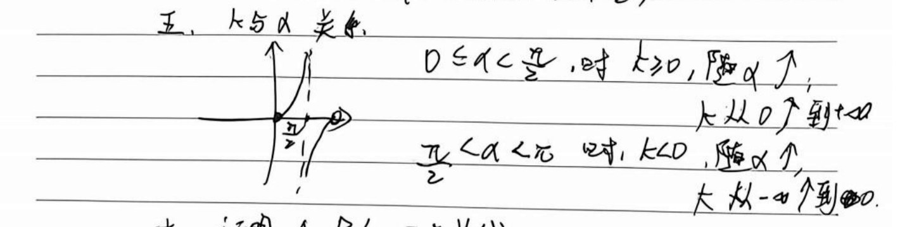
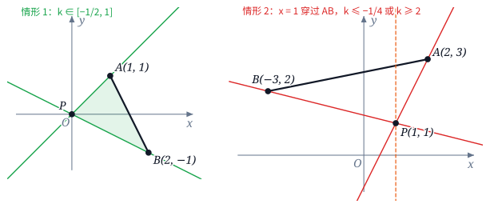

# k与α关系（含倾斜角范围例题、与线段相交的斜率范围）

> **原序号**：大写 五、 ｜ **原稿页码**：P2, P5

**备注**：附原稿 P5 顶部关于倾斜角范围求参数 m 的例题。

## 补充：直线与线段相交时斜率的范围

过定点 $P$ 的直线 $l$ 与线段 $AB$ 有公共点，求 $l$ 的斜率 $k$ 的范围。先算端点的斜率 $k_{PA}$、$k_{PB}$，再看==过 $P$ 的竖直线（斜率不存在）是否穿过线段 $AB$==：

- **情形 1：竖直线不穿过 $AB$**。直线从 $PB$ 转到 $PA$ 的过程中不经过竖直位置，斜率连续变化，$k$ 介于两者之间：$k \in [k_{PB}, k_{PA}]$（小的在前）。例：$P(0, 0)$，$A(1, 1)$，$B(2, -1)$，$k_{PA} = 1$，$k_{PB} = -\frac{1}{2}$，$k \in \left[-\frac{1}{2}, 1\right]$。
- **情形 2：竖直线穿过 $AB$**。转动中经过竖直位置，斜率在那里从 $+\infty$ 跳到 $-\infty$，所以范围是==两边往外取==：$k \le$ 较小值或 $k \ge$ 较大值。例：$P(1, 1)$，$A(2, 3)$，$B(-3, 2)$，$k_{PA} = 2$，$k_{PB} = -\frac{1}{4}$，竖直线 $x = 1$ 介于 $-3$ 与 $2$ 之间，所以 ==$k \le -\frac{1}{4}$ 或 $k \ge 2$==。

判断方法：看 $P$ 的横坐标是否落在 $A$、$B$ 横坐标之间。问倾斜角的范围时，情形 2 反而是连续的一段 $[\alpha_{PA}, \alpha_{PB}]$。
