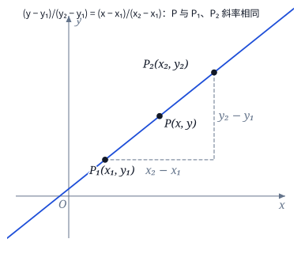
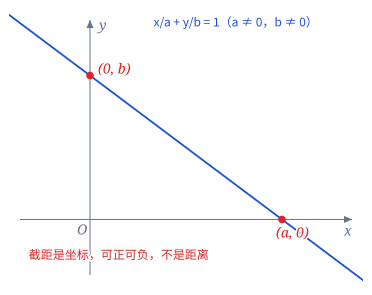
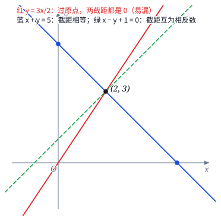

# 直线的两点式、截距式方程与五种形式对照

> **来源**：电子笔记 ｜ **所属模块**：一、直线与方程 → 2. 直线方程

## 一、两点式

直线过 $P_1(x_1, y_1)$、$P_2(x_2, y_2)$（$x_1 \ne x_2$，$y_1 \ne y_2$）：

$$\frac{y - y_1}{y_2 - y_1} = \frac{x - x_1}{x_2 - x_1}$$

由点斜式 $y - y_1 = \frac{y_2 - y_1}{x_2 - x_1}(x - x_1)$ 变形而来。==不能表示平行于坐标轴的直线==（分母为 $0$）。

**不会出错的写法**：$(y - y_1)(x_2 - x_1) = (x - x_1)(y_2 - y_1)$，去掉分母后对所有直线（包括竖直、水平）都成立。

## 二、截距式

直线在 $x$ 轴、$y$ 轴上的截距分别为 $a$、$b$（$a \ne 0$，$b \ne 0$），即过 $(a, 0)$、$(0, b)$：

$$\frac{x}{a} + \frac{y}{b} = 1$$

- ==截距是交点的坐标，可正、可负、可为 $0$==，不是距离。
- 截距式==不能表示过原点的直线==（截距为 $0$）和平行于坐标轴的直线（某条轴上没有截距）。
- 由截距式立刻得到直线与两坐标轴围成的三角形面积 $S = \frac{1}{2}|ab|$。

## 三、截距相等类问题（必须考虑过原点）

用截距式设方程时，会把「过原点」的情况漏掉。凡是题目说两截距「相等」「互为相反数」「成倍数」「绝对值相等」，都要==先单独讨论截距为 $0$（直线过原点）==。

**例**　直线过点 $(2, 3)$，求满足下列条件的直线方程：(1) 两截距相等；(2) 两截距互为相反数；(3) 两截距的绝对值相等；(4) 在 $x$ 轴上的截距是在 $y$ 轴上截距的 $2$ 倍。

**解**：先看过原点：$y = \frac{3}{2}x$，两截距都是 $0$，满足 (1)(2)(3)(4) 全部条件。

(1) 截距不为 $0$：设 $\frac{x}{a} + \frac{y}{a} = 1$，代入得 $a = 5$，$x + y - 5 = 0$。答案：==$y = \frac{3}{2}x$ 或 $x + y - 5 = 0$==。

(2) 设 $\frac{x}{a} - \frac{y}{a} = 1$，$a = -1$，$x - y + 1 = 0$。答案：$y = \frac{3}{2}x$ 或 $x - y + 1 = 0$。

(3) 合并 (1)(2)：==三条==，$y = \frac{3}{2}x$，$x + y - 5 = 0$，$x - y + 1 = 0$。

(4) 设 $\frac{x}{2b} + \frac{y}{b} = 1$，$b = 4$，$x + 2y - 8 = 0$。答案：$y = \frac{3}{2}x$ 或 $x + 2y - 8 = 0$。

**为什么会漏**：截距式的前提是 $a, b \ne 0$。截距都为 $0$ 时「相等」「互为相反数」「$2$ 倍」都成立，但截距式写不出来。另一种不漏的设法是设点斜式 $y - 3 = k(x - 2)$，求出两截距 $2 - \frac{3}{k}$、$3 - 2k$ 再列方程，解出的 $k = \frac{3}{2}$ 就对应过原点的那条。

## 四、直线方程五种形式对照

| 形式 | 方程 | 已知条件 | ==不能表示的直线== |
| --- | --- | --- | --- |
| 点斜式 | $y - y_0 = k(x - x_0)$ | 一点 + 斜率 | 竖直线 $x = x_0$ |
| 斜截式 | $y = kx + b$ | 斜率 + $y$ 轴截距 | 竖直线 |
| 两点式 | $\frac{y - y_1}{y_2 - y_1} = \frac{x - x_1}{x_2 - x_1}$ | 两点 | 竖直线、水平线 |
| 截距式 | $\frac{x}{a} + \frac{y}{b} = 1$ | 两截距 | 竖直线、水平线、过原点的直线 |
| 一般式 | $Ax + By + C = 0$（$A$、$B$ 不全为 $0$） | — | 无，能表示所有直线 |

另有点法式、点向式（本节第 4 条）和直线系（第 5 条）。设方程时：

- 斜率可能不存在 $\Rightarrow$ 单独讨论 $x = x_0$，或直接设 $x = my + n$（不能表示水平线）；
- 截距可能为 $0$ $\Rightarrow$ 单独讨论过原点；
- 都不想讨论 $\Rightarrow$ 用一般式或去分母的两点式。

**一般式里的系数关系**（$B \ne 0$ 时）：斜率 $k = -\frac{A}{B}$，$y$ 轴截距 $-\frac{C}{B}$；$A \ne 0$ 时 $x$ 轴截距 $-\frac{C}{A}$。
