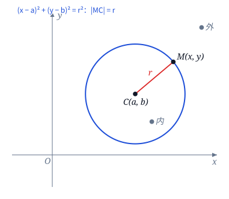
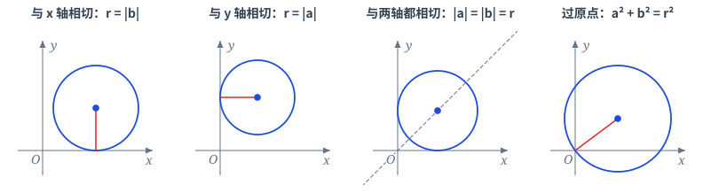
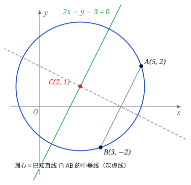

# 圆的标准方程（含点与圆的位置关系）

> **来源**：电子笔记 ｜ **所属模块**：二、圆与方程 → 1. 圆的方程与求法

## 一、标准方程

圆是平面内到定点（圆心）距离等于定长（半径）的点的集合。圆心 $C(a, b)$、半径 $r$（$r > 0$）的圆，由 $|MC| = r$ 两边平方得

$$(x - a)^2 + (y - b)^2 = r^2$$

- 圆心在原点时：$x^2 + y^2 = r^2$。
- 确定一个圆需要三个独立条件 $a$、$b$、$r$；==看到标准方程立刻读出圆心和半径==，注意符号：$(x + 1)^2 + (y - 2)^2 = 5$ 的圆心是 $(-1, 2)$，半径 $\sqrt{5}$。
- 展开后就是一般方程 $x^2 + y^2 + Dx + Ey + F = 0$（下一条起是直径式、一般方程与求法）。

## 二、点与圆的位置关系

点 $P(x_0, y_0)$，圆心 $C(a, b)$，半径 $r$，$d = |PC|$：

| 位置 | 几何 | 代数（代入左边） |
| --- | --- | --- |
| 点在圆外 | $d > r$ | $(x_0 - a)^2 + (y_0 - b)^2 > r^2$ |
| 点在圆上 | $d = r$ | $= r^2$ |
| 点在圆内 | $d < r$ | $< r^2$ |

用一般方程时，把点代入 $x^2 + y^2 + Dx + Ey + F$，==大于 $0$ 在圆外，等于 $0$ 在圆上，小于 $0$ 在圆内==（这个值就是切线长的平方，见本模块第 2 节切线长公式）。

**例 1**　点 $(1, 1)$ 在圆 $(x - a)^2 + (y + a)^2 = 4$ 的内部，求 $a$ 的范围。

**解**：$(1 - a)^2 + (1 + a)^2 < 4$，$2 + 2a^2 < 4$，==$-1 < a < 1$==。

## 三、特殊位置的圆

| 条件 | 方程特征 |
| --- | --- |
| 圆心在 $x$ 轴上 | $b = 0$ |
| 圆心在 $y$ 轴上 | $a = 0$ |
| 与 $x$ 轴相切 | ==$r = |b|$== |
| 与 $y$ 轴相切 | $r = |a|$ |
| 与两坐标轴都相切 | $|a| = |b| = r$（圆心在 $y = \pm x$ 上） |
| 过原点 | $a^2 + b^2 = r^2$ |
| 与直线 $Ax + By + C = 0$ 相切 | $r = \frac{|Aa + Bb + C|}{\sqrt{A^2 + B^2}}$ |

## 四、例题：用几何性质求标准方程

**例 2**　圆心在直线 $2x - y - 3 = 0$ 上，且过点 $A(5, 2)$、$B(3, -2)$，求圆的方程。

**解法一（几何）**：圆心在 $AB$ 的中垂线上。$AB$ 中点 $(4, 0)$，$k_{AB} = 2$，中垂线 $y = -\frac{1}{2}(x - 4)$。与 $2x - y - 3 = 0$ 联立得圆心 $(2, 1)$，$r^2 = (5 - 2)^2 + (2 - 1)^2 = 10$。

**解法二（待定系数）**：设圆心 $(a, 2a - 3)$，由 $|CA| = |CB|$：$(a - 5)^2 + (2a - 5)^2 = (a - 3)^2 + (2a - 1)^2$，得 $a = 2$。

答案：==$(x - 2)^2 + (y - 1)^2 = 10$==。

已知圆心位置（在某直线上）、或与某直线相切时，优先设标准方程；已知圆过三个点时，优先设一般方程（本节第 5 条「求圆的方程方法」）。
