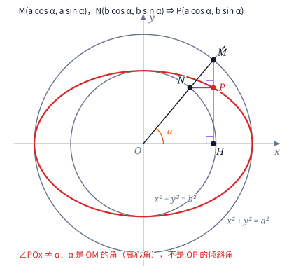

# 椭圆的参数方程（含几何意义）

> **原稿序号**：小写 47、(3) ｜ **原稿页码**：P51-P52 ｜ **所属模块**：三、圆锥曲线的定义、方程与基本几何性质 → 1. 椭圆

## 两个同心圆作图：参数方程的来历（手写笔记整理）

> **来源**：手写笔记（照片），按原推导整理

**题**　已知射线 $OM$ 交圆 $x^2 + y^2 = a^2$ 于 $M$，交圆 $x^2 + y^2 = b^2$ 于 $N$（$a > b > 0$），过 $M$ 作 $MH \perp x$ 轴于 $H$，过 $N$ 作 $NP \perp MH$ 于 $P$，求 $P$ 的轨迹方程。

**解**：设射线 $OM$ 为角 $\alpha$ 的终边，则

$$M(a\cos \alpha, \, a\sin \alpha), \quad N(b\cos \alpha, \, b\sin \alpha)$$

$P$ 和 $M$ 横坐标相同，和 $N$ 纵坐标相同，设 $P(x, y)$：

$$\begin{cases} x = a\cos \alpha \\ y = b\sin \alpha \end{cases}$$

消去 $\alpha$（$\cos^2\alpha + \sin^2\alpha = 1$）得 $\frac{x^2}{a^2} + \frac{y^2}{b^2} = 1$，所以 $P$ 的轨迹是椭圆，它的参数方程就是 ==$x = a\cos \alpha$，$y = b\sin \alpha$（$\alpha$ 为参数）==。

**注意**：$\alpha$ 是 $OM$（大圆半径）与 $x$ 轴的夹角，叫离心角，==不是 $OP$ 的倾斜角==。$OP$ 的斜率是 $\frac{b}{a}\tan \alpha$，只有 $\alpha$ 是 $\frac{\pi}{2}$ 的整数倍时两角才相等。
