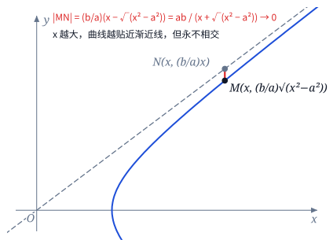
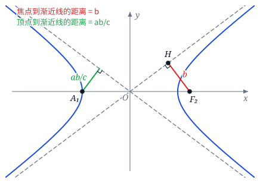
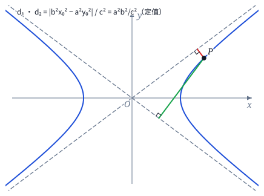
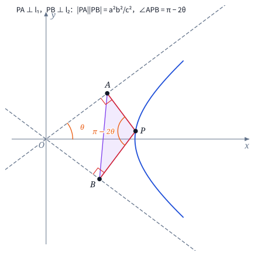
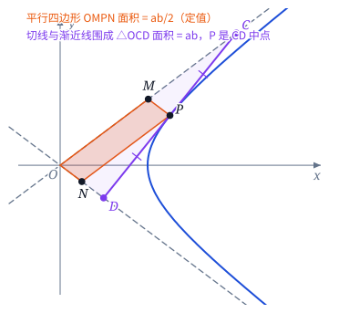
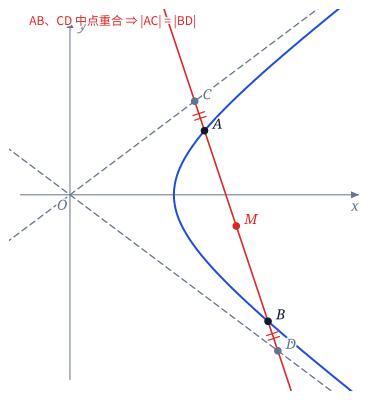

# 渐近线的方程与性质

> **来源**：电子笔记 ｜ **所属模块**：三、圆锥曲线的定义、方程与基本几何性质 → 2. 双曲线

（记号：$\frac{x^2}{a^2} - \frac{y^2}{b^2} = 1$，$c^2 = a^2 + b^2$，渐近线 $l_1: y = \frac{b}{a}x$，$l_2: y = -\frac{b}{a}x$，$l_1$ 的倾斜角为 $\theta$。）

## 一、渐近线方程怎么求

==把标准方程右边的 $1$ 换成 $0$==：

$$\frac{x^2}{a^2} - \frac{y^2}{b^2} = 0 \;\Rightarrow\; \left(\frac{x}{a} - \frac{y}{b}\right)\left(\frac{x}{a} + \frac{y}{b}\right) = 0 \;\Rightarrow\; y = \pm \frac{b}{a}x$$

- 焦点在 $y$ 轴的 $\frac{y^2}{a^2} - \frac{x^2}{b^2} = 1$，渐近线是 ==$y = \pm \frac{a}{b}x$==，最容易写反。用「$1$ 换 $0$」就不会错。
- 渐近线也可以写成一般式 $bx \pm ay = 0$，算距离时更方便。
- 反过来，已知渐近线求双曲线，要用共渐近线系 $\frac{x^2}{a^2} - \frac{y^2}{b^2} = \lambda$ 去设，见本模块第 4 节。

## 二、渐近线斜率与离心率

| 焦点位置 | 渐近线斜率 $k$ | 离心率 |
| --- | --- | --- |
| $x$ 轴 | $\pm \frac{b}{a}$ | ==$e^2 = 1 + k^2$== |
| $y$ 轴 | $\pm \frac{a}{b}$ | $e^2 = 1 + \frac{1}{k^2}$ |

统一：设渐近线与实轴的夹角为 $\theta$，则 ==$e = \frac{1}{\cos \theta}$==（模块五的原稿结论）。两条渐近线的夹角是 $2\theta$ 或 $\pi - 2\theta$，题目说「渐近线夹角为 $60^\circ$」时两种都要考虑：$\theta = 30^\circ$ 或 $60^\circ$，$e = \frac{2\sqrt{3}}{3}$ 或 $2$。

==只知道渐近线、不知道焦点在哪条轴时，离心率有两个值==。例如渐近线 $y = \pm 2x$：焦点在 $x$ 轴 $e = \sqrt{5}$，焦点在 $y$ 轴 $e = \frac{\sqrt{5}}{2}$。

## 三、「渐近」是什么意思

取右支第一象限的点 $M\left(x, \frac{b}{a}\sqrt{x^2 - a^2}\right)$，同一横坐标在渐近线上的点 $N\left(x, \frac{b}{a}x\right)$：

$$|MN| = \frac{b}{a}\left(x - \sqrt{x^2 - a^2}\right) = \frac{ab}{x + \sqrt{x^2 - a^2}} \to 0 \quad (x \to +\infty)$$

所以曲线无限接近渐近线但永不相交；==双曲线夹在两条渐近线之间（含焦点的那两个区域）==。

## 四、距离类性质

**1. 焦点到渐近线的距离等于 $b$**（最常用）

$$d = \frac{|b \cdot c - a \cdot 0|}{\sqrt{b^2 + a^2}} = \frac{bc}{c} = b$$

**2. 顶点到渐近线的距离等于 $\frac{ab}{c}$**：$d = \frac{|b \cdot a|}{c} = \frac{ab}{c}$。

**3. 双曲线上任一点到两条渐近线的距离之积为定值 ==$\frac{a^2b^2}{c^2}$==**

设 $P(x_0, y_0)$ 在双曲线上，则 $b^2x_0^2 - a^2y_0^2 = a^2b^2$，

$$d_1 \cdot d_2 = \frac{|bx_0 - ay_0|}{c} \cdot \frac{|bx_0 + ay_0|}{c} = \frac{|b^2x_0^2 - a^2y_0^2|}{c^2} = \frac{a^2b^2}{c^2}$$

**3′. 垂足三角形**：过 $P$ 作两条渐近线的垂线，垂足为 $A$（在 $l_1$ 上）、$B$（在 $l_2$ 上），则

$P$ 在两支所夹的含 $x$ 轴的区域内，四边形 $OAPB$ 中 $\angle AOB = 2\theta$，两个垂足处是直角，所以 ==$\angle APB = \pi - 2\theta$==。又 $\cos 2\theta = \frac{a^2 - b^2}{c^2}$，$\sin 2\theta = \frac{2ab}{c^2}$，于是

$$\overrightarrow{PA} \cdot \overrightarrow{PB} = |PA||PB|\cos(\pi - 2\theta) = \frac{a^2b^2}{c^2} \cdot \frac{b^2 - a^2}{c^2} = \frac{a^2b^2(b^2 - a^2)}{c^4}$$

$$S_{\triangle PAB} = \frac{1}{2}|PA||PB|\sin(\pi - 2\theta) = \frac{1}{2} \cdot \frac{a^2b^2}{c^2} \cdot \frac{2ab}{c^2} = \frac{a^3b^3}{c^4}$$

两者都是==定值==。等轴双曲线（$a = b$）时 $\overrightarrow{PA} \cdot \overrightarrow{PB} = 0$，即 $PA \perp PB$。

## 五、面积类性质（用「渐近线坐标」最快）

把双曲线上的点写成两条渐近线方向的组合：令 $\vec{e_1} = (a, b)$，$\vec{e_2} = (a, -b)$，$P = u\vec{e_1} + v\vec{e_2}$，即 $x = a(u + v)$，$y = b(u - v)$。代入方程得

$$(u + v)^2 - (u - v)^2 = 1 \;\Rightarrow\; uv = \frac{1}{4}$$

而 $\vec{e_1}$、$\vec{e_2}$ 张成的平行四边形面积 $|a \cdot (-b) - b \cdot a| = 2ab$。

**4. 平行四边形面积为定值 ==$\frac{ab}{2}$==**：过双曲线上一点 $P$ 作两条渐近线的平行线，与渐近线交于 $M$、$N$，则 $S_{OMPN} = uv \cdot 2ab = \frac{ab}{2}$。

**5. 切线与两渐近线围成的三角形面积为定值 ==$ab$==，且切点是这段切线的中点**：$P$ 处切线交渐近线于 $C = 2u\vec{e_1}$、$D = 2v\vec{e_2}$（$C$、$D$ 的中点就是 $P$），

$$S_{\triangle OCD} = \frac{1}{2} \cdot 2u \cdot 2v \cdot 2ab = ab$$

（用普通坐标也能证：$P(x_0, y_0)$ 处切线 $\frac{x_0x}{a^2} - \frac{y_0y}{b^2} = 1$ 与 $y = \pm \frac{b}{a}x$ 联立，交点横坐标为 $\frac{a}{\frac{x_0}{a} \mp \frac{y_0}{b}}$，两者之和恰为 $2x_0$。）

**5′. 交点坐标之积**（同上记号）：

| | 横坐标之积 | 纵坐标之积 |
| --- | --- | --- |
| 过 $P$ 作渐近线的平行线，交渐近线于 $M$、$N$ | $x_Mx_N = \frac{a^2}{4}$ | $y_My_N = -\frac{b^2}{4}$ |
| $P$ 处的切线交渐近线于 $C$、$D$ | ==$x_Cx_D = a^2$== | ==$y_Cy_D = -b^2$== |

渐近线坐标的证法：$M = u\vec{e_1} = (au, bu)$，$N = v\vec{e_2} = (av, -bv)$，$x_Mx_N = a^2uv = \frac{a^2}{4}$，$y_My_N = -b^2uv = -\frac{b^2}{4}$；切线的 $C$、$D$ 坐标都乘 $2$，积乘 $4$。

**证法二（直接设坐标）**：设 $M(x_1, \frac{b}{a}x_1)$ 在 $l_1$ 上，$N(x_2, -\frac{b}{a}x_2)$ 在 $l_2$ 上。$OMPN$ 是平行四边形，$\overrightarrow{OP} = \overrightarrow{OM} + \overrightarrow{ON}$：

$$x_0 = x_1 + x_2, \quad y_0 = \frac{b}{a}(x_1 - x_2)$$

代入 $\frac{x_0^2}{a^2} - \frac{y_0^2}{b^2} = 1$：

$$\frac{(x_1 + x_2)^2 - (x_1 - x_2)^2}{a^2} = \frac{4x_1x_2}{a^2} = 1 \;\Rightarrow\; x_1x_2 = \frac{a^2}{4}, \quad y_My_N = -\frac{b^2}{a^2}x_1x_2 = -\frac{b^2}{4}$$

切线的情形：设 $C(x_3, \frac{b}{a}x_3)$、$D(x_4, -\frac{b}{a}x_4)$，由性质 5，$P$ 是 $CD$ 的中点：$x_0 = \frac{x_3 + x_4}{2}$，$y_0 = \frac{b}{2a}(x_3 - x_4)$。同样代入得 $\frac{4x_3x_4}{4a^2} = 1$，$x_3x_4 = a^2$，$y_3y_4 = -b^2$。

（这组坐标积也能反过来推面积：$S_{\triangle OCD} = \frac{1}{2}|x_Cy_D - x_Dy_C| = \frac{1}{2} \cdot \frac{2b}{a}|x_3x_4| = ab$。）

## 六、截线段性质

**6. 任一直线与双曲线交于 $A$、$B$，与两渐近线交于 $C$、$D$，则 ==$|AC| = |BD|$==。**

**证明**：设直线斜率为 $k$（不过原点）。由垂径定理（模块七第 1 节），弦 $AB$ 的中点 $M$ 满足 $k_{OM} \cdot k = \frac{b^2}{a^2}$；由「渐近线的垂径定理」，$CD$ 的中点 $M'$ 也满足 $k_{OM'} \cdot k = \frac{b^2}{a^2}$。$M$、$M'$ 都在这条直线上，又都在同一条过原点的直线上，所以重合。中点相同，$|AC| = |BD|$。（竖直直线由对称性直接成立。）

## 七、其他与渐近线有关的结论（指引）

| 结论 | 位置 |
| --- | --- |
| 与渐近线平行的直线与双曲线只有一个交点（相交不相切） | 模块七第 2 节「直线与双曲线交点个数」 |
| 以 $F_1F_2$ 为直径的圆与渐近线交于 $(\pm a, \pm b)$；焦点到渐近线的垂足在准线上 | 下一条「渐近线中的特征三角形」 |
| 渐近线的垂径定理 $k_{OM} \cdot k_{AB} = \frac{b^2}{a^2}$ | 模块七第 1 节 |
| 共渐近线的双曲线系 | 本模块第 4 节 |

## 八、例题

**例 1**　双曲线 $\frac{x^2}{a^2} - \frac{y^2}{b^2} = 1$ 的焦点到渐近线的距离等于实轴长，求离心率。

**解**：焦点到渐近线距离为 $b$，所以 $b = 2a$，==$e = \sqrt{5}$==。

**例 2**　$P$ 是双曲线 $\frac{x^2}{4} - y^2 = 1$ 上任一点，求 $P$ 到两条渐近线距离之积；过 $P$ 作两渐近线的平行线围成的平行四边形面积。

**解**：$a = 2$，$b = 1$，$c^2 = 5$。距离之积 $\frac{a^2b^2}{c^2} = \frac{4}{5}$；平行四边形面积 $\frac{ab}{2} = 1$。
