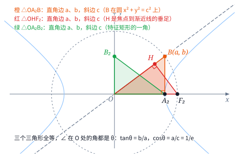
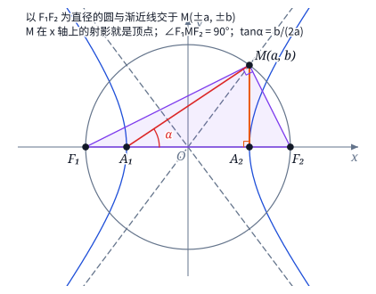
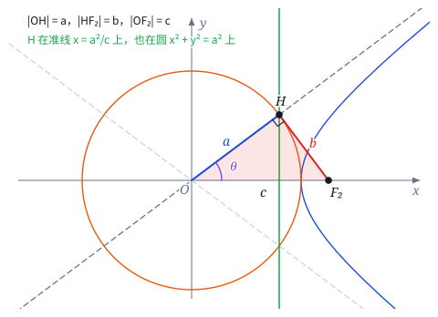
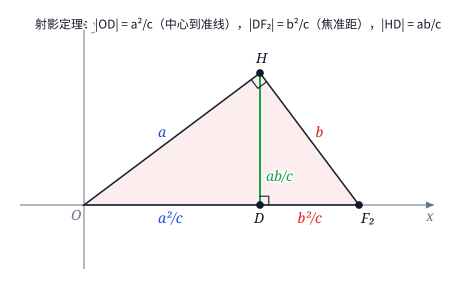
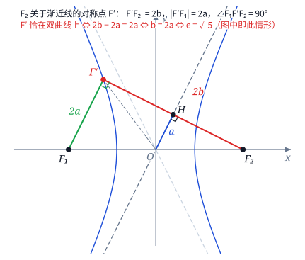
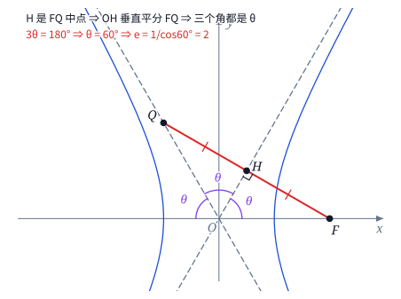

# 渐近线中的特征三角形

> **来源**：电子笔记 ｜ **所属模块**：三、圆锥曲线的定义、方程与基本几何性质 → 2. 双曲线

（记号同上一条：$\frac{x^2}{a^2} - \frac{y^2}{b^2} = 1$，渐近线 $y = \frac{b}{a}x$ 的倾斜角为 $\theta$，$\tan \theta = \frac{b}{a}$，==$\cos \theta = \frac{a}{c} = \frac{1}{e}$==。）

双曲线的离心率小题，绝大多数是在图里找到一个「直角边 $a$、$b$，斜边 $c$」的直角三角形，然后用角 $\theta$ 或边长关系列式。这样的三角形藏在渐近线附近至少四处，下面逐个列出。

## 一、三角形①：顶点竖线三角形 $\triangle OA_2M$

过右顶点 $A_2(a, 0)$ 作 $x$ 轴的垂线交渐近线于 $M(a, b)$：

- $|OA_2| = a$，$|A_2M| = b$，==$|OM| = c$==，$\angle MOA_2 = \theta$。
- 所以 $M$ 在圆 $x^2 + y^2 = c^2$ 上：==以 $F_1F_2$ 为直径的圆与渐近线的交点就是 $(\pm a, \pm b)$==，它们在 $x$ 轴上的射影恰是两个顶点。
- $M$ 在以 $F_1F_2$ 为直径的圆上，所以 $\angle F_1MF_2 = 90^\circ$。
- 在 $\triangle MA_1A_2$ 中，$|A_1A_2| = 2a$，$|A_2M| = b$，$MA_2 \perp A_1A_2$，所以 ==$\tan \angle MA_1A_2 = \frac{b}{2a}$==。

这正是特征矩形（四个顶点 $(\pm a, \pm b)$）的一角；矩形的外接圆就是以 $F_1F_2$ 为直径的圆。$\triangle OA_2B_2$（$B_2(0, b)$）与它全等，原稿第 28 条「特征三角形找离心率」里双曲线的那张图就是它。

## 二、三角形②：焦点垂足三角形 $\triangle OHF_2$（最重要）

过焦点 $F_2$ 作渐近线的垂线，垂足为 $H$：

- ==$|F_2H| = b$==（焦点到渐近线距离），$|OF_2| = c$，所以 ==$|OH| = a$==，$\angle HOF_2 = \theta$。
- $H\left(\frac{a^2}{c}, \frac{ab}{c}\right)$：==$H$ 在圆 $x^2 + y^2 = a^2$ 上，也在准线 $x = \frac{a^2}{c}$ 上==（三线共点，上一节第 4 条已证）。

再作 $HD \perp x$ 轴于 $D$，直角三角形的射影定理一次性给出准线和焦准距：

$$|OD| = \frac{a^2}{c}, \quad |DF_2| = \frac{b^2}{c}, \quad |HD| = \frac{ab}{c}$$

**常见出题方式**：

| 条件 | 翻译 | 结果 |
| --- | --- | --- |
| $|F_2H| = k|OH|$ | $b = ka$ | $e = \sqrt{1 + k^2}$ |
| $\triangle OHF_2$ 的面积为 $S$ | $\frac{1}{2}ab = S$ | |
| $H$ 在圆 $x^2 + y^2 = a^2$ 上 | 恒成立，不是条件 | 题目给出时只是提示 |
| $\angle HF_2O = \alpha$ | $\angle HOF_2 = 90^\circ - \alpha$ | $e = \frac{1}{\cos(90^\circ - \alpha)} = \frac{1}{\sin \alpha}$ |

## 三、三角形③：焦点关于渐近线的对称点 $\triangle F_1F'F_2$

作 $F_2$ 关于渐近线 $y = \frac{b}{a}x$ 的对称点 $F'$，则 $H$ 是 $F_2F'$ 的中点，$O$ 是 $F_1F_2$ 的中点，$OH$ 是 $\triangle F_1F'F_2$ 的中位线：

- ==$|F'F_2| = 2b$，$|F'F_1| = 2|OH| = 2a$，$\angle F_1F'F_2 = 90^\circ$==（$F_1F' \parallel OH \perp F_2F'$）。
- $|OF'| = |OF_2| = c$，$F'$ 在以 $F_1F_2$ 为直径的圆上。
- ==若 $F'$ 恰在双曲线上==（左支）：$|F'F_2| - |F'F_1| = 2a$，即 $2b - 2a = 2a$，$b = 2a$，==$e = \sqrt{5}$==。

这个三角形就是 $\triangle OHF_2$ 放大 $2$ 倍。题目里出现「$F_2$ 关于渐近线的对称点」「$PF_1 \parallel$ 渐近线」「$PF_2 \perp$ 渐近线」等字眼，都要立刻想到它。

## 四、三角形④：垂线交另一条渐近线

过 $F_2$ 作渐近线 $l_1$ 的垂线，垂足 $H$，与另一条渐近线 $l_2$ 交于 $Q$。$\angle HOF_2 = \theta$，$l_2$ 与 $x$ 轴负方向的夹角也是 $\theta$。

**典型条件「$H$ 是 $F_2Q$ 的中点」**（或 $\overrightarrow{F_2H} = \overrightarrow{HQ}$）：$OH$ 垂直平分 $F_2Q$，所以 $OH$ 平分 $\angle F_2OQ$，于是

$$\angle F_2OH = \angle HOQ = \angle QOx' = \theta \;\Rightarrow\; 3\theta = 180^\circ \;\Rightarrow\; \theta = 60^\circ, \; e = 2$$

**其他比例条件**用长度算：$|F_2H| = b$；在 $\triangle OHQ$ 中，$\angle HOQ = 180^\circ - 2\theta$，所以 $|HQ| = a \tan(180^\circ - 2\theta) = -a\tan 2\theta$（$\theta > 45^\circ$ 时 $Q$ 与 $F_2$ 在 $H$ 两侧）。例如 $|HQ| = 2|F_2H|$：$-a\tan 2\theta = 2b$，代入 $\tan 2\theta = \frac{2ab}{a^2 - b^2}$ 得 $\frac{2a^2b}{b^2 - a^2} = 2b$，$b^2 = 2a^2$，$e = \sqrt{3}$。

## 五、小结：看到什么想到哪个三角形

| 题目字眼 | 三角形 | 关键边角 |
| --- | --- | --- |
| 过顶点作 $x$ 轴垂线 / 以 $F_1F_2$ 为直径的圆与渐近线相交 | ① $\triangle OA_2M$ | $M(a, b)$，$\tan \angle MA_1A_2 = \frac{b}{2a}$ |
| 焦点到渐近线的距离 / 过焦点作渐近线的垂线 | ② $\triangle OHF_2$ | $|OH| = a$，$|F_2H| = b$ |
| 焦点关于渐近线的对称点 | ③ $\triangle F_1F'F_2$ | $2a$、$2b$、$2c$，直角在 $F'$ |
| 垂线与另一条渐近线相交 | ④ 角 $\theta$ 的倍角关系 | 中点条件 $\Rightarrow$ $3\theta = 180^\circ$ |
| 渐近线与实轴夹角 | 任意一个 | $e = \frac{1}{\cos \theta}$ |

## 六、例题

**例 1**　以双曲线 $\frac{x^2}{a^2} - \frac{y^2}{b^2} = 1$ 的焦距为直径的圆与渐近线在第一象限交于 $M$，$A_1$ 为左顶点，若 $\angle MA_1A_2 = 30^\circ$，求离心率。

**解**：由三角形①，$M(a, b)$，$\tan 30^\circ = \frac{b}{2a}$，$\frac{b}{a} = \frac{2\sqrt{3}}{3}$，$e^2 = 1 + \frac{4}{3}$，==$e = \frac{\sqrt{21}}{3}$==。

**例 2**　右焦点 $F$ 关于一条渐近线的对称点恰好落在双曲线上，求离心率。

**解**：由三角形③，$2b - 2a = 2a$，==$e = \sqrt{5}$==。

**例 3**　过右焦点 $F$ 作一条渐近线的垂线，垂足为 $H$，交另一条渐近线于 $Q$，若 $\overrightarrow{FH} = \overrightarrow{HQ}$，求离心率。

**解**：由三角形④，$\theta = 60^\circ$，==$e = 2$==。

**例 4**　过右焦点 $F$ 作渐近线的垂线，垂足为 $H$，$O$ 为原点，若 $\triangle OHF$ 的面积为 $\frac{\sqrt{3}}{2}a^2$，求离心率。

**解**：由三角形②，$S = \frac{1}{2}ab = \frac{\sqrt{3}}{2}a^2$，$b = \sqrt{3}a$，==$e = 2$==。
