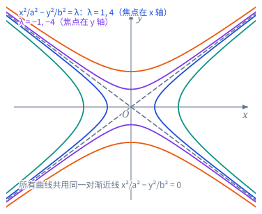
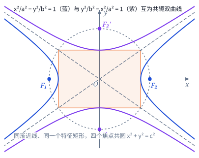
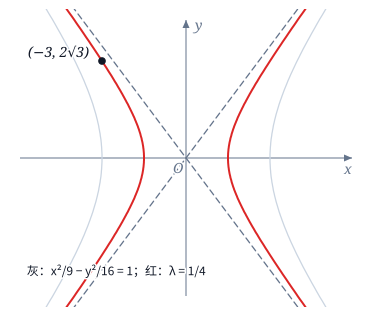

# 共渐近线的双曲线系与共轭双曲线

> **来源**：补充专题（双曲线的曲线系方程 1/3） ｜ **适用模块**：三、圆锥曲线的定义、方程与基本几何性质 → 2. 双曲线

*(和直线系、圆系一样，双曲线系就是「只给一部分条件、留一个参数 $\lambda$」的一族双曲线。先用已知条件把方程设成带 $\lambda$ 的形式，再用剩下的条件求 $\lambda$，可以省掉讨论焦点位置、解方程组的麻烦。本专题三条：共渐近线系、共焦点系、其他常用设法。)*

## 一、共渐近线的双曲线系

与双曲线 $\frac{x^2}{a^2} - \frac{y^2}{b^2} = 1$ 有共同渐近线的双曲线方程可设为

$$\frac{x^2}{a^2} - \frac{y^2}{b^2} = \lambda \quad (\lambda \ne 0)$$

- ==$\lambda > 0$ 焦点在 $x$ 轴，$\lambda < 0$ 焦点在 $y$ 轴==，一个式子把两种情况都包含了，所以==不用讨论焦点位置==。
- $\lambda = 0$ 时是两条渐近线本身，要去掉。

**为什么**：双曲线的渐近线是把右边的常数换成 $0$ 得到的，$\frac{x^2}{a^2} - \frac{y^2}{b^2} = \lambda$ 不管 $\lambda$ 是多少，换成 $0$ 后都是同一个 $\frac{x^2}{a^2} - \frac{y^2}{b^2} = 0$。

**已知渐近线方程时的设法**：

| 已知 | 设 |
| --- | --- |
| 渐近线 $y = \pm \frac{n}{m}x$ | ==$\frac{x^2}{m^2} - \frac{y^2}{n^2} = \lambda$==（$\lambda \ne 0$） |
| 渐近线 $Ax \pm By = 0$ | $A^2x^2 - B^2y^2 = \lambda$（$\lambda \ne 0$） |
| 与某双曲线共渐近线 | 把那条双曲线右边的 $1$ 换成 $\lambda$ |

例如渐近线 $y = \pm 2x$，设 $4x^2 - y^2 = \lambda$ 或 $x^2 - \frac{y^2}{4} = \lambda$ 都可以。

## 二、共渐近线时的离心率

$\lambda > 0$ 时 $\frac{x^2}{\lambda a^2} - \frac{y^2}{\lambda b^2} = 1$，离心率 $\sqrt{1 + \frac{b^2}{a^2}}$ 与原双曲线相同；$\lambda < 0$ 时实轴、虚轴对调，离心率变成 $\sqrt{1 + \frac{a^2}{b^2}}$。所以：

- 同一族里离心率只有两个值，焦点在同一条轴上的那些离心率相同（形状相同，只是大小不同，==共渐近线且焦点同轴 ⇔ 离心率相同==）。
- ==只知道渐近线、不知道焦点位置，离心率有两解==：渐近线 $y = \pm kx$（$k > 0$）对应 $e = \sqrt{1 + k^2}$ 或 $e = \sqrt{1 + \frac{1}{k^2}}$。

## 三、共轭双曲线

$\lambda = -1$ 的那一条叫原双曲线的共轭双曲线：

$$\frac{x^2}{a^2} - \frac{y^2}{b^2} = 1 \quad \text{与} \quad \frac{y^2}{b^2} - \frac{x^2}{a^2} = 1$$

一条的实轴是另一条的虚轴。

**性质**：

1. 渐近线相同，特征矩形相同。
2. 焦距相同（都是 $c^2 = a^2 + b^2$），==四个焦点在同一个圆 $x^2 + y^2 = c^2$ 上==。
3. 离心率 $e_1 = \frac{c}{a}$，$e_2 = \frac{c}{b}$，满足

$$\frac{1}{e_1^2} + \frac{1}{e_2^2} = \frac{a^2 + b^2}{c^2} = 1$$

即 ==$\frac{1}{e_1^2} + \frac{1}{e_2^2} = 1$==，等价写法 $e_1^2 + e_2^2 = e_1^2e_2^2$。

4. 由基本不等式 $1 = \frac{1}{e_1^2} + \frac{1}{e_2^2} \ge \frac{2}{e_1e_2}$，得 ==$e_1e_2 \ge 2$，$e_1 + e_2 \ge 2\sqrt{e_1e_2} \ge 2\sqrt{2}$==，当且仅当 $e_1 = e_2 = \sqrt{2}$（等轴双曲线，它的共轭双曲线就是把它旋转 $90^\circ$）时取等号。

## 四、例题

**例 1**　求与双曲线 $\frac{x^2}{9} - \frac{y^2}{16} = 1$ 有共同渐近线，且过点 $(-3, 2\sqrt{3})$ 的双曲线方程。

**解**：设 $\frac{x^2}{9} - \frac{y^2}{16} = \lambda$，代入点：$\lambda = 1 - \frac{12}{16} = \frac{1}{4}$，所以

$$\frac{x^2}{\frac{9}{4}} - \frac{y^2}{4} = 1$$

（若先判断焦点位置再设 $\frac{x^2}{a^2} - \frac{y^2}{b^2} = 1$、$\frac{b}{a} = \frac{4}{3}$，也能做，但要多解一个方程组，焦点位置判断错了还会无解。）

**例 2**　双曲线的渐近线为 $2x \pm 3y = 0$，且过点 $(\sqrt{6}, 2)$，求方程。

**解**：设 $4x^2 - 9y^2 = \lambda$，代入得 $\lambda = 24 - 36 = -12$，所以 $9y^2 - 4x^2 = 12$，即 ==$\frac{y^2}{\frac{4}{3}} - \frac{x^2}{3} = 1$==，焦点在 $y$ 轴（$\lambda < 0$ 自动给出）。

**例 3**　双曲线 $C_1$ 与其共轭双曲线 $C_2$ 的离心率分别为 $e_1$、$e_2$，若 $e_1 = 2$，求 $e_2$；并求 $e_1 + e_2$ 的最小值。

**解**：$\frac{1}{4} + \frac{1}{e_2^2} = 1$，==$e_2 = \frac{2\sqrt{3}}{3}$==。$e_1 + e_2$ 的最小值为 $2\sqrt{2}$（$e_1 = e_2 = \sqrt{2}$）。
