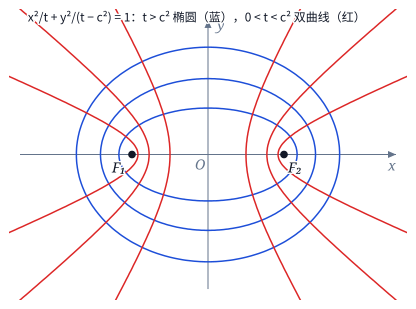
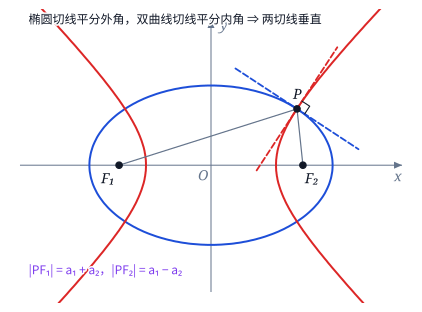
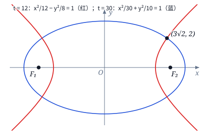

# 共焦点的曲线系（双曲线与椭圆）

> **来源**：补充专题（双曲线的曲线系方程 2/3） ｜ **适用模块**：三、圆锥曲线的定义、方程与基本几何性质 → 2. 双曲线

## 一、三种设法

**1. 与双曲线 $\frac{x^2}{a^2} - \frac{y^2}{b^2} = 1$ 共焦点的双曲线**

$$\frac{x^2}{a^2 + \lambda} - \frac{y^2}{b^2 - \lambda} = 1 \quad (-a^2 < \lambda < b^2)$$

两个分母之和恒为 $a^2 + b^2 = c^2$，所以焦点不变。

**2. 与椭圆 $\frac{x^2}{a^2} + \frac{y^2}{b^2} = 1$（$a > b > 0$）共焦点的曲线**

$$\frac{x^2}{a^2 - \lambda} + \frac{y^2}{b^2 - \lambda} = 1$$

==$\lambda < b^2$ 时是椭圆，$b^2 < \lambda < a^2$ 时是双曲线==（两个分母之差恒为 $a^2 - b^2 = c^2$）。

**3. 统一写法（最推荐）**：焦点为 $(\pm c, 0)$ 的椭圆和双曲线都可以设成

$$\frac{x^2}{t} + \frac{y^2}{t - c^2} = 1 \quad (t > 0, \; t \ne c^2)$$

==$t > c^2$ 是椭圆，$0 < t < c^2$ 是双曲线==。只用一个参数，代入一个点就能解出，最后按 $t$ 的范围取舍。焦点在 $y$ 轴时把 $x$、$y$ 对调。

## 二、共焦点的椭圆与双曲线相交（结论汇总）

设椭圆 $\frac{x^2}{a_1^2} + \frac{y^2}{b_1^2} = 1$ 与双曲线 $\frac{x^2}{a_2^2} - \frac{y^2}{b_2^2} = 1$ 共焦点 $F_1$、$F_2$，在第一象限交于 $P$，$\angle F_1PF_2 = \theta$，离心率分别为 $e_1$、$e_2$。（原稿第 29 条「双曲线与椭圆的共焦点三角形性质」有手写推导，这里把结论列全。）

1. **焦半径**：$|PF_1| + |PF_2| = 2a_1$，$|PF_1| - |PF_2| = 2a_2$，所以 ==$|PF_1| = a_1 + a_2$，$|PF_2| = a_1 - a_2$==。
2. **焦半径之积**：$|PF_1| \cdot |PF_2| = a_1^2 - a_2^2 = b_1^2 + b_2^2$（因为 $a_1^2 - b_1^2 = c^2 = a_2^2 + b_2^2$）。
3. **交点坐标**：$P\left(\frac{a_1a_2}{c}, \frac{b_1b_2}{c}\right)$。
4. **顶角**：椭圆焦点三角形面积 $S = b_1^2\tan \frac{\theta}{2}$，双曲线焦点三角形面积 $S = \frac{b_2^2}{\tan \frac{\theta}{2}}$，同一个三角形面积相等，所以 ==$\tan \frac{\theta}{2} = \frac{b_2}{b_1}$，$S = b_1b_2$==。
5. **离心率关系**：在 $\triangle F_1PF_2$ 中用余弦定理，

$$4c^2 = (a_1 + a_2)^2 + (a_1 - a_2)^2 - 2(a_1^2 - a_2^2)\cos \theta = 4a_1^2\sin^2 \frac{\theta}{2} + 4a_2^2\cos^2 \frac{\theta}{2}$$

两边除以 $4c^2$：

$$\frac{\sin^2 \frac{\theta}{2}}{e_1^2} + \frac{\cos^2 \frac{\theta}{2}}{e_2^2} = 1$$

特别地 ==$\theta = 90^\circ$ 时 $\frac{1}{e_1^2} + \frac{1}{e_2^2} = 2$==；$\theta = 60^\circ$ 时 $\frac{1}{e_1^2} + \frac{3}{e_2^2} = 4$。

6. **交点处切线互相垂直**（共焦点曲线「正交」）：椭圆在 $P$ 处的切线平分 $\angle F_1PF_2$ 的外角，双曲线在 $P$ 处的切线平分 $\angle F_1PF_2$ 的内角（模块七光学性质），内角平分线与外角平分线垂直，所以==两条切线互相垂直==。

## 三、例题

**例 1**　求与椭圆 $\frac{x^2}{49} + \frac{y^2}{24} = 1$ 有公共焦点，且离心率 $e = \frac{5}{4}$ 的双曲线方程。

**解**：$c^2 = 49 - 24 = 25$，$c = 5$，$a = \frac{c}{e} = 4$，$b^2 = 9$，==$\frac{x^2}{16} - \frac{y^2}{9} = 1$==。

**例 2**　求与双曲线 $\frac{x^2}{16} - \frac{y^2}{4} = 1$ 有公共焦点，且过点 $(3\sqrt{2}, 2)$ 的双曲线方程。

**解**：$c^2 = 20$，设 $\frac{x^2}{t} + \frac{y^2}{t - 20} = 1$，代入点：

$$\frac{18}{t} + \frac{4}{t - 20} = 1 \;\Rightarrow\; t^2 - 42t + 360 = 0 \;\Rightarrow\; t = 12 \text{ 或 } 30$$

要双曲线取 $0 < t < 20$，$t = 12$：==$\frac{x^2}{12} - \frac{y^2}{8} = 1$==。（$t = 30$ 是过该点的共焦点椭圆 $\frac{x^2}{30} + \frac{y^2}{10} = 1$。）

**例 3**　椭圆与双曲线有公共焦点 $F_1$、$F_2$，$P$ 是它们的一个公共点，$\angle F_1PF_2 = 60^\circ$，离心率分别为 $e_1$、$e_2$，求 $e_1e_2$ 的最小值。

**解**：由结论 5，$\frac{1}{e_1^2} + \frac{3}{e_2^2} = 4$。由基本不等式 $4 \ge 2\sqrt{\frac{3}{e_1^2e_2^2}} = \frac{2\sqrt{3}}{e_1e_2}$，所以 ==$e_1e_2 \ge \frac{\sqrt{3}}{2}$==，当 $\frac{1}{e_1^2} = \frac{3}{e_2^2} = 2$，即 $e_1 = \frac{\sqrt{2}}{2}$、$e_2 = \frac{\sqrt{6}}{2}$ 时取等号。
