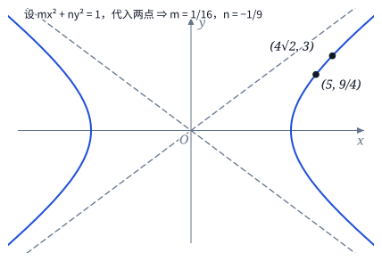
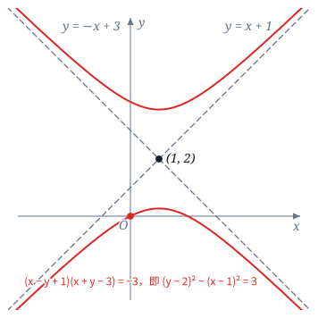

# 其他双曲线系与设方程技巧

> **来源**：补充专题（双曲线的曲线系方程 3/3） ｜ **适用模块**：三、圆锥曲线的定义、方程与基本几何性质 → 2. 双曲线

## 一、焦点位置不确定：$mx^2 + ny^2 = 1$（$mn < 0$）

已知双曲线过两个点、但不知道焦点在哪条轴上时，设

$$mx^2 + ny^2 = 1 \quad (mn < 0)$$

两个点代入是关于 $m$、$n$ 的==一次==方程组，比设 $\frac{x^2}{a^2} - \frac{y^2}{b^2} = 1$ 再分类讨论简单。解出后 $m > 0$ 焦点在 $x$ 轴，$n > 0$ 焦点在 $y$ 轴。

**例 1**　双曲线过 $\left(5, \frac{9}{4}\right)$ 与 $(4\sqrt{2}, 3)$，求方程。

**解**：设 $mx^2 + ny^2 = 1$，得

$$\begin{cases} 25m + \frac{81}{16}n = 1 \\ 32m + 9n = 1 \end{cases}$$

解得 $m = \frac{1}{16}$，$n = -\frac{1}{9}$，==$\frac{x^2}{16} - \frac{y^2}{9} = 1$==。

## 二、已知离心率：先定 $\frac{b}{a}$

已知 $e$ 就知道 $\frac{b^2}{a^2} = e^2 - 1$，于是

- 焦点在 $x$ 轴：设 $\frac{x^2}{a^2} - \frac{y^2}{(e^2 - 1)a^2} = 1$，只剩一个参数 $a^2$；
- 焦点位置不定：设 $\frac{x^2}{1} - \frac{y^2}{e^2 - 1} = \lambda$（$\lambda > 0$）或 $\frac{y^2}{1} - \frac{x^2}{e^2 - 1} = \lambda$（$\lambda > 0$）两种，分别代点。==同一个 $e$ 对应两族渐近线不同的双曲线==，注意和第 1 条「共渐近线」区分：共渐近线 $\Rightarrow$ 离心率至多两个值；同离心率 $\Rightarrow$ 渐近线有两种。

例如 $e = \sqrt{2}$：一定是等轴双曲线，可直接设 $x^2 - y^2 = \lambda$（$\lambda \ne 0$），这时两族合成一族。

## 三、双曲线 = 「两条渐近线之积」等于常数

第 1 条的共渐近线系可以改写成

$$\left(\frac{x}{a} - \frac{y}{b}\right)\left(\frac{x}{a} + \frac{y}{b}\right) = \lambda$$

左边是两条渐近线方程的乘积。这个看法可以推广到==中心不在原点、渐近线是任意两条相交直线==的情形：

以 $l_1: A_1x + B_1y + C_1 = 0$、$l_2: A_2x + B_2y + C_2 = 0$（相交）为渐近线的双曲线可设为

$$(A_1x + B_1y + C_1)(A_2x + B_2y + C_2) = \lambda \quad (\lambda \ne 0)$$

反比例函数 $xy = k$ 就是 $l_1: x = 0$、$l_2: y = 0$ 的情形；分式函数 $(x - h)(y - m) = k$ 就是渐近线 $x = h$、$y = m$ 的情形（第 2 节等轴双曲线）。

**例 2**　双曲线的两条渐近线为 $y = x + 1$ 和 $y = -x + 3$，且过原点，求方程，并指出中心与焦点所在的直线。

**解**：设 $(x - y + 1)(x + y - 3) = \lambda$，代入 $(0, 0)$：$\lambda = 1 \times (-3) = -3$，所以

$$(x - y + 1)(x + y - 3) = -3$$

令 $X = x - 1$，$Y = y - 2$（两渐近线交点 $(1, 2)$ 为中心），则 $x - y + 1 = X - Y$，$x + y - 3 = X + Y$，方程化为 $X^2 - Y^2 = -3$，即

$$(y - 2)^2 - (x - 1)^2 = 3$$

是中心 $(1, 2)$、实轴平行于 $y$ 轴的==等轴双曲线==（两条渐近线垂直），焦点在直线 $x = 1$ 上：$(1, 2 \pm \sqrt{6})$。

## 四、过两条曲线交点的曲线系

和圆系一样，若 $f_1(x, y) = 0$、$f_2(x, y) = 0$ 是两条二次曲线，则

$$f_1(x, y) + \lambda f_2(x, y) = 0$$

表示过它们全部交点的曲线（不含 $f_2 = 0$ 本身）。特别地，取 $f_2$ 为两条直线之积 $l_1 \cdot l_2$，就得到「过双曲线与两条直线的四个交点」的曲线系，大题里证明四点共圆时会用到（四点共圆 $\Leftrightarrow$ 存在 $\lambda$ 使 $x^2$、$y^2$ 系数相等且 $xy$ 系数为 $0$）。小题中只需知道这种设法即可。

## 五、设法总表

| 已知条件 | 设法 | 注意 |
| --- | --- | --- |
| 焦点在 $x$ 轴，求 $a$、$b$ | $\frac{x^2}{a^2} - \frac{y^2}{b^2} = 1$ | 普通待定系数 |
| 过两点，焦点位置不定 | $mx^2 + ny^2 = 1$（$mn < 0$） | 一次方程组 |
| 已知渐近线 $y = \pm \frac{n}{m}x$ | $\frac{x^2}{m^2} - \frac{y^2}{n^2} = \lambda$ | ==$\lambda$ 的符号自动定焦点== |
| 与已知双曲线共渐近线 | 右边 $1$ 换成 $\lambda$ | $\lambda \ne 0$ |
| 与已知双曲线共焦点 | $\frac{x^2}{a^2 + \lambda} - \frac{y^2}{b^2 - \lambda} = 1$ | $-a^2 < \lambda < b^2$ |
| 与已知椭圆共焦点 | $\frac{x^2}{a^2 - \lambda} + \frac{y^2}{b^2 - \lambda} = 1$ | $b^2 < \lambda < a^2$ 为双曲线 |
| 只知焦点 $(\pm c, 0)$ | ==$\frac{x^2}{t} + \frac{y^2}{t - c^2} = 1$== | $0 < t < c^2$ 双曲线 |
| 已知离心率 $e = \sqrt{2}$ | $x^2 - y^2 = \lambda$ | 等轴 |
| 渐近线为任意两条相交直线 | $l_1 \cdot l_2 = \lambda$ | 中心是两直线交点 |
