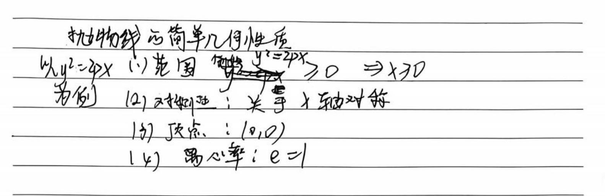
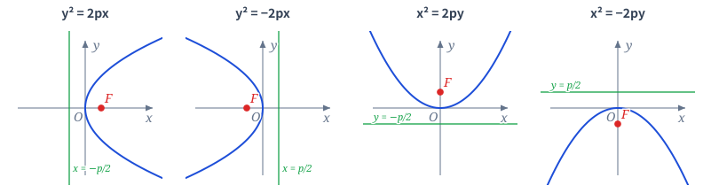

# 抛物线的简单几何性质

> **原稿序号**：无序号 ｜ **原稿页码**：P12 ｜ **所属模块**：三、圆锥曲线的定义、方程与基本几何性质 → 3. 抛物线

## 四种标准方程对照

原稿以 $y^2 = 2px$ 为例列了范围、对称性、顶点、离心率四条，下面把四种开口方向和焦点、准线等常用量补齐。

| 方程（$p > 0$） | 焦点 | 准线 | 范围 | 对称轴 | 开口 |
| --- | --- | --- | --- | --- | --- |
| $y^2 = 2px$ | $\left(\frac{p}{2}, 0\right)$ | $x = -\frac{p}{2}$ | $x \ge 0$ | $x$ 轴 | 向右 |
| $y^2 = -2px$ | $\left(-\frac{p}{2}, 0\right)$ | $x = \frac{p}{2}$ | $x \le 0$ | $x$ 轴 | 向左 |
| $x^2 = 2py$ | $\left(0, \frac{p}{2}\right)$ | $y = -\frac{p}{2}$ | $y \ge 0$ | $y$ 轴 | 向上 |
| $x^2 = -2py$ | $\left(0, -\frac{p}{2}\right)$ | $y = \frac{p}{2}$ | $y \le 0$ | $y$ 轴 | 向下 |

- ==一次项定轴，符号定开口==：一次项是 $x$ 就关于 $x$ 轴对称，系数为正开口朝正方向。
- 焦点坐标 = 一次项系数的 $\frac{1}{4}$：$y^2 = ax$ 的焦点 $\left(\frac{a}{4}, 0\right)$，准线 $x = -\frac{a}{4}$（$a$ 正负都适用）。
- ==易错==：$y = ax^2$ 不是标准方程，要先化成 $x^2 = \frac{1}{a}y$，焦点 $\left(0, \frac{1}{4a}\right)$，准线 $y = -\frac{1}{4a}$。例如 $y = 4x^2$ 的焦点是 $\left(0, \frac{1}{16}\right)$，不是 $(1, 0)$。

## 其他常用量

| 量 | 值 | 说明 |
| --- | --- | --- |
| 焦准距（焦点到准线距离） | ==$p$== | $p$ 的几何意义 |
| 顶点到焦点、顶点到准线 | $\frac{p}{2}$ | 顶点是焦点到准线垂线段的中点 |
| 通径 | ==$2p$== | 最短的焦点弦 |
| 焦半径 | $|PF| = x_0 + \frac{p}{2}$ | 对 $y^2 = 2px$，最小值 $\frac{p}{2}$（在顶点） |

- 抛物线只有一条对称轴、一个顶点，==没有中心，没有渐近线==；开口越往外越「直」，但不会趋近于任何直线。
- $p$ 越大开口越大（同一横坐标处 $|y| = \sqrt{2px}$ 越大）。
- 离心率 $e = 1$ 是第二定义（到焦点距离 = 到准线距离）的直接结果，椭圆、双曲线的统一定义见模块三第 1、2 节。
