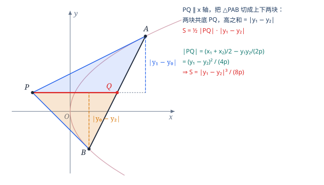
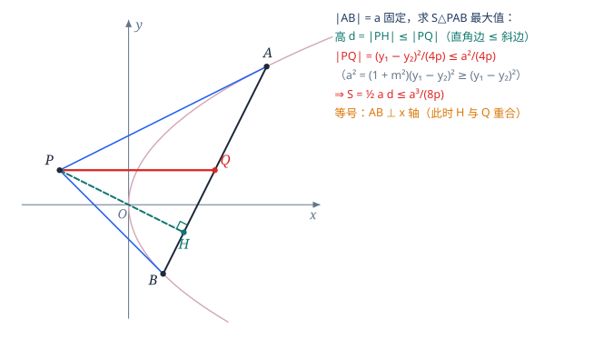
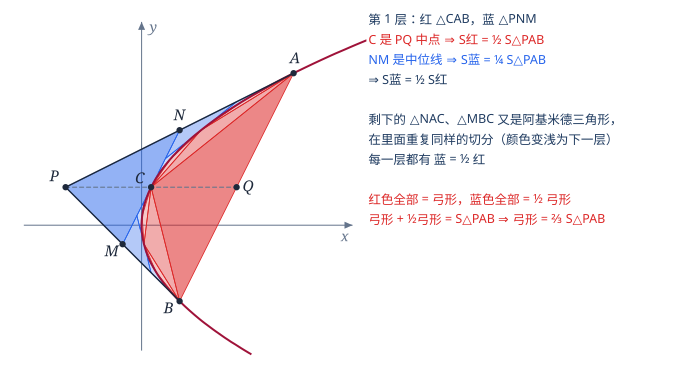

# 阿基米德三角形的面积：两个面积公式、定长底边的最大面积与 2/3 弓形定理

> **来源**：补充专题（阿基米德三角形 3/6） ｜ **适用模块**：三、圆锥曲线的定义、方程与基本几何性质 → 3. 抛物线

*(记号同第 1 条：$y^2 = 2px$，$A(x_1, y_1)$、$B(x_2, y_2)$，顶点 $P(x_0, y_0)$，$Q$ 为 $AB$ 中点。)*

## 一、面积公式（两种形式）

$$S_{\triangle PAB} = \frac{|y_1 - y_2|^3}{8p} = \frac{1}{p}\left(y_0^2 - 2px_0\right)^{\frac{3}{2}}$$

- 第一种用两切点的纵坐标：==面积只和 $A$、$B$ 的纵坐标之差有关==。
- 第二种用顶点 $P$ 的坐标：==把 $P$ 代入抛物线方程、移项得 $y_0^2 - 2px_0$（$P$ 在抛物线外，它大于 $0$），再取 $\frac{3}{2}$ 次方、除以 $p$==。已知 $P$ 在某条直线上动、求面积最值时最好用。

开口向上的 $x^2 = 2py$：$S = \frac{|x_1 - x_2|^3}{8p} = \frac{1}{p}\left(x_0^2 - 2py_0\right)^{\frac{3}{2}}$。

### 1. 证明第一种形式

$PQ \parallel x$ 轴（第 1 条性质 1），用 $PQ$ 把三角形切成上下两块，它们共底 $PQ$，高分别是 $|y_1 - y_0|$ 与 $|y_0 - y_2|$，加起来正好是 $|y_1 - y_2|$（$A$、$B$ 在 $PQ$ 两侧）。所以

$$S = \frac{1}{2}|PQ| \cdot |y_1 - y_2|$$

由 $P\left(\frac{y_1 y_2}{2p}, \frac{y_1 + y_2}{2}\right)$、$Q\left(\frac{x_1 + x_2}{2}, \frac{y_1 + y_2}{2}\right)$，并用 $x_1 = \frac{y_1^2}{2p}$、$x_2 = \frac{y_2^2}{2p}$ 换掉横坐标：

$$|PQ| = \frac{x_1 + x_2}{2} - \frac{y_1 y_2}{2p} = \frac{y_1^2 + y_2^2}{4p} - \frac{2y_1 y_2}{4p} = \frac{(y_1 - y_2)^2}{4p}$$

所以 $S = \frac{1}{2} \cdot \frac{(y_1 - y_2)^2}{4p} \cdot |y_1 - y_2| = \frac{|y_1 - y_2|^3}{8p}$。

### 2. 由第一种推出第二种

$$S = \frac{1}{p}\left|\frac{y_1 - y_2}{2}\right|^3 = \frac{1}{p}\left[\frac{(y_1 - y_2)^2}{4}\right]^{\frac{3}{2}} = \frac{1}{p}\left[\frac{(y_1 + y_2)^2 - 4y_1 y_2}{4}\right]^{\frac{3}{2}}$$

而 $\frac{(y_1 + y_2)^2}{4} = \left(\frac{y_1 + y_2}{2}\right)^2 = y_0^2$，$\frac{4y_1 y_2}{4} = y_1 y_2 = 2px_0$（第 1 条），所以 $S = \frac{1}{p}\left(y_0^2 - 2px_0\right)^{\frac{3}{2}}$。

**应用（第 2 条用过）**：$AB$ 过焦点时 $x_0 = -\frac{p}{2}$，$S = \frac{1}{p}(y_0^2 + p^2)^{\frac{3}{2}} \ge p^2$。

## 二、底边长为定值 $a$ 时，面积最大值为 $\frac{a^3}{8p}$

**证法一（高 ≤ 中线，配套资料方法）**：设 $|AB| = a$，$P$ 到 $AB$ 的距离为 $d$。$d$ 是从 $P$ 到直线 $AB$ 的垂线段，$PQ$ 是从 $P$ 到 $AB$ 上一点的斜线段，所以（直角边小于斜边）

$$d \le |PQ| = \frac{(y_1 - y_2)^2}{4p}$$

设 $AB: x = my + n$，则 $a = \sqrt{1 + m^2}\,|y_1 - y_2|$，所以 $(y_1 - y_2)^2 \le a^2$，$d \le \frac{a^2}{4p}$，

$$S = \frac{1}{2}ad \le \frac{a^3}{8p}$$

**证法二（直接用面积公式，笔记方法）**：$a^2 = (m^2 + 1)(y_1 - y_2)^2$，所以 $|y_1 - y_2| = \frac{a}{\sqrt{m^2 + 1}} \le a$，代入 $S = \frac{|y_1 - y_2|^3}{8p} \le \frac{a^3}{8p}$。

两种方法都在 $m = 0$，即 ==$AB \perp x$ 轴时取到最大值 $\frac{a^3}{8p}$==（此时垂足 $H$ 与 $Q$ 重合）。

## 三、阿基米德的 2/3 定理：弓形面积 = $\frac{2}{3}S_{\triangle PAB}$

弦 $AB$ 与抛物线所围成的弓形面积，等于阿基米德三角形 $PAB$ 面积的 $\frac{2}{3}$。这是阿基米德用「逼近」（穷竭法）证明的，下面是配套资料里的证法。

**第一步（切一刀）**：$PQ$ 是 $AB$ 边上的中线，$PQ \parallel x$ 轴。由第 1 条性质 2，$PQ$ 的中点 $C$ 在抛物线上，$C$ 处切线平行于 $AB$，交 $PA$、$PB$ 于它们的中点 $N$、$M$。

- 红色 $\triangle CAB$：$C$ 是 $PQ$ 中点，$C$ 到 $AB$ 的距离是 $P$ 到 $AB$ 距离的一半，所以 $S_{\triangle CAB} = \frac{1}{2}S_{\triangle PAB}$。
- 蓝色 $\triangle PNM$：$NM$ 是中位线，$S_{\triangle PNM} = \frac{1}{4}S_{\triangle PAB}$。
- 所以 ==$S_{\text{蓝}} = \frac{1}{2}S_{\text{红}}$==。

**第二步（重复）**：剩下的 $\triangle NAC$、$\triangle MCB$ 又都是阿基米德三角形（$NA$、$NC$ 是抛物线在 $A$、$C$ 处的切线；$MC$、$MB$ 同理）。在它们里面做同样的切分，又得到新的红色三角形（在弓形里）和蓝色三角形（在弓形外），并且每一处都有「蓝 = 红的一半」。

**第三步（累加到无穷）**：这样无限做下去，

- 所有红色三角形恰好铺满弓形：$\sum S_{\text{红}} = S_{\text{弓形}}$；
- 所有蓝色三角形恰好铺满「两条切线与弧之间的区域」：$\sum S_{\text{蓝}} = \frac{1}{2}S_{\text{弓形}}$；
- 两部分合起来就是整个 $\triangle PAB$：$S_{\text{弓形}} + \frac{1}{2}S_{\text{弓形}} = S_{\triangle PAB}$。

所以 ==$S_{\text{弓形}} = \frac{2}{3}S_{\triangle PAB}$==。

等价说法：$S_{\triangle CAB} = \frac{1}{2}S_{\triangle PAB}$，所以 $S_{\text{弓形}} = \frac{4}{3}S_{\triangle CAB}$（弓形面积是「内接三角形 $CAB$」的 $\frac{4}{3}$ 倍，$C$ 是弓形上到 $AB$ 最远的点）。结合第一部分的面积公式，弓形面积 $= \frac{2}{3} \cdot \frac{|y_1 - y_2|^3}{8p} = \frac{|y_1 - y_2|^3}{12p}$。

这个定理在第 6 条「三切线面积关系 $S_{\triangle ABC} = 2S_{\triangle PMN}$」的证明里还要用。
