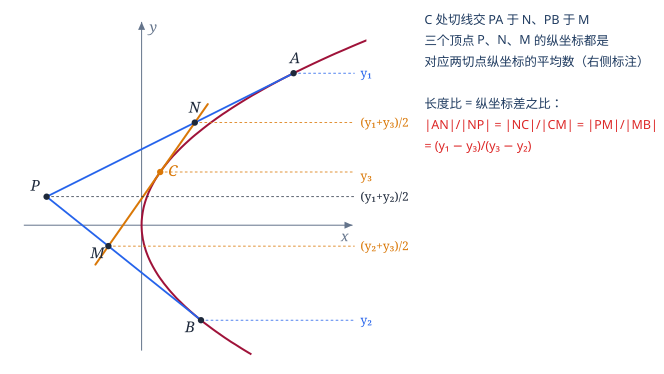
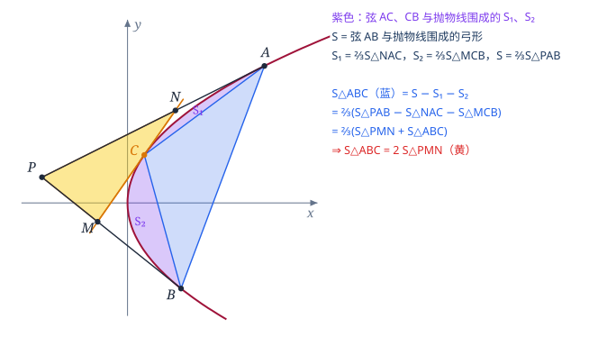
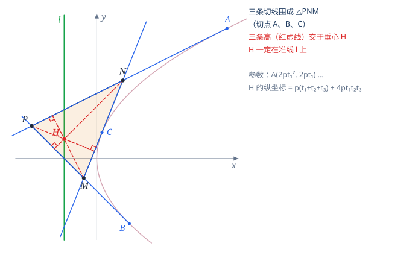

# 三条切线：线段定比、S△ABC = 2S△PMN、切线三角形的垂心在准线上

> **来源**：补充专题（阿基米德三角形 6/6） ｜ **适用模块**：三、圆锥曲线的定义、方程与基本几何性质 → 3. 抛物线

*(记号：$y^2 = 2px$，抛物线上三点 $A(x_1, y_1)$、$B(x_2, y_2)$、$C(x_3, y_3)$，$C$ 在 $A$、$B$ 之间的弧上；三点处的切线两两相交：$A$、$B$ 处切线交于 $P$，$C$ 处切线交 $PA$ 于 $N$、交 $PB$ 于 $M$。配套资料里顶点记作 $Q$、第三个切点记作 $I$、$N$、$M$ 记作 $S$、$T$，内容相同。)*

**一个关键观察**：三个交点 $P$、$N$、$M$ 各自是一个阿基米德三角形的顶点（$\triangle PAB$、$\triangle NAC$、$\triangle MCB$），由第 1 条性质 1：

$$y_P = \frac{y_1 + y_2}{2}, \quad y_N = \frac{y_1 + y_3}{2}, \quad y_M = \frac{y_2 + y_3}{2}$$

==每个交点的纵坐标都是对应两个切点纵坐标的平均数==，下面两个结论都从这里来。

## 一、线段定比：$\frac{|AN|}{|NP|} = \frac{|NC|}{|CM|} = \frac{|PM|}{|MB|}$

$C$ 为抛物线上（$A$、$B$ 之间）任一点，$C$ 处切线与 $PA$、$PB$ 分别交于 $N$、$M$，则

$$\frac{|AN|}{|NP|} = \frac{|NC|}{|CM|} = \frac{|PM|}{|MB|} = \frac{y_1 - y_3}{y_3 - y_2}$$

记法：三条切线把彼此分成了三组线段，==按从 $A$ 到 $B$ 的同一方向，「前一段比后一段」的三个比值都相等==（课上说成「短比长 = 短比长 = 短比长」，图中 $C$ 偏向哪边，对应的三段就同样偏短）。

**证明（课上方法，转化为纵坐标之比）**：同一条直线上的线段之比等于它们在 $y$ 轴上投影之比，也就是纵坐标之差的比。

$$\frac{|AN|}{|NP|} = \frac{y_1 - y_N}{y_N - y_P} = \frac{y_1 - \frac{y_1 + y_3}{2}}{\frac{y_1 + y_3}{2} - \frac{y_1 + y_2}{2}} = \frac{y_1 - y_3}{y_3 - y_2}$$

$$\frac{|NC|}{|CM|} = \frac{y_N - y_3}{y_3 - y_M} = \frac{\frac{y_1 + y_3}{2} - y_3}{y_3 - \frac{y_2 + y_3}{2}} = \frac{y_1 - y_3}{y_3 - y_2}$$

$$\frac{|PM|}{|MB|} = \frac{y_P - y_M}{y_M - y_2} = \frac{\frac{y_1 + y_2}{2} - \frac{y_2 + y_3}{2}}{\frac{y_2 + y_3}{2} - y_2} = \frac{y_1 - y_3}{y_3 - y_2}$$

三个比都等于 $\frac{y_1 - y_3}{y_3 - y_2}$。（课上提到 2023 届湖北四调多选题最后一个选项考过这条。）

**特例**：$C$ 取 $PQ$ 的中点（$y_3 = \frac{y_1 + y_2}{2}$）时三个比都等于 $1$，$N$、$M$ 是 $PA$、$PB$ 的中点，就是第 1 条的性质 2。

## 二、面积：$S_{\triangle ABC} = 2S_{\triangle PMN}$

==三个切点围成的三角形面积，是三条切线围成的三角形面积的 2 倍==。

**证法一（用 2/3 弓形定理，课上与配套资料方法）**：设弦 $AC$、$CB$、$AB$ 与抛物线围成的弓形面积分别为 $S_1$、$S_2$、$S$。$\triangle NAC$、$\triangle MCB$、$\triangle PAB$ 都是阿基米德三角形，由第 3 条：

$$S_1 = \frac{2}{3}S_{\triangle NAC}, \quad S_2 = \frac{2}{3}S_{\triangle MCB}, \quad S = \frac{2}{3}S_{\triangle PAB}$$

大弓形 $S$ 由 $\triangle ABC$ 和两个小弓形组成，所以

$$S_{\triangle ABC} = S - S_1 - S_2 = \frac{2}{3}\left(S_{\triangle PAB} - S_{\triangle NAC} - S_{\triangle MCB}\right)$$

而 $\triangle PAB$ 恰好被分成 $\triangle PMN$、$\triangle NAC$、$\triangle MCB$、$\triangle ABC$ 四块，括号里等于 $S_{\triangle PMN} + S_{\triangle ABC}$。于是

$$S_{\triangle ABC} = \frac{2}{3}\left(S_{\triangle PMN} + S_{\triangle ABC}\right) \ \Rightarrow\ \frac{1}{3}S_{\triangle ABC} = \frac{2}{3}S_{\triangle PMN} \ \Rightarrow\ S_{\triangle ABC} = 2S_{\triangle PMN}$$

**证法二（坐标直接算，作为验证）**：三点 $\left(\frac{y_i^2}{2p}, y_i\right)$ 用行列式（或割补）求面积，得

$$S_{\triangle ABC} = \frac{|(y_1 - y_2)(y_2 - y_3)(y_3 - y_1)|}{4p}$$

三个交点 $\left(\frac{y_i y_j}{2p}, \frac{y_i + y_j}{2}\right)$ 同样计算得

$$S_{\triangle PMN} = \frac{|(y_1 - y_2)(y_2 - y_3)(y_3 - y_1)|}{8p}$$

正好差 2 倍。

## 三、三条切线围成的三角形，垂心在准线上

抛物线上任取三点，过三点的切线围成 $\triangle PNM$，则 ==$\triangle PNM$ 的垂心在准线上==。

**证明（参数法，配套资料方法）**：设 $A(2pt_1^2, 2pt_1)$、$B(2pt_2^2, 2pt_2)$、$C(2pt_3^2, 2pt_3)$。由第 1 条参数形式，切线 $x - 2t_i y + 2pt_i^2 = 0$ 的斜率为 $\frac{1}{2t_i}$，两切线交点为 $\left(2pt_it_j, p(t_i + t_j)\right)$：

$$P(2pt_1t_2,\ p(t_1 + t_2)), \quad N(2pt_1t_3,\ p(t_1 + t_3)), \quad M(2pt_2t_3,\ p(t_2 + t_3))$$

- 过 $M$ 作 $PN$（即 $A$ 处切线，斜率 $\frac{1}{2t_1}$）的垂线，斜率 $-2t_1$：

$$2t_1 x + y = p(t_2 + t_3) + 4pt_1t_2t_3$$

令 $x = -\frac{p}{2}$，得与准线交点的纵坐标 $y = p(t_1 + t_2 + t_3) + 4pt_1t_2t_3$。

- 过 $N$ 作 $PM$（即 $B$ 处切线，斜率 $\frac{1}{2t_2}$）的垂线：$2t_2 x + y = p(t_1 + t_3) + 4pt_1t_2t_3$，与准线交点的纵坐标同样是 $p(t_1 + t_2 + t_3) + 4pt_1t_2t_3$。

两条高与准线交于同一点，所以垂心 ==$H\left(-\frac{p}{2},\ p(t_1 + t_2 + t_3) + 4pt_1t_2t_3\right)$== 在准线上。（式子关于 $t_1$、$t_2$、$t_3$ 对称，第三条高当然也过这一点。）

**与第 2 条的联系**：$AB$ 过焦点时 $PA \perp PB$，直角三角形的垂心就是直角顶点 $P$，而 $P$ 在准线上，正好是这个结论的特例。
