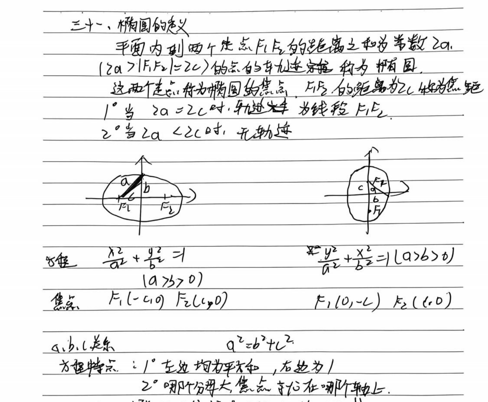
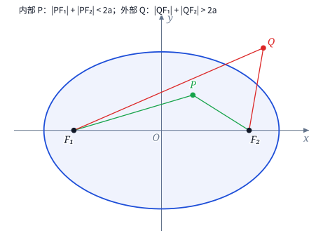

# 椭圆的定义与标准方程

> **原稿序号**：大写 二十一、 ｜ **原稿页码**：P9 ｜ **所属模块**：三、椭圆 → 1. 定义、标准方程与几何性质

**备注**：勘误提示：原稿焦点在 $y$ 轴上的那一行，$F_2$ 应为 $(0, c)$，原稿误写成了 $(c, 0)$。

## 补充：常数 $2a$ 与 $2c$ 的关系

第一定义 $|MF_1| + |MF_2| = 2a$ 要求 ==$2a > 2c = |F_1F_2|$==，否则轨迹不是椭圆：

| 条件 | 轨迹 |
| --- | --- |
| $2a > 2c$ | 椭圆 |
| $2a = 2c$ | ==线段 $F_1F_2$==（三角形两边之和等于第三边，$M$ 只能在线段上） |
| $2a < 2c$ | 不存在（两边之和大于第三边） |

## 补充：点与椭圆的位置关系（两种判法）

设点 $P(x_0, y_0)$，椭圆 $\frac{x^2}{a^2} + \frac{y^2}{b^2} = 1$，焦点 $F_1$、$F_2$。

| | 方程法 | 定义法 |
| --- | --- | --- |
| $P$ 在椭圆内 | $\frac{x_0^2}{a^2} + \frac{y_0^2}{b^2} < 1$ | $|PF_1| + |PF_2| < 2a$ |
| $P$ 在椭圆上 | $\frac{x_0^2}{a^2} + \frac{y_0^2}{b^2} = 1$ | $|PF_1| + |PF_2| = 2a$ |
| $P$ 在椭圆外 | $\frac{x_0^2}{a^2} + \frac{y_0^2}{b^2} > 1$ | $|PF_1| + |PF_2| > 2a$ |

**为什么定义法成立**：$P$ 在椭圆内时，延长 $F_1P$ 交椭圆于 $Q$，则 $|PF_2| < |PQ| + |QF_2|$（三角形两边之和大于第三边），所以

$$|PF_1| + |PF_2| < |PF_1| + |PQ| + |QF_2| = |QF_1| + |QF_2| = 2a$$

$P$ 在外部时，$F_1P$ 与椭圆交于 $Q$（$Q$ 在 $F_1$、$P$ 之间），同理 $|QF_2| < |QP| + |PF_2|$，得 $|PF_1| + |PF_2| > 2a$。

**怎么选**：给坐标用方程法；给的是到两焦点的距离（或能算出距离）用定义法。==方程法记「小于 1 在内」，定义法记「小于 2a 在内」==，方向一致。

**例**　直线 $y = kx + 1$ 与椭圆 $\frac{x^2}{5} + \frac{y^2}{m} = 1$ 恒有公共点，求 $m$ 的范围。

**解**：直线恒过 $(0, 1)$，对任意 $k$ 都有公共点 $\Leftrightarrow$ $(0, 1)$ 在椭圆内或椭圆上：$0 + \frac{1}{m} \le 1$，$m \ge 1$。又方程表示椭圆，$m > 0$ 且 ==$m \ne 5$==（$m = 5$ 是圆）。答案 $m \ge 1$ 且 $m \ne 5$，即 $[1, 5) \cup (5, +\infty)$。
