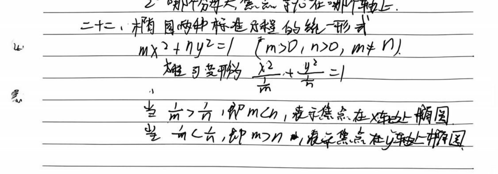

# 椭圆两种标准方程的统一形式

> **原稿序号**：大写 二十二、 ｜ **原稿页码**：P9 ｜ **所属模块**：三、椭圆 → 1. 定义、标准方程与几何性质

## 补充：方程表示椭圆的参数范围（易错）

**例**　方程 $\frac{x^2}{m - 1} + \frac{y^2}{3 - m} = 1$ 表示椭圆，求 $m$ 的范围；表示焦点在 $y$ 轴上的椭圆呢？

**解**：两个分母都为正，而且==不能相等==（相等时是圆）：

$$\begin{cases} m - 1 > 0 \\ 3 - m > 0 \\ m - 1 \ne 3 - m \end{cases} \;\Rightarrow\; 1 < m < 3 \text{ 且 } m \ne 2$$

焦点在 $y$ 轴上，要求 $y^2$ 的分母更大：$3 - m > m - 1 > 0$，得 ==$1 < m < 2$==。

用统一形式 $mx^2 + ny^2 = 1$ 说就是：表示椭圆 $\Leftrightarrow$ $m > 0$，$n > 0$，$m \ne n$；焦点在 $x$ 轴上 $\Leftrightarrow$ $0 < m < n$（系数小的那个对应的分母大）。
