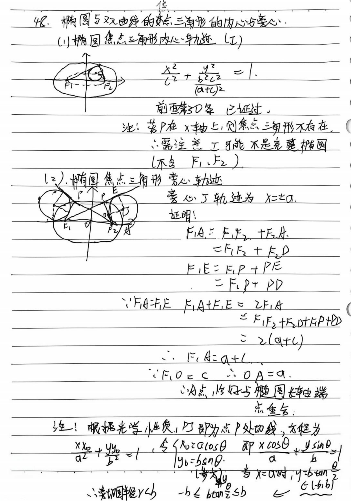
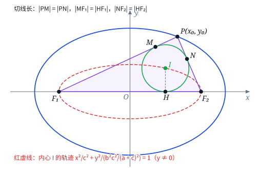

# 椭圆焦点三角形的内心与旁心轨迹

> **原稿序号**：小写 48、(1)(2) ｜ **原稿页码**：P53 ｜ **所属模块**：三、椭圆 → 2. 椭圆的焦点三角形、内心与旁心

**备注**：原稿 P53 说「第 30 条已证过」。第 30 条就是本小节上一条「椭圆的焦点三角形（全性质与完整证明）」（模块三第 2 小节第 1 条，原稿 P35–P38）；也可以在书末「原稿序号索引」里按「小写 30.」查到页码。

## 内心轨迹的完整证明（手写笔记整理）

> **来源**：手写笔记（照片），按原推导整理

设 $P(x_0, y_0)$（$y_0 \ne 0$）在椭圆上，$\triangle PF_1F_2$ 的内切圆圆心为 $I$，与 $PF_1$、$PF_2$、$F_1F_2$ 分别切于 $M$、$N$、$H$。

**第一步：横坐标（切线长）**。由焦半径公式 $|PF_1| = a + ex_0$，$|PF_2| = a - ex_0$；又切线长 $|PM| = |PN|$，$|MF_1| = |HF_1|$，$|NF_2| = |HF_2|$：

$$|PF_1| - |PF_2| = (a + ex_0) - (a - ex_0) = 2ex_0$$

$$|PF_1| - |PF_2| = |MF_1| - |NF_2| = |HF_1| - |HF_2| = (x_H + c) - (c - x_H) = 2x_H$$

所以 $x_H = ex_0$，而 $IH \perp x$ 轴，$x_I = x_H = ex_0$。

**第二步：纵坐标（面积算两遍）**。设内切圆半径为 $r$：

$$S_{\triangle PF_1F_2} = \frac{1}{2}(2a + 2c) \cdot r = \frac{1}{2} \cdot 2c \cdot |y_0| \;\Rightarrow\; r = \frac{c|y_0|}{a + c}$$

所以 $y_I = \frac{c}{a + c}y_0 = \frac{e}{1 + e}y_0$，即 ==$I\left(ex_0, \, \frac{e}{1 + e}y_0\right)$==。

**第三步：相关点法求轨迹**。设 $I(x, y)$：

$$\begin{cases} x = \frac{c}{a}x_0 \\ y = \frac{c}{a + c}y_0 \end{cases} \;\Rightarrow\; \begin{cases} x_0 = \frac{a}{c}x \\ y_0 = \frac{a + c}{c}y \end{cases}$$

代入 $\frac{x_0^2}{a^2} + \frac{y_0^2}{b^2} = 1$：

$$\frac{x^2}{c^2} + \frac{y^2}{\frac{b^2c^2}{(a + c)^2}} = 1 \quad (y \ne 0)$$

内心轨迹是以 $F_1$、$F_2$ 为长轴端点的小椭圆（去掉这两个点）。
