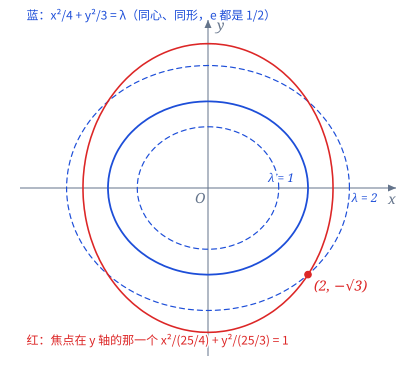
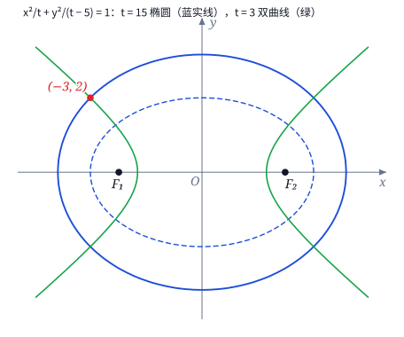

# 同离心率与共焦点的椭圆系（含设方程技巧）

> **来源**：补充专题（椭圆的曲线系方程 1/2） ｜ **适用模块**：三、椭圆

「曲线系」就是带一个参数的一族曲线。题目给的条件不够直接定出 $a$、$b$，但能看出所求椭圆和已知椭圆「同一家族」，就先按家族的样子设方程，只剩一个参数，代入一个点就能解出来。

## 一、离心率相同的椭圆系

$$\frac{x^2}{a^2} + \frac{y^2}{b^2} = \lambda \quad (\lambda > 0)$$

改写成 $\frac{x^2}{\lambda a^2} + \frac{y^2}{\lambda b^2} = 1$，长、短半轴和半焦距都乘了 $\sqrt{\lambda}$，比值不变，所以 ==这一族椭圆的离心率都等于原椭圆的离心率==。几何上看，它们是以原点为中心互相放缩得到的，形状完全一样（相似）。

**易错点**：「离心率相同」只定了形状，没定焦点在哪条轴上。题目没说焦点位置时，要把 $x^2$、$y^2$ 的分母对调再设一次，==分两种情况==。

**例 1**　求与椭圆 $\frac{x^2}{4} + \frac{y^2}{3} = 1$ 离心率相同，且过点 $(2, -\sqrt{3})$ 的椭圆方程。

**解**：

- 焦点在 $x$ 轴：设 $\frac{x^2}{4} + \frac{y^2}{3} = \lambda$，代入得 $\lambda = 1 + 1 = 2$，方程 $\frac{x^2}{8} + \frac{y^2}{6} = 1$。
- 焦点在 $y$ 轴：设 $\frac{y^2}{4} + \frac{x^2}{3} = \lambda$，代入得 $\lambda = \frac{3}{4} + \frac{4}{3} = \frac{25}{12}$，方程 $\frac{x^2}{\frac{25}{4}} + \frac{y^2}{\frac{25}{3}} = 1$。

两个都对，答案是 ==$\frac{x^2}{8} + \frac{y^2}{6} = 1$ 或 $\frac{4x^2}{25} + \frac{3y^2}{25} = 1$==。验证第二个：$a^2 = \frac{25}{3}$，$c^2 = \frac{25}{3} - \frac{25}{4} = \frac{25}{12}$，$e^2 = \frac{1}{4}$，与原椭圆相同。

## 二、焦点位置不定：$mx^2 + ny^2 = 1$

过两个已知点、焦点位置不知道时，设 $mx^2 + ny^2 = 1$（$m > 0$，$n > 0$，$m \ne n$），列一次方程组即可，$m < n$ 时焦点在 $x$ 轴。详见本模块第 1 小节「椭圆两种标准方程的统一形式」。

**例 2**　椭圆过 $(\sqrt{6}, 1)$、$(-\sqrt{3}, -\sqrt{2})$，求方程。

**解**：$6m + n = 1$，$3m + 2n = 1$，解得 $m = \frac{1}{9}$，$n = \frac{1}{3}$，方程 ==$\frac{x^2}{9} + \frac{y^2}{3} = 1$==。

## 三、共焦点的椭圆系

与 $\frac{x^2}{a^2} + \frac{y^2}{b^2} = 1$（$a > b > 0$）焦点相同的椭圆：

$$\frac{x^2}{a^2 + k} + \frac{y^2}{b^2 + k} = 1 \quad (k > -b^2)$$

两个分母之差恒为 $a^2 - b^2 = c^2$，所以焦点不动。$k$ 越大椭圆越「圆」（$e = \frac{c}{\sqrt{a^2 + k}}$ 越小）。如果 $-a^2 < k < -b^2$，第二个分母变负，得到的是==同焦点的双曲线==。

更省事的写法是只用焦距：焦点为 $(\pm c, 0)$ 时设 ==$\frac{x^2}{t} + \frac{y^2}{t - c^2} = 1$==，$t > c^2$ 是椭圆，$0 < t < c^2$ 是双曲线。

**例 3**　求与椭圆 $\frac{x^2}{9} + \frac{y^2}{4} = 1$ 有相同焦点，且过点 $(-3, 2)$ 的椭圆方程。

**解**：$c^2 = 5$，设 $\frac{x^2}{t} + \frac{y^2}{t - 5} = 1$，代入：

$$\frac{9}{t} + \frac{4}{t - 5} = 1 \;\Rightarrow\; t^2 - 18t + 45 = 0 \;\Rightarrow\; t = 15 \text{ 或 } t = 3$$

$t = 3 < 5$ 对应双曲线 $\frac{x^2}{3} - \frac{y^2}{2} = 1$，舍去；$t = 15$，所求椭圆为 ==$\frac{x^2}{15} + \frac{y^2}{10} = 1$==。

这也说明：==过平面上一点（不在坐标轴上），共焦点的椭圆和双曲线各恰有一条==，而且它们在这一点的切线互相垂直。共焦点椭圆与双曲线相交的全部结论见模块四「双曲线的曲线系方程（补充专题）」的「共焦点的曲线系」。

## 四、设方程技巧小结（椭圆）

| 已知条件 | 设法 | 注意 |
| --- | --- | --- |
| 焦点位置已知 | $\frac{x^2}{a^2} + \frac{y^2}{b^2} = 1$ | 普通待定系数 |
| 过两点，焦点位置不定 | $mx^2 + ny^2 = 1$ | $m > 0$，$n > 0$，$m \ne n$ |
| 与已知椭圆离心率相同 | $\frac{x^2}{a^2} + \frac{y^2}{b^2} = \lambda$ | ==焦点位置不定要分两种== |
| 与已知椭圆焦点相同 | $\frac{x^2}{a^2 + k} + \frac{y^2}{b^2 + k} = 1$ | $k > -b^2$ |
| 只知焦点 $(\pm c, 0)$ | $\frac{x^2}{t} + \frac{y^2}{t - c^2} = 1$ | $t > c^2$ 才是椭圆 |
