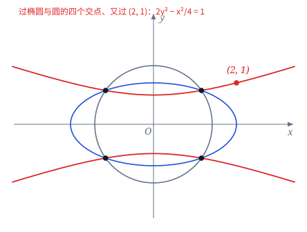
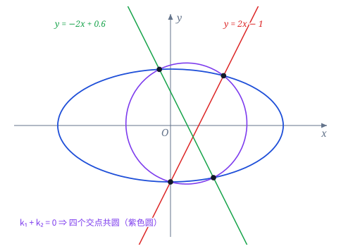

# 过交点的曲线系与四点共圆

> **来源**：补充专题（椭圆的曲线系方程 2/2） ｜ **适用模块**：三、椭圆

## 一、过两条曲线交点的曲线系

如果 $f_1(x, y) = 0$ 和 $f_2(x, y) = 0$ 有交点，那么

$$f_1(x, y) + \lambda f_2(x, y) = 0$$

表示一族曲线，==每一条都经过 $f_1 = 0$ 与 $f_2 = 0$ 的全部交点==（交点同时让 $f_1 = 0$、$f_2 = 0$，代进去当然是 $0$）。这一族不包括 $f_2 = 0$ 本身。直线系「过两直线交点」是它的特例。

**例 1**　求经过椭圆 $\frac{x^2}{4} + y^2 = 1$ 与圆 $x^2 + y^2 = 2$ 的所有交点，且过点 $(2, 1)$ 的曲线方程（二次曲线）。

**解**：设 $(x^2 + y^2 - 2) + \lambda\left(\frac{x^2}{4} + y^2 - 1\right) = 0$，代入 $(2, 1)$：$3 + \lambda \cdot 1 = 0$，$\lambda = -3$。整理得

$$\frac{x^2}{4} - 2y^2 + 1 = 0, \quad \text{即} \quad 2y^2 - \frac{x^2}{4} = 1$$

是一条焦点在 $y$ 轴上的双曲线。验证：两曲线交点满足 $x^2 = \frac{4}{3}$，$y^2 = \frac{2}{3}$，代入 $2 \cdot \frac{2}{3} - \frac{1}{3} = 1$。所求为 ==$2y^2 - \frac{x^2}{4} = 1$==。

## 二、四点共圆的判定：两直线斜率互为相反数

两条直线 $l_1$：$y = k_1x + m_1$，$l_2$：$y = k_2x + m_2$ 各与椭圆 $\frac{x^2}{a^2} + \frac{y^2}{b^2} = 1$ 交于两点，共四个点。

**结论**：==四个交点共圆 $\Leftrightarrow$ $k_1 + k_2 = 0$==（两直线都不垂直于坐标轴时）。

**证明**：把两条直线乘起来当作 $f_2$，过四个交点的曲线系为

$$\left(\frac{x^2}{a^2} + \frac{y^2}{b^2} - 1\right) + \lambda(k_1x - y + m_1)(k_2x - y + m_2) = 0$$

它是圆，要求 $xy$ 项系数为 $0$，且 $x^2$、$y^2$ 系数相等：

- $xy$ 项：$\lambda \cdot (-k_1 - k_2) = 0$，而 $\lambda = 0$ 时只剩椭圆，不是圆，所以 $k_1 + k_2 = 0$；
- $x^2$ 项 $\frac{1}{a^2} + \lambda k_1k_2$，$y^2$ 项 $\frac{1}{b^2} + \lambda$，令两者相等，$\lambda = \frac{\frac{1}{b^2} - \frac{1}{a^2}}{k_1k_2 - 1}$。$k_2 = -k_1$ 时分母 $-k_1^2 - 1 \ne 0$，$\lambda$ 一定能取到。

所以共圆必有 $k_1 + k_2 = 0$；反过来 $k_1 + k_2 = 0$ 时取上面的 $\lambda$，方程就是圆（四个交点都在上面）。==两直线的倾斜角互补==是它的几何说法。这个结论对双曲线、抛物线（把 $y^2$ 换成一次项，同样看 $xy$ 系数）也成立。

**例 2**　直线 $y = 2x - 1$ 和 $y = kx + m$ 分别与椭圆 $\frac{x^2}{4} + y^2 = 1$ 交于两点，若这四个点在同一个圆上，求 $k$。

**解**：由上面的结论，$k + 2 = 0$，==$k = -2$==（$m$ 只要让第二条直线与椭圆有两个交点即可）。

**小结**：过交点的曲线系在小题里主要就是这一个用法：看到「两条弦的四个端点共圆」，立刻想到==斜率互为相反数==。
