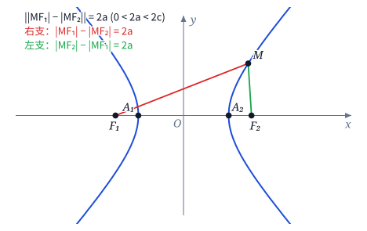
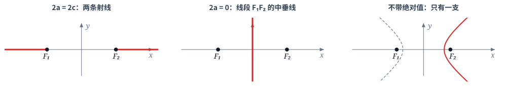
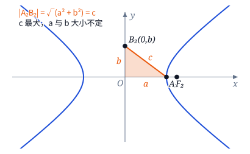
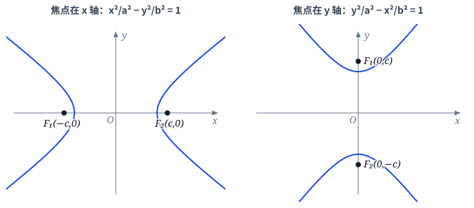
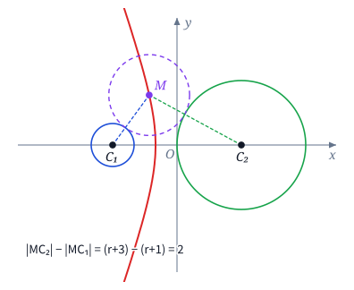
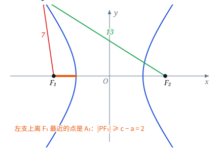

# 双曲线的定义与标准方程

> **来源**：电子笔记 ｜ **所属模块**：四、双曲线 → 1. 定义、标准方程与几何性质

## 一、第一定义

平面内与两个定点 $F_1$、$F_2$ 的==距离之差的绝对值等于常数 $2a$（$0 < 2a < |F_1F_2|$）==的点的轨迹叫双曲线。两个定点叫焦点，$|F_1F_2| = 2c$ 叫焦距。

$$\left||MF_1| - |MF_2|\right| = 2a, \quad 0 < 2a < 2c$$

- 去掉绝对值，就只剩一支：$|MF_1| - |MF_2| = 2a$ 表示==靠近 $F_2$ 的那一支==（右支），$|MF_2| - |MF_1| = 2a$ 表示靠近 $F_1$ 的那一支。
- 判断是哪一支：==离哪个焦点近就是哪一支==（差值为正的那一项对应的焦点离得远）。

### 常数 $2a$ 与 $2c$ 的关系（轨迹是什么）

| 条件 | 轨迹 |
| --- | --- |
| $0 < 2a < 2c$ | 双曲线（带绝对值两支，不带绝对值一支） |
| $2a = 2c$ | 以 $F_1$、$F_2$ 为端点、方向朝外的==两条射线==（不带绝对值时只有一条） |
| $2a > 2c$ | 不存在（三角形两边之差小于第三边） |
| $2a = 0$ | 线段 $F_1F_2$ 的中垂线 |

## 二、标准方程的推导

以 $F_1F_2$ 所在直线为 $x$ 轴、中点为原点建系，$F_1(-c, 0)$，$F_2(c, 0)$。由定义

$$\sqrt{(x + c)^2 + y^2} - \sqrt{(x - c)^2 + y^2} = \pm 2a$$

移项、平方、整理得 $cx - a^2 = \pm a\sqrt{(x - c)^2 + y^2}$，再平方：

$$(c^2 - a^2)x^2 - a^2y^2 = a^2(c^2 - a^2)$$

因为 $c > a$，令 ==$b^2 = c^2 - a^2$（$b > 0$）==，两边同除以 $a^2b^2$：

$$\frac{x^2}{a^2} - \frac{y^2}{b^2} = 1 \quad (a > 0, b > 0)$$

（第一步平方后得到的 $cx - a^2 = \pm a|MF_2|$ 其实就是第二定义：$|MF_2| = \frac{c}{a}\left|x - \frac{a^2}{c}\right|$，见本模块第 3、4 条。）

## 三、两种标准方程

| | 焦点在 $x$ 轴 | 焦点在 $y$ 轴 |
| --- | --- | --- |
| 方程 | $\frac{x^2}{a^2} - \frac{y^2}{b^2} = 1$ | $\frac{y^2}{a^2} - \frac{x^2}{b^2} = 1$ |
| 焦点 | $(\pm c, 0)$ | $(0, \pm c)$ |
| $a, b, c$ 关系 | ==$c^2 = a^2 + b^2$==，$c$ 最大 | 同左 |

- ==焦点位置看正号==：哪个平方项系数为正，焦点就在哪条轴上（椭圆是看分母大小，双曲线与分母大小无关）。
- $a$、$b$ 没有大小要求，$a$ 永远是正项下面的那个。
- 统一形式：$mx^2 + ny^2 = 1$（==$mn < 0$==）。$m > 0$ 焦点在 $x$ 轴，$n > 0$ 焦点在 $y$ 轴。不知道焦点在哪条轴时就这样设（见模块四第 4 节）。

### 与椭圆的对比

| | 椭圆 | 双曲线 |
| --- | --- | --- |
| 定义 | $|MF_1| + |MF_2| = 2a > 2c$ | $\left||MF_1| - |MF_2|\right| = 2a < 2c$ |
| 关系 | $a^2 = b^2 + c^2$，$a$ 最大 | $c^2 = a^2 + b^2$，$c$ 最大 |
| 焦点位置 | 看分母大小 | 看哪项为正 |
| 统一形式 | $mx^2 + ny^2 = 1$（$m, n > 0$，$m \ne n$） | $mx^2 + ny^2 = 1$（$mn < 0$） |

## 四、例题

**例 1（方程表示双曲线的条件）**　方程 $\frac{x^2}{m - 2} + \frac{y^2}{m + 1} = 1$ 表示双曲线，求 $m$ 的范围；焦点能在 $x$ 轴上吗？

**解**：两个分母异号：$(m - 2)(m + 1) < 0$，==$-1 < m < 2$==。此时 $m - 2 < 0 < m + 1$，$y^2$ 项为正，所以焦点只能在 $y$ 轴上，不可能在 $x$ 轴上。

**例 2（定义判轨迹）**　圆 $C_1: (x + 3)^2 + y^2 = 1$，$C_2: (x - 3)^2 + y^2 = 9$，动圆 $M$ 与两圆都外切，求圆心 $M$ 的轨迹方程。

**解**：设动圆半径 $r$，则 $|MC_1| = r + 1$，$|MC_2| = r + 3$，相减 $|MC_2| - |MC_1| = 2 < 6 = |C_1C_2|$。轨迹是以 $C_1$、$C_2$ 为焦点的双曲线中==靠近 $C_1$ 的一支==（左支），$a = 1$，$c = 3$，$b^2 = 8$：

$$x^2 - \frac{y^2}{8} = 1 \quad (x \le -1)$$

**例 3（定义求焦半径，易错）**　$P$ 在双曲线 $\frac{x^2}{9} - \frac{y^2}{16} = 1$ 上，$|PF_1| = 7$，求 $|PF_2|$。

**解**：$a = 3$，$c = 5$，$\left||PF_1| - |PF_2|\right| = 6$，得 $|PF_2| = 13$ 或 $1$。但双曲线上的点到焦点的距离 ==$\ge c - a = 2$==，所以 $|PF_2| = 1$ 舍去，==$|PF_2| = 13$==（$P$ 在左支，$P(-6, \pm 4\sqrt{3})$）。

> 凡是「已知一个焦半径求另一个」，算出两个值后都要用 $|PF| \ge c - a$ 检验。
