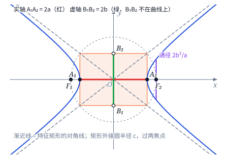
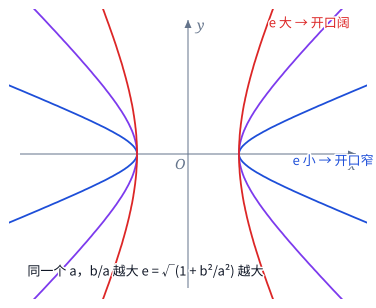
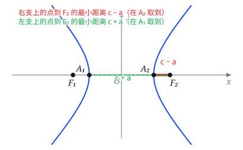

# 双曲线的简单几何性质

> **来源**：电子笔记 ｜ **所属模块**：四、双曲线 → 1. 定义、标准方程与几何性质

以 $\frac{x^2}{a^2} - \frac{y^2}{b^2} = 1$（$a > 0, b > 0$）为例，$c^2 = a^2 + b^2$。

## 一、六条基本性质

1. **范围**：$\frac{x^2}{a^2} = 1 + \frac{y^2}{b^2} \ge 1$，所以 ==$x \le -a$ 或 $x \ge a$==，$y$ 可取任意实数。两支之间（$-a < x < a$）没有点。
2. **对称性**：关于 $x$ 轴、$y$ 轴、原点都对称；原点叫双曲线的中心。
3. **顶点**：$A_1(-a, 0)$、$A_2(a, 0)$。双曲线只有两个顶点；$B_1(0, -b)$、$B_2(0, b)$ ==不在双曲线上==。
4. **实轴与虚轴**：线段 $A_1A_2$ 叫实轴，长 $2a$；线段 $B_1B_2$ 叫虚轴，长 $2b$。$a$、$b$ 分别叫实半轴长、虚半轴长。
5. **渐近线**：==$y = \pm \frac{b}{a}x$==。以实轴、虚轴为中线的矩形（四个顶点 $(\pm a, \pm b)$）叫特征矩形，两条渐近线就是它的对角线；矩形的半对角线长 $\sqrt{a^2 + b^2} = c$，所以==外接圆 $x^2 + y^2 = c^2$ 过两个焦点==。渐近线的全部性质见本模块第 2 节。
6. **离心率**：$e = \frac{c}{a}$，==$e > 1$==。

$$e = \frac{c}{a} = \sqrt{1 + \frac{b^2}{a^2}}, \quad \quad \frac{b}{a} = \sqrt{e^2 - 1}$$

$e$ 越大，$\frac{b}{a}$ 越大，渐近线越陡，==开口越阔==；$e$ 越接近 $1$，开口越窄。

## 二、常用的几个量

| 量 | 结果 | 说明 |
| --- | --- | --- |
| 焦点到渐近线的距离 | ==$b$== | $\frac{|bc|}{\sqrt{a^2 + b^2}} = b$，见第 2 节 |
| 顶点到渐近线的距离 | $\frac{ab}{c}$ | |
| 通径（过焦点垂直于实轴的弦） | ==$\frac{2b^2}{a}$== | 把 $x = c$ 代入得 $y = \pm \frac{b^2}{a}$ |
| 准线 | $x = \pm \frac{a^2}{c}$ | 见第 4 条 |
| 焦准距 | $\frac{b^2}{c}$ | 见第 4 条 |
| 同支焦半径最小值 | ==$c - a$== | 在顶点取到 |
| 异支焦半径最小值 | $c + a$ | 在另一支顶点取到 |

由焦半径公式（模块六第 1 节）：右支上 $|PF_2| = ex_0 - a \ge ea - a = c - a$，$|PF_1| = ex_0 + a \ge c + a$。所以==双曲线上的点到焦点距离的取值范围是 $[c - a, +\infty)$==，这是检验「算出两个焦半径」时用的条件。

## 三、两种方程的性质对照

| 性质 | $\frac{x^2}{a^2} - \frac{y^2}{b^2} = 1$ | $\frac{y^2}{a^2} - \frac{x^2}{b^2} = 1$ |
| --- | --- | --- |
| 范围 | $x \le -a$ 或 $x \ge a$ | $y \le -a$ 或 $y \ge a$ |
| 顶点 | $(\pm a, 0)$ | $(0, \pm a)$ |
| 焦点 | $(\pm c, 0)$ | $(0, \pm c)$ |
| 渐近线 | $y = \pm \frac{b}{a}x$ | ==$y = \pm \frac{a}{b}x$== |
| 准线 | $x = \pm \frac{a^2}{c}$ | $y = \pm \frac{a^2}{c}$ |
| 离心率 | $e = \frac{c}{a} > 1$ | 同左 |

渐近线不用背两套：==把方程右边的 $1$ 换成 $0$==，$\frac{y^2}{a^2} - \frac{x^2}{b^2} = 0$ 就得 $y = \pm \frac{a}{b}x$。

## 四、例题

**例**　求双曲线 $9y^2 - 16x^2 = 144$ 的实轴长、虚轴长、顶点、焦点、离心率、渐近线、通径。

**解**：化成标准式 $\frac{y^2}{16} - \frac{x^2}{9} = 1$，焦点在 $y$ 轴，$a = 4$，$b = 3$，$c = 5$。实轴长 $8$，虚轴长 $6$；顶点 $(0, \pm 4)$；焦点 $(0, \pm 5)$；$e = \frac{5}{4}$；渐近线 ==$y = \pm \frac{4}{3}x$==（不是 $\pm \frac{3}{4}x$）；通径 $\frac{2b^2}{a} = \frac{9}{2}$。
