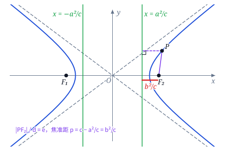
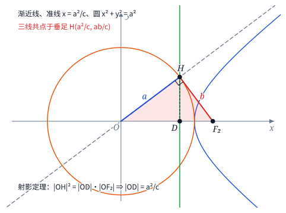
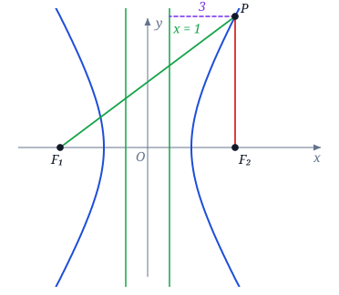

# 双曲线准线方程与焦准距

> **来源**：电子笔记 ｜ **所属模块**：四、双曲线 → 1. 定义、标准方程与几何性质

（与椭圆第 5 条「椭圆准线方程与焦准距」对照着看；第二定义见上一条。）

## 一、准线方程

| 方程 | 焦点 | 准线 |
| --- | --- | --- |
| $\frac{x^2}{a^2} - \frac{y^2}{b^2} = 1$ | $F_1(-c, 0)$、$F_2(c, 0)$ | 左准线 $x = -\frac{a^2}{c}$，右准线 ==$x = \frac{a^2}{c}$== |
| $\frac{y^2}{a^2} - \frac{x^2}{b^2} = 1$ | $F_1(0, -c)$、$F_2(0, c)$ | 下准线 $y = -\frac{a^2}{c}$，上准线 $y = \frac{a^2}{c}$ |

- ==准线和焦点「左对左、右对右」==：第二定义 $\frac{|PF|}{d} = e$ 中，$F$ 与 $d$ 必须是同侧的焦点和准线。
- 因为 $c > a$，所以 $\frac{a^2}{c} < a$：==双曲线的准线在两个顶点之间==（夹在两支中间）；椭圆的准线在椭圆外，这是两者的区别。
- 中心到准线的距离 $\frac{a^2}{c}$，两准线间的距离 $\frac{2a^2}{c}$。

## 二、焦准距

焦点到相应准线的距离叫焦准距（也叫焦参数），记作 $p$：

$$p = c - \frac{a^2}{c} = \frac{c^2 - a^2}{c} = \frac{b^2}{c}$$

和椭圆完全同形：椭圆 $p = \frac{a^2}{c} - c = \frac{b^2}{c}$，抛物线 $p$ 就是方程 $y^2 = 2px$ 里的 $p$。

==三种曲线的半通径都等于 $ep$==：双曲线 $e \cdot p = \frac{c}{a} \cdot \frac{b^2}{c} = \frac{b^2}{a}$，正是半通径（通径 $\frac{2b^2}{a}$）。焦半径的角度公式 $|PF| = \frac{ep}{1 - e\cos \theta}$ 中的 $ep$ 就是它（模块六第 2 节）。

## 三、用第二定义写焦半径

$P(x_0, y_0)$ 在右支上，到右准线的距离 $d = x_0 - \frac{a^2}{c}$，所以

$$|PF_2| = e\left(x_0 - \frac{a^2}{c}\right) = ex_0 - a, \quad |PF_1| = e\left(x_0 + \frac{a^2}{c}\right) = ex_0 + a$$

左支上 $|PF_1| = -ex_0 - a$，$|PF_2| = -ex_0 + a$。这就是模块六第 1 节双曲线焦半径坐标公式的由来。

## 四、准线与渐近线的交点：三线共点

过焦点 $F_2$ 作渐近线 $y = \frac{b}{a}x$ 的垂线，垂足为 $H$，则

$$H\left(\frac{a^2}{c}, \frac{ab}{c}\right), \quad |OH| = a, \quad |F_2H| = b$$

所以 ==$H$ 同时在渐近线、右准线 $x = \frac{a^2}{c}$、圆 $x^2 + y^2 = a^2$ 上==（三线共点）。

**证明**：$|F_2H|$ 是焦点到渐近线的距离 $\frac{bc}{\sqrt{a^2 + b^2}} = b$，在直角三角形 $OHF_2$ 中 $|OH| = \sqrt{c^2 - b^2} = a$，所以 $H$ 在圆 $x^2 + y^2 = a^2$ 上。作 $HD \perp x$ 轴于 $D$，由射影定理

$$|OD| = \frac{|OH|^2}{|OF_2|} = \frac{a^2}{c}, \quad |DF_2| = \frac{|F_2H|^2}{|OF_2|} = \frac{b^2}{c}, \quad |HD| = \frac{|OH| \cdot |HF_2|}{|OF_2|} = \frac{ab}{c}$$

$|OD| = \frac{a^2}{c}$ 说明 $H$ 在右准线上，而 $|DF_2| = \frac{b^2}{c}$ 恰好就是焦准距。==这个直角三角形 $OHF_2$（三边 $a$、$b$、$c$）是双曲线最重要的特征三角形==，第 2 节会专门讲它。

## 五、例题

**例**　双曲线 $\frac{x^2}{4} - \frac{y^2}{12} = 1$ 右支上一点 $P$ 到右准线的距离为 $3$，求 $|PF_2|$ 与 $|PF_1|$。

**解**：$a = 2$，$c = 4$，$e = 2$，右准线 $x = 1$。由第二定义 ==$|PF_2| = e \cdot d = 6$==，再由第一定义 $|PF_1| = |PF_2| + 2a = 10$。（也可先求 $x_0 = 1 + 3 = 4$，用 $|PF_2| = ex_0 - a = 6$ 检验。）
