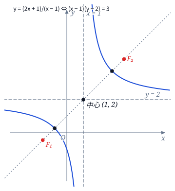
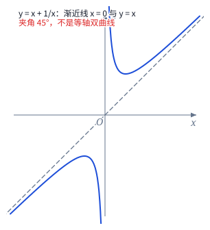
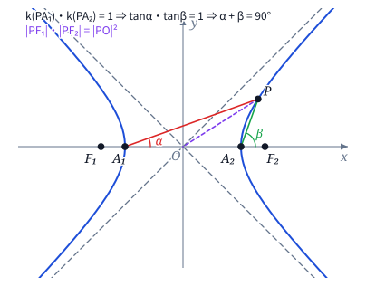
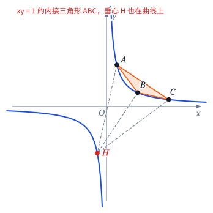
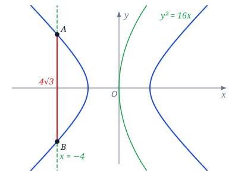

# 等轴双曲线：几种形式与全部性质

> **来源**：电子笔记 ｜ **所属模块**：四、双曲线 → 2. 渐近线与等轴双曲线

## 一、定义与三个等价条件

实轴长与虚轴长相等（$a = b$）的双曲线叫等轴双曲线。下面三条互相等价，题目给出任何一条都要想到另外两条：

$$a = b \;\Leftrightarrow\; e = \sqrt{2} \;\Leftrightarrow\; \text{两条渐近线互相垂直}$$

（$e = \sqrt{1 + \frac{b^2}{a^2}} = \sqrt{2}$；渐近线 $y = \pm x$ 斜率之积为 $-1$。）还有 $c = \sqrt{2}a$，特征矩形是正方形。

## 二、几种形式（全部要认得出）

| 形式 | 中心 | 渐近线 | 实轴所在直线 | 说明 |
| --- | --- | --- | --- | --- |
| $x^2 - y^2 = \lambda$（$\lambda > 0$） | 原点 | $y = \pm x$ | $x$ 轴 | $a^2 = b^2 = \lambda$，焦点 $(\pm \sqrt{2\lambda}, 0)$ |
| $x^2 - y^2 = \lambda$（$\lambda < 0$） | 原点 | $y = \pm x$ | $y$ 轴 | 即 $y^2 - x^2 = -\lambda$ |
| ==$xy = k$==（$k > 0$） | 原点 | 两条坐标轴 | $y = x$ | 反比例函数 $y = \frac{k}{x}$ 的图像 |
| $xy = k$（$k < 0$） | 原点 | 两条坐标轴 | $y = -x$ | 图像在二、四象限 |
| $(x - h)^2 - (y - m)^2 = \lambda$ | $(h, m)$ | $y - m = \pm(x - h)$ | 平行于坐标轴 | 平移 |
| ==$y = \frac{ax + b}{cx + d}$==（$c \ne 0$，$ad \ne bc$） | $\left(-\frac{d}{c}, \frac{a}{c}\right)$ | $x = -\frac{d}{c}$，$y = \frac{a}{c}$ | 斜 $45^\circ$ | 分式函数（一次比一次） |

### 1. 反比例函数 $xy = k$ 为什么是等轴双曲线

把坐标轴旋转 $45^\circ$：令 $x = \frac{X - Y}{\sqrt{2}}$，$y = \frac{X + Y}{\sqrt{2}}$，则 $xy = \frac{X^2 - Y^2}{2}$，$xy = k$ 变成

$$X^2 - Y^2 = 2k$$

所以 $k > 0$ 时 ==$a = b = \sqrt{2k}$，$c = 2\sqrt{k}$==：

- 顶点 $(\sqrt{k}, \sqrt{k})$、$(-\sqrt{k}, -\sqrt{k})$（到原点距离 $\sqrt{2k}$）；
- 焦点 ==$(\sqrt{2k}, \sqrt{2k})$、$(-\sqrt{2k}, -\sqrt{2k})$==（到原点距离 $2\sqrt{k}$）；
- 实轴长 $2\sqrt{2k}$，焦距 $4\sqrt{k}$。

例如 $y = \frac{1}{x}$：顶点 $(1, 1)$、$(-1, -1)$，焦点 $(\sqrt{2}, \sqrt{2})$、$(-\sqrt{2}, -\sqrt{2})$，实轴长 $2\sqrt{2}$。

### 2. 分式函数是平移后的反比例函数

$$y = \frac{ax + b}{cx + d} = \frac{a}{c} + \frac{bc - ad}{c^2} \cdot \frac{1}{x + \frac{d}{c}} \;\Leftrightarrow\; \left(x + \frac{d}{c}\right)\left(y - \frac{a}{c}\right) = \frac{bc - ad}{c^2}$$

==中心 $\left(-\frac{d}{c}, \frac{a}{c}\right)$，渐近线 $x = -\frac{d}{c}$、$y = \frac{a}{c}$==，是 $XY = k'$ 型等轴双曲线平移所得，图像关于中心成中心对称。

### 3. 易混：对勾函数也是双曲线，但不是等轴的

$y = x + \frac{1}{x}$ 的渐近线是 $x = 0$ 和 $y = x$，两条渐近线夹角 $45^\circ$，它是双曲线（实轴在两渐近线夹角的平分线上），但==不是等轴双曲线==。一般地 $y = mx + \frac{n}{x}$（$mn \ne 0$）都是双曲线，渐近线为 $x = 0$ 与 $y = mx$。

## 三、等轴双曲线的性质（以 $x^2 - y^2 = a^2$ 为例）

把一般双曲线的结论代入 $a = b$ 就得到下面这些，但其中几条形式特别漂亮，要单独记：

1. ==$e = \sqrt{2}$==，$c = \sqrt{2}a$，渐近线 $y = \pm x$ 互相垂直。
2. **第三定义**：$P$ 在双曲线上，==$k_{PA_1} \cdot k_{PA_2} = 1$==（一般是 $\frac{b^2}{a^2}$）。所以 $P$ 在第一象限时，$PA_1$、$PA_2$ 的==倾斜角 $\alpha$、$\beta$ 互余==：$\tan \alpha \tan \beta = 1 \Rightarrow \alpha + \beta = 90^\circ$。
3. **垂径定理**：弦 $AB$ 中点为 $M$，==$k_{OM} \cdot k_{AB} = 1$==。
4. **焦半径之积**：==$|PF_1| \cdot |PF_2| = |PO|^2$==。证：右支上 $|PF_1| = \sqrt{2}x_0 + a$，$|PF_2| = \sqrt{2}x_0 - a$，乘积 $2x_0^2 - a^2$；而 $|PO|^2 = x_0^2 + y_0^2 = x_0^2 + (x_0^2 - a^2) = 2x_0^2 - a^2$。
5. **焦点三角形面积**：$S = \frac{b^2}{\tan \frac{\theta}{2}} = \frac{a^2}{\tan \frac{\theta}{2}}$；==$\angle F_1PF_2 = 90^\circ$ 时 $S = a^2$==。
6. **渐近线性质**：焦点到渐近线距离 $= a$；点到两渐近线距离之积 $= \frac{a^2}{2}$；平行四边形面积 $= \frac{a^2}{2}$；切线三角形面积 $= a^2$。
7. **垂心性质**：==等轴双曲线的内接三角形，其垂心也在这条双曲线上==。

**性质 7 的证明**（用 $xy = 1$ 最简单）：设 $A\left(x_1, \frac{1}{x_1}\right)$、$B\left(x_2, \frac{1}{x_2}\right)$、$C\left(x_3, \frac{1}{x_3}\right)$。$k_{BC} = \frac{\frac{1}{x_3} - \frac{1}{x_2}}{x_3 - x_2} = -\frac{1}{x_2x_3}$，所以过 $A$ 的高线斜率为 $x_2x_3$：

$$y - \frac{1}{x_1} = x_2x_3(x - x_1)$$

验证点 $H\left(-\frac{1}{x_1x_2x_3}, -x_1x_2x_3\right)$：左边 $-x_1x_2x_3 - \frac{1}{x_1}$，右边 $x_2x_3 \cdot \left(-\frac{1}{x_1x_2x_3} - x_1\right) = -\frac{1}{x_1} - x_1x_2x_3$，相等。由对称性 $H$ 也在另外两条高线上，所以 $H$ 是垂心，且 $x_H \cdot y_H = 1$，==$H$ 在双曲线上==。

## 四、例题

**例 1**　中心在原点、焦点在 $x$ 轴上的等轴双曲线 $C$ 与抛物线 $y^2 = 16x$ 的准线交于 $A$、$B$ 两点，$|AB| = 4\sqrt{3}$，求 $C$ 的实轴长。

**解**：设 $C: x^2 - y^2 = \lambda$（$\lambda > 0$），准线 $x = -4$，代入得 $y^2 = 16 - \lambda$，$|AB| = 2\sqrt{16 - \lambda} = 4\sqrt{3}$，$\lambda = 4$，所以 $a = 2$，==实轴长为 $4$==。

**例 2**　求函数 $y = \frac{2x + 1}{x - 1}$ 图像（双曲线）的中心、渐近线与焦点。

**解**：$y = 2 + \frac{3}{x - 1}$，即 $(x - 1)(y - 2) = 3$，是 $XY = 3$ 平移所得。中心 $(1, 2)$，渐近线 $x = 1$、$y = 2$；$XY = 3$ 的焦点为 $(\sqrt{6}, \sqrt{6})$、$(-\sqrt{6}, -\sqrt{6})$，平移后焦点为 ==$(1 + \sqrt{6}, 2 + \sqrt{6})$、$(1 - \sqrt{6}, 2 - \sqrt{6})$==。

**例 3**　$P$ 是等轴双曲线 $x^2 - y^2 = a^2$ 右支上第一象限内的点，$A_1$、$A_2$ 是左、右顶点，若 $\angle PA_2x = 2\angle PA_1A_2$，求 $\angle A_1PA_2$。

**解**：设 $\angle PA_1A_2 = \alpha$，$\angle PA_2x = \beta = 2\alpha$。由性质 2，$\alpha + \beta = 90^\circ$，所以 $\alpha = 30^\circ$，$\beta = 60^\circ$，==$\angle A_1PA_2 = \beta - \alpha = 30^\circ$==。
