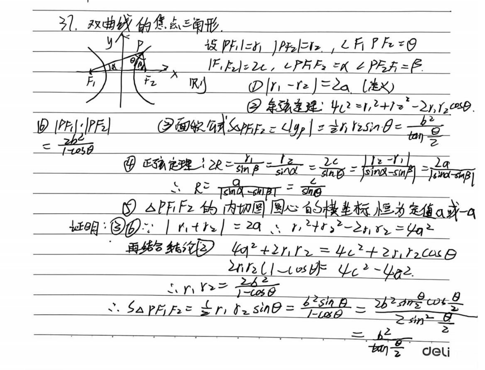
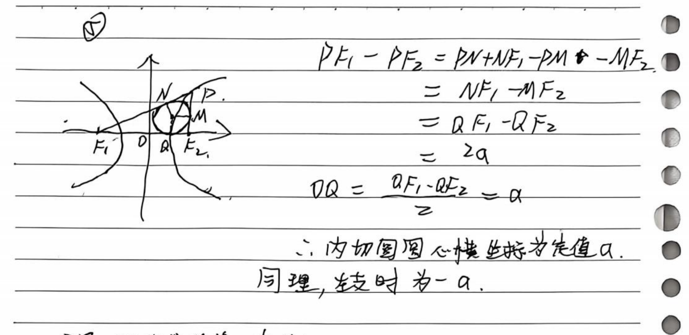
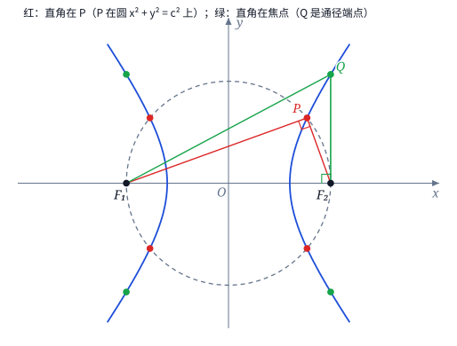

# 双曲线的焦点三角形（含内心横坐标证明、范围与直角情形）

> **原稿序号**：小写 37. ｜ **原稿页码**：P38-P39 ｜ **所属模块**：四、双曲线 → 3. 双曲线的焦点三角形、共焦点与双切圆

## 补充：范围类结论（与椭圆第 30 条对照）

设 $P(x_0, y_0)$ 在双曲线 $\frac{x^2}{a^2} - \frac{y^2}{b^2} = 1$ 上，$\angle F_1PF_2 = \theta$。

**1. 焦点数量积**

$$\overrightarrow{PF_1} \cdot \overrightarrow{PF_2} = (-c - x_0)(c - x_0) + y_0^2 = |PO|^2 - c^2$$

双曲线上 $|PO| \ge a$（顶点处取等），所以 ==$\overrightarrow{PF_1} \cdot \overrightarrow{PF_2} \ge a^2 - c^2 = -b^2$==，没有最大值。（椭圆是 $[b^2 - c^2, b^2]$，见模块六「坐标与参数型最值」。）

**2. 顶角 $\theta$ 没有最大值，能取遍 $(0, \pi)$**

不妨设 $P$ 在右支，$|PF_1| \cdot |PF_2| = (ex_0 + a)(ex_0 - a) = e^2x_0^2 - a^2$。余弦定理：

$$\cos \theta = \frac{|PF_1|^2 + |PF_2|^2 - 4c^2}{2|PF_1||PF_2|} = \frac{(|PF_1| - |PF_2|)^2 + 2|PF_1||PF_2| - 4c^2}{2|PF_1||PF_2|} = 1 - \frac{2b^2}{e^2x_0^2 - a^2}$$

$x_0$ 从 $a$ 增大到 $+\infty$，$\cos \theta$ 从 $-1$ 增大到趋近 $1$，$\theta$ 从 $\pi$（顶点处退化）一路减小到趋近 $0$。所以 ==$\theta$ 能取 $(0, \pi)$ 内任何值==，不像椭圆在短轴端点处有最大值。

**3. 直角三角形的两种情况**

- **直角在 $P$**：$PF_1 \perp PF_2$ $\Leftrightarrow$ $|PO| = c$，$P$ 在圆 $x^2 + y^2 = c^2$ 上。因为 $c > a$，这个圆==一定==与双曲线交于 $4$ 个点，$|y_P| = \frac{b^2}{c}$，面积 $S = \frac{b^2}{\tan 45^\circ} = b^2$。（椭圆要 $e \ge \frac{\sqrt{2}}{2}$ 才有。）
- **直角在焦点**：$PF_2 \perp x$ 轴，$P$ 是通径端点 $\left(c, \pm \frac{b^2}{a}\right)$，$|PF_2| = \frac{b^2}{a}$，$|PF_1| = \frac{b^2}{a} + 2a$，面积 $S = c \cdot \frac{b^2}{a}$。两个焦点共 $4$ 个点。

所以使 $\triangle PF_1F_2$ 为直角三角形的点 $P$ ==恒有 $8$ 个==。做题时「直角三角形」没说直角在哪，两种都要讨论。
