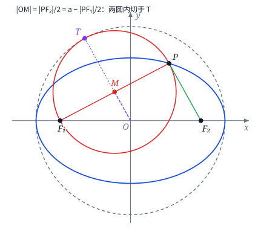

# 椭圆焦半径公式的坐标表示

> **原稿序号**：小写 10. ｜ **原稿页码**：P24 ｜ **所属模块**：四、焦半径、焦点弦与通径 → 1. 焦半径公式（坐标表示）

## 补充：焦半径的范围与以焦半径为直径的圆

**焦半径的范围**：由 $|PF_1| = a + ex_0$，$-a \le x_0 \le a$，得

$$a - c \le |PF_1| \le a + c$$

==长轴端点处取到最值==：离焦点近的顶点处最小 $a - c$，远的顶点处最大 $a + c$。小题里「椭圆上到焦点距离的最大值、最小值」就是这两个数，比如已知最大值与最小值之比求离心率：$\frac{a + c}{a - c} = 3 \Rightarrow e = \frac{1}{2}$。

**以焦半径为直径的圆**：==以 $PF_1$ 为直径的圆与以长轴为直径的圆 $x^2 + y^2 = a^2$ 内切==。

**证明**：设 $M$ 为 $PF_1$ 中点，$O$ 为 $F_1F_2$ 中点，$OM$ 是 $\triangle PF_1F_2$ 的中位线：

$$|OM| = \frac{1}{2}|PF_2| = \frac{1}{2}(2a - |PF_1|) = a - \frac{1}{2}|PF_1|$$

圆心距等于两半径之差（$a$ 减去小圆半径 $\frac{1}{2}|PF_1|$），所以两圆内切。
