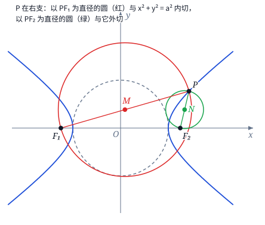

# 双曲线焦半径公式的坐标表示

> **原稿序号**：小写 11. ｜ **原稿页码**：P25 ｜ **所属模块**：四、焦半径、焦点弦与通径 → 1. 焦半径公式（坐标表示）

## 补充：焦半径的范围与以焦半径为直径的圆

**焦半径的范围**：$P$ 在右支上时 $|PF_2| = ex_0 - a$，$x_0 \ge a$，所以 $|PF_2| \ge c - a$；$|PF_1| = ex_0 + a \ge a + c$。综合两支：

$$|PF| \ge c - a$$

==最小值 $c - a$ 在离该焦点近的那个顶点处取到，没有最大值==。已知一条焦半径求另一条时，算出的两个值都要用它检验（模块三第 2 节「双曲线的定义与标准方程」例 3）。

**以焦半径为直径的圆**：与以实轴为直径的圆 $x^2 + y^2 = a^2$ ==相切==。$P$ 在右支上时：

- 以 $PF_1$（远焦点）为直径的圆，圆心 $M$，$|OM| = \frac{1}{2}|PF_2| = \frac{1}{2}(|PF_1| - 2a) = \frac{1}{2}|PF_1| - a$，等于两半径之差，==内切==；
- 以 $PF_2$（近焦点）为直径的圆，圆心 $N$，$|ON| = \frac{1}{2}|PF_1| = \frac{1}{2}|PF_2| + a$，等于两半径之和，==外切==。

对比椭圆：椭圆两个焦半径为直径的圆都与 $x^2 + y^2 = a^2$ 内切。
