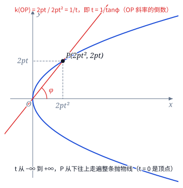
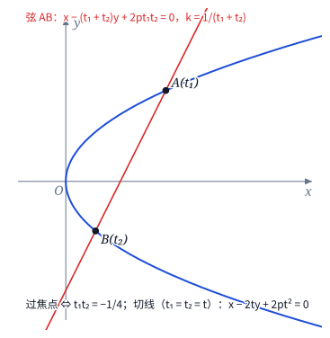
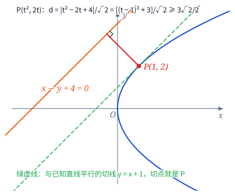

# 抛物线的参数方程（含几何意义）

> **来源**：电子笔记 ｜ **所属模块**：五、抛物线 → 1. 定义、标准方程与几何性质

（与圆、椭圆、双曲线的参数方程对照着看：圆和椭圆的参数是角，双曲线的参数也是角（$\frac{1}{\cos \theta}$、$\tan \theta$ 型），抛物线的参数是==斜率的倒数==。）

## 一、参数方程

$$y^2 = 2px \;\Rightarrow\; \begin{cases} x = 2pt^2 \\ y = 2pt \end{cases} \quad (t \text{ 为参数，取全体实数})$$

**推导**：设 $P(x, y)$（$P \ne O$），令 $t = \frac{x}{y}$，即 $\frac{1}{t}$ 是直线 $OP$ 的斜率。代入 $y^2 = 2px$：$y^2 = 2pty$，得 $y = 2pt$，$x = ty = 2pt^2$。$t = 0$ 对应顶点 $O$。

**几何意义**：==$t$ 是直线 $OP$ 斜率的倒数==，$t = \frac{1}{\tan \varphi}$（$\varphi$ 为 $OP$ 的倾斜角）。$t$ 从 $-\infty$ 增到 $+\infty$，点 $P$ 从下往上走遍整条抛物线。

**其他三种开口**：

| 方程 | 参数方程 | $t$ 的意义 |
| --- | --- | --- |
| $y^2 = 2px$ | $x = 2pt^2$，$y = 2pt$ | $\frac{1}{k_{OP}}$ |
| $y^2 = -2px$ | $x = -2pt^2$，$y = 2pt$ | $-\frac{1}{k_{OP}}$ |
| $x^2 = 2py$ | $x = 2pt$，$y = 2pt^2$ | ==$k_{OP}$== |
| $x^2 = -2py$ | $x = 2pt$，$y = -2pt^2$ | $-k_{OP}$ |

**常用变形**：$y^2 = 4x$ 常写成 $x = t^2$，$y = 2t$（此时 $t = \frac{y}{2}$）；$x^2 = 4y$ 写成 $x = 2t$，$y = t^2$。做题时也常直接「设纵不设横」：$P\left(\frac{y_0^2}{2p}, y_0\right)$，本质相同。

## 二、四种曲线的参数方程对照

| 曲线 | 参数方程 | 参数的意义 |
| --- | --- | --- |
| 圆 $(x - a)^2 + (y - b)^2 = r^2$ | $x = a + r\cos \theta$，$y = b + r\sin \theta$ | 半径的旋转角 |
| 椭圆 $\frac{x^2}{a^2} + \frac{y^2}{b^2} = 1$ | $x = a\cos \theta$，$y = b\sin \theta$ | 离心角（不是 $\angle xOP$） |
| 双曲线 $\frac{x^2}{a^2} - \frac{y^2}{b^2} = 1$ | $x = \frac{a}{\cos \theta}$，$y = b\tan \theta$ | 离心角 |
| 抛物线 $y^2 = 2px$ | $x = 2pt^2$，$y = 2pt$ | $OP$ 斜率的倒数 |

## 三、用参数表示弦和切线

设 $A(2pt_1^2, 2pt_1)$，$B(2pt_2^2, 2pt_2)$：

- 弦 $AB$ 的斜率 $k_{AB} = \frac{2pt_1 - 2pt_2}{2pt_1^2 - 2pt_2^2}$ = ==$\frac{1}{t_1 + t_2}$==；
- 弦 $AB$ 的方程 ==$x - (t_1 + t_2)y + 2pt_1t_2 = 0$==（代入 $A$、$B$ 直接验证）；
- 令 $t_1 = t_2 = t$ 得 $P(t)$ 处的切线 $x - 2ty + 2pt^2 = 0$，斜率 $\frac{1}{2t}$；
- 弦 $AB$ 过焦点 $\left(\frac{p}{2}, 0\right)$ $\Leftrightarrow$ $\frac{p}{2} + 2pt_1t_2 = 0$ $\Leftrightarrow$ ==$t_1t_2 = -\frac{1}{4}$==，换回坐标就是 $y_1y_2 = 4p^2t_1t_2 = -p^2$（焦点弦性质 ⑦）。
- 弦 $AB$ 过 $(m, 0)$ $\Leftrightarrow$ $t_1t_2 = -\frac{m}{2p}$；$OA \perp OB$ $\Leftrightarrow$ $\frac{1}{t_1} \cdot \frac{1}{t_2} = -1$ $\Leftrightarrow$ $t_1t_2 = -1$，对应 $m = 2p$（见第 2 节「直角弦」）。

## 四、应用：最值

**例**　$P$ 在抛物线 $y^2 = 4x$ 上，求 $P$ 到直线 $x - y + 4 = 0$ 的最小距离及此时 $P$ 的坐标。

**解**：设 $P(t^2, 2t)$，

$$d = \frac{|t^2 - 2t + 4|}{\sqrt{2}} = \frac{(t - 1)^2 + 3}{\sqrt{2}} \ge \frac{3}{\sqrt{2}} = \frac{3\sqrt{2}}{2}$$

$t = 1$ 时取等，==最小距离 $\frac{3\sqrt{2}}{2}$，$P(1, 2)$==。（几何法：与已知直线平行的切线 $y = x + m$，由 $p = 2km$ 得 $2 = 2m$，$m = 1$，切点 $(1, 2)$，两平行线距离 $\frac{3}{\sqrt{2}}$。）

参数方程把抛物线上的点变成「一个变量 $t$」，距离、面积、斜率都化成关于 $t$ 的二次函数或分式，是最值题的通用方法（模块六第 6 节）。
