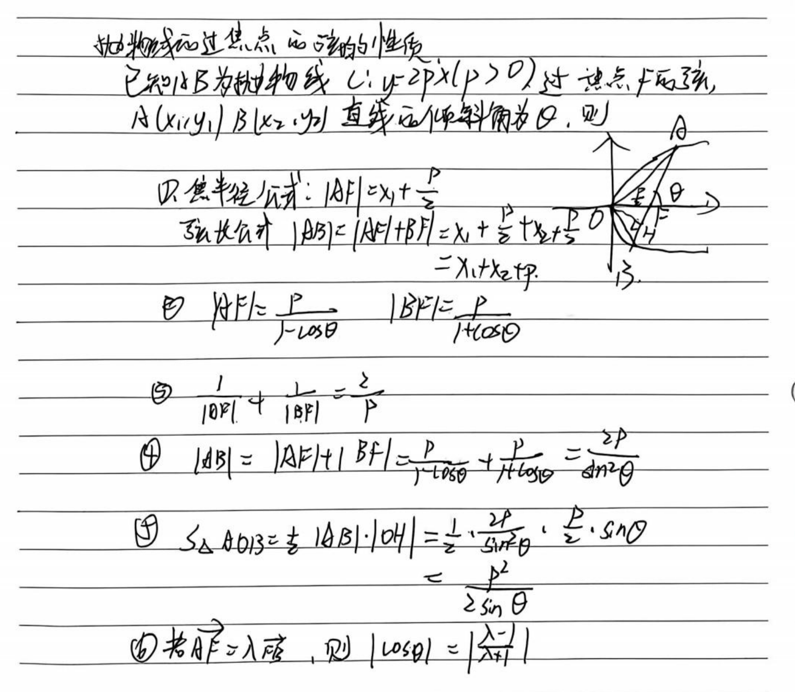
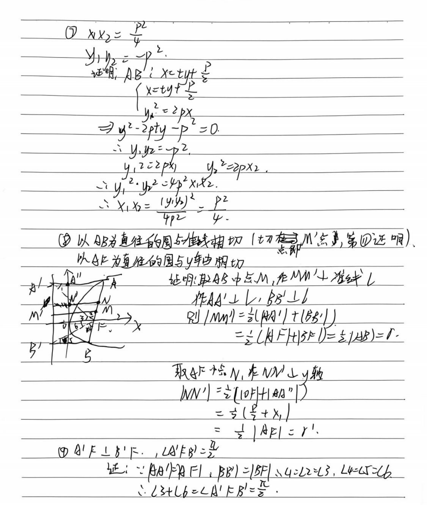
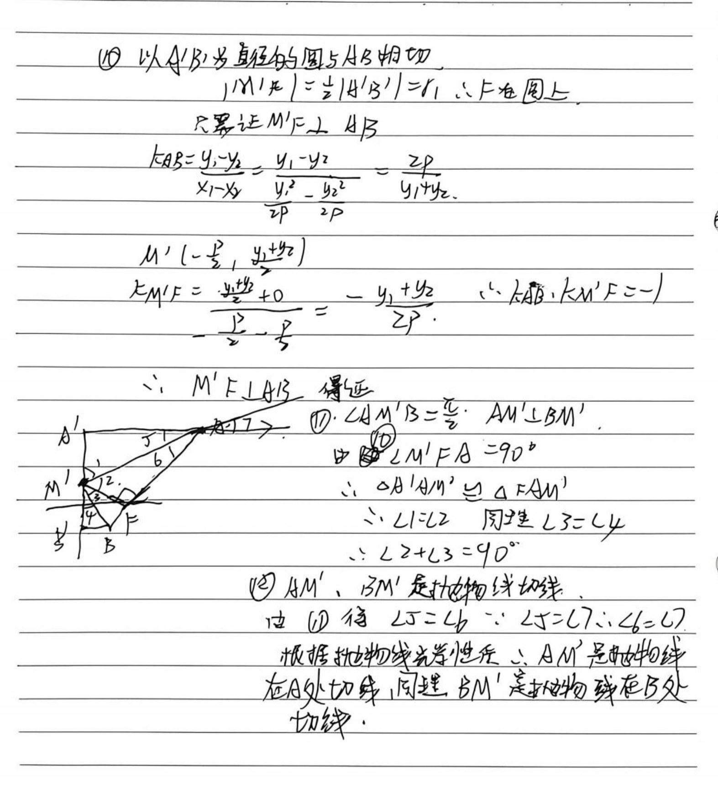
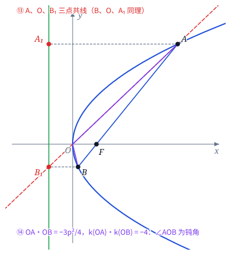
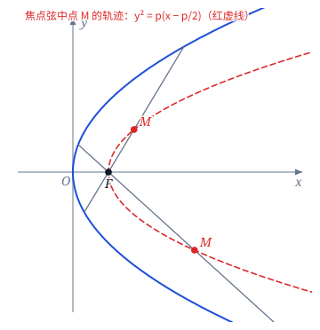

# 抛物线过焦点的弦的性质（①–⑫全证明）

> **原稿序号**：无序号（①–⑫） ｜ **原稿页码**：P12-P14 ｜ **所属模块**：五、抛物线 → 2. 抛物线焦点弦的核心性质

## 补充性质 ⑬–⑱（原稿 ①–⑫ 之外的常考结论）

记号同原稿：$AB$ 是 $y^2 = 2px$ 的焦点弦，$A(x_1, y_1)$，$B(x_2, y_2)$，倾斜角 $\theta$，$A_1$、$B_1$ 是 $A$、$B$ 在准线上的射影，$M$ 是 $AB$ 中点。全部从原稿 ⑦ 的 $y_1y_2 = -p^2$、$x_1x_2 = \frac{p^2}{4}$ 推出。原稿 ⑪⑫（切线交于准线、互相垂直）的完整展开见第 3 节阿基米德三角形。

**⑬ $A$、$O$、$B_1$ 三点共线**（同理 $B$、$O$、$A_1$ 共线）

$k_{OA} = \frac{y_1}{x_1} = \frac{2p}{y_1}$，$k_{OB_1} = \frac{y_2}{-\frac{p}{2}} = -\frac{2y_2}{p}$。由 $y_2 = -\frac{p^2}{y_1}$，$k_{OB_1} = \frac{2p}{y_1} = k_{OA}$，所以==共线==。反过来，过 $A$ 和原点的直线与准线的交点，其纵坐标等于 $B$ 的纵坐标，即 $BB_1 \parallel x$ 轴（2001 年全国卷经典题）。

**⑭ 数量积与斜率积**

$$\overrightarrow{OA} \cdot \overrightarrow{OB} = x_1x_2 + y_1y_2 = \frac{p^2}{4} - p^2 = -\frac{3}{4}p^2, \quad k_{OA} \cdot k_{OB} = \frac{y_1y_2}{x_1x_2} = -4$$

所以 ==$\angle AOB$ 恒为钝角==，$\triangle AOB$ 不可能是直角三角形（直角在 $O$）。

**⑮ 焦半径之积**：$|AF| \cdot |BF| = \frac{p}{1 - \cos \theta} \cdot \frac{p}{1 + \cos \theta} = \frac{p^2}{\sin^2\theta}$ = ==$\frac{p}{2}|AB|$==（由 ④ $|AB| = \frac{2p}{\sin^2\theta}$）。这和 ③ $\frac{1}{|AF|} + \frac{1}{|BF|} = \frac{2}{p}$ 是同一件事。

**⑯ 通径最短**：$|AB| = \frac{2p}{\sin^2\theta} \ge 2p$，==$\theta = 90^\circ$ 时最短，等于通径 $2p$==；$S_{\triangle AOB} = \frac{p^2}{2\sin \theta} \ge \frac{p^2}{2}$，也是通径时最小。

**⑰ 坐标和与中点轨迹**：设 $AB: x = my + \frac{p}{2}$（$m = \frac{1}{\tan \theta}$），则

$$y_1 + y_2 = 2pm, \quad x_1 + x_2 = m(y_1 + y_2) + p = 2pm^2 + p, \quad |AB| = x_1 + x_2 + p = 2p(1 + m^2)$$

中点 $M\left(pm^2 + \frac{p}{2}, \, pm\right)$，消去 $m$ 得==中点轨迹 $y^2 = p\left(x - \frac{p}{2}\right)$==（顶点在焦点的抛物线）。

**⑱ 以焦半径、焦点弦为直径的圆**：原稿 ⑧ 已证「以 $AB$ 为直径的圆与准线相切」「以 $AF$ 为直径的圆与 $y$ 轴相切」；另外 ==以 $A_1B_1$ 为直径的圆过焦点 $F$，且与 $AB$ 相切于 $F$==（即原稿 ⑨⑩ 的合写：$\angle A_1FB_1 = 90^\circ$，$M'F \perp AB$）。

**推广到非焦点弦**：把焦点换成 $x$ 轴上任一点 $(m, 0)$，结论 $y_1y_2 = -2pm$、$x_1x_2 = m^2$ 仍然成立；$m = 2p$ 时 $OA \perp OB$。见下一条「直角弦与定点弦」。
