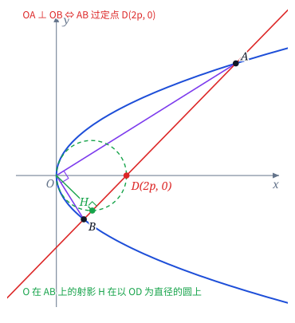
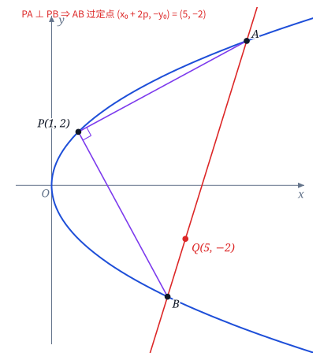
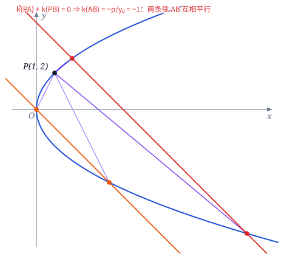

# 抛物线的直角弦与定点弦

> **来源**：电子笔记 ｜ **所属模块**：五、抛物线 → 2. 抛物线焦点弦的核心性质

（上一条是「过焦点」的弦；本条把焦点换成 $x$ 轴上任一定点，以及「两条弦互相垂直」「斜率和为 $0$」这类条件，都是小题里的定点、定值结论。记号：$y^2 = 2px$，$A(x_1, y_1)$，$B(x_2, y_2)$。）

## 一、过 $x$ 轴上定点 $(m, 0)$ 的弦

设 $AB: x = ty + m$，代入得 $y^2 - 2pty - 2pm = 0$，所以

$$y_1y_2 = -2pm, \quad x_1x_2 = \frac{(y_1y_2)^2}{4p^2} = m^2, \quad y_1 + y_2 = 2pt$$

==反过来也对==：若 $y_1y_2 = -2pm$（或 $x_1x_2 = m^2$ 且 $A$、$B$ 在 $x$ 轴两侧），则 $AB$ 过 $(m, 0)$。$m = \frac{p}{2}$ 就是焦点弦的 $y_1y_2 = -p^2$。

## 二、直角弦：$OA \perp OB$ ⇔ $AB$ 过 $(2p, 0)$

$$\overrightarrow{OA} \cdot \overrightarrow{OB} = x_1x_2 + y_1y_2 = m^2 - 2pm = 0 \;\Leftrightarrow\; m = 2p$$

所以 ==$OA \perp OB$ $\Leftrightarrow$ 直线 $AB$ 过定点 $(2p, 0)$==，此时 $y_1y_2 = -4p^2$，$x_1x_2 = 4p^2$。

**推论**：

1. ==$O$ 在 $AB$ 上的射影 $H$ 的轨迹==：$OH \perp HD$（$D(2p, 0)$），所以 $H$ 在以 $OD$ 为直径的圆 $(x - p)^2 + y^2 = p^2$ 上（去掉原点）。
2. ==$\triangle AOB$ 面积的最小值为 $4p^2$==：$S = \frac{1}{2} \cdot 2p \cdot |y_1 - y_2| = p\sqrt{4p^2t^2 + 16p^2} \ge 4p^2$，$t = 0$（$AB$ 竖直）时取到。
3. 一般地，==$k_{OA} \cdot k_{OB} = \lambda$（定值）$\Rightarrow$ $AB$ 过定点 $\left(-\frac{2p}{\lambda}, 0\right)$==：$k_{OA}k_{OB} = \frac{y_1y_2}{x_1x_2} = \frac{-2pm}{m^2} = -\frac{2p}{m}$。$\lambda = -1$ 得 $m = 2p$；焦点弦对应 $\lambda = -4$（上一条 ⑭）。
4. $\overrightarrow{OA} \cdot \overrightarrow{OB} = \mu$（定值）$\Rightarrow$ $m^2 - 2pm = \mu$，$AB$ 过 $x$ 轴上的定点（一般有两个，结合题意取舍）。

## 三、抛物线上的定点引两条垂直的弦

$P(x_0, y_0)$ 在抛物线上，$PA \perp PB$，则 ==$AB$ 过定点 $(x_0 + 2p, \, -y_0)$==。

**证明**：$k_{PA} = \frac{y_1 - y_0}{x_1 - x_0} = \frac{2p}{y_1 + y_0}$，同理 $k_{PB} = \frac{2p}{y_2 + y_0}$。$k_{PA}k_{PB} = -1$：

$$(y_1 + y_0)(y_2 + y_0) = -4p^2 \;\Rightarrow\; y_1y_2 + y_0(y_1 + y_2) + y_0^2 + 4p^2 = 0$$

设 $AB: x = ty + m$，$y_1 + y_2 = 2pt$，$y_1y_2 = -2pm$，代入得 $m = ty_0 + \frac{y_0^2}{2p} + 2p = ty_0 + x_0 + 2p$。于是

$$AB: x = t(y + y_0) + x_0 + 2p$$

恒过 $(x_0 + 2p, -y_0)$。$P$ 取顶点 $O$ 时就是第二部分的 $(2p, 0)$。

## 四、斜率和为 $0$：$AB$ 的斜率为定值

$P(x_0, y_0)$ 在抛物线上，$k_{PA} + k_{PB} = 0$（$PA$、$PB$ 倾斜角互补），则 ==$k_{AB} = -\frac{p}{y_0}$（定值）==，即等于 $P$ 处切线斜率的相反数。

**证明**：$\frac{2p}{y_1 + y_0} + \frac{2p}{y_2 + y_0} = 0 \Rightarrow y_1 + y_2 = -2y_0$，所以 $k_{AB} = \frac{2p}{y_1 + y_2} = -\frac{p}{y_0}$。

（椭圆、双曲线也有同类结论：曲线上定点 $P$ 引斜率和为 $0$ 的两条弦，$AB$ 斜率为定值；引斜率积为定值的两条弦，$AB$ 过定点。这是大题常见背景，小题记住抛物线的形式即可。）

## 五、例题

**例 1**　$A$、$B$ 是抛物线 $y^2 = 4x$ 上异于原点的两点，$OA \perp OB$，求证 $AB$ 过定点，并求 $\triangle AOB$ 面积的最小值。

**解**：$p = 2$，$AB$ 过 ==$(4, 0)$==；==$S_{\min} = 4p^2 = 16$==（$A(4, 4)$、$B(4, -4)$）。

**例 2**　$P(1, 2)$ 在抛物线 $y^2 = 4x$ 上，$A$、$B$ 是抛物线上的动点。(1) 若 $PA \perp PB$，求 $AB$ 所过定点；(2) 若 $PA$、$PB$ 的倾斜角互补，求 $k_{AB}$。

**解**：(1) ==$(x_0 + 2p, -y_0) = (5, -2)$==。(2) ==$k_{AB} = -\frac{p}{y_0} = -1$==。
