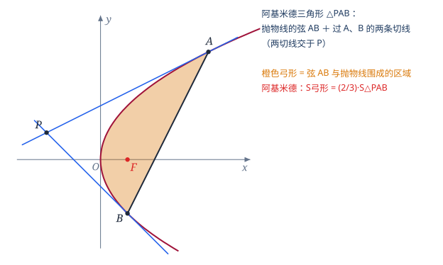
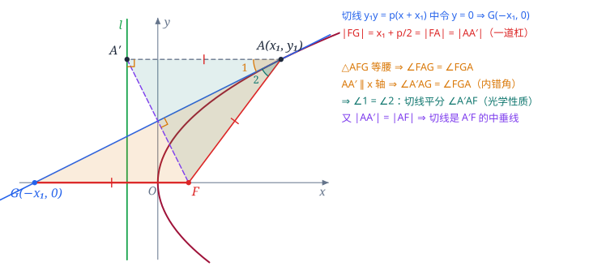
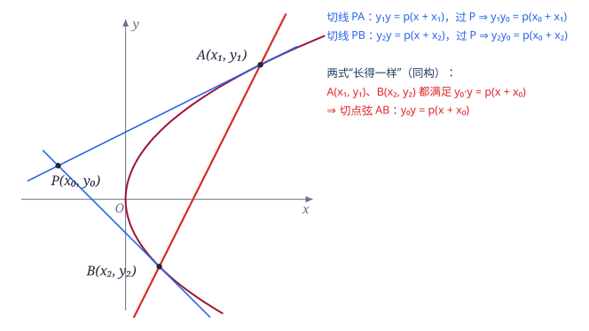
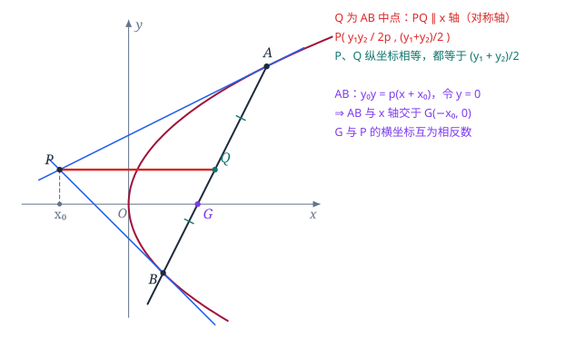
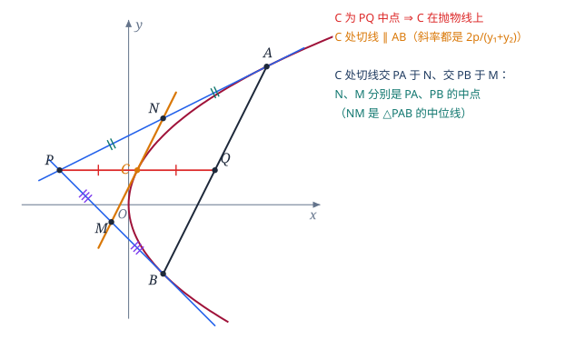

# 阿基米德三角形：定义、切点弦（同构法）与顶点坐标、中线平行于轴

> **来源**：补充专题（阿基米德三角形 1/6） ｜ **适用模块**：五、抛物线

*(说明：本专题统一用抛物线 $y^2 = 2px\ (p > 0)$，焦点 $F\left(\frac{p}{2}, 0\right)$，准线 $l: x = -\frac{p}{2}$；切点 $A(x_1, y_1)$、$B(x_2, y_2)$，两切线交点（阿基米德三角形的顶点）记为 $P(x_0, y_0)$，弦 $AB$ 的中点记为 $Q$。有的资料把顶点记作 $Q$ 或 $S$、把 $AB$ 中点记作 $M$，结论一样，做题时先看清字母。开口向上的 $x^2 = 2py$ 只需把 $x$、$y$ 对调，见第五部分的对照表。)*

## 一、定义与阿基米德的面积结论

==抛物线的弦与过弦的两个端点的两条切线所围成的三角形，叫做阿基米德三角形==，弦 $AB$ 叫它的底边，两切线交点 $P$ 叫它的顶点。

阿基米德本人用「逼近」（穷竭法）证明了：==弦 $AB$ 与抛物线所围成的弓形面积，等于阿基米德三角形面积的 $\frac{2}{3}$==，即

$$S_{\text{弓形}} = \frac{2}{3} S_{\triangle PAB}$$

这个结论后面证明「三切线面积关系」时要用，逼近法的完整证明见本专题第 3 条。

## 二、预备知识：抛物线的切线与切点弦

### 1. 切线方程「代一半」

过抛物线上一点 $A(x_1, y_1)$ 的切线方程为

$$y_1 y = p(x + x_1)$$

记法：把 $y^2$ 换成 $y_1 y$，把 $2x$ 换成 $x + x_1$（「代一半」，也叫半代换）。资料里给了三种推导：

- **方法一（代一半直接写）**：$y^2 = 2px$ 写成 $y \cdot y = 2p \cdot \frac{x + x}{2}$，各代一半得 $y_1 y = 2p \cdot \frac{x + x_1}{2}$，即 $y_1 y = p(x + x_1)$。
- **方法二（求导）**：$y^2 = 2px$ 两边对 $x$ 求导，$2y \cdot y' = 2p$，所以 ==$y' = \frac{p}{y}$==，切线斜率等于 $p$ 除以切点纵坐标。于是切线为 $y - y_1 = \frac{p}{y_1}(x - x_1)$，两边乘 $y_1$ 并用 $y_1^2 = 2px_1$ 化简，得 $y_1 y = p(x + x_1)$。
- **方法三（几何法，光学性质）**：设 $A$ 处切线交 $x$ 轴于 $G$。由光学性质，切线平分 $\angle A'AF$（$A'$ 是 $A$ 在准线上的投影），结合 $AA' \parallel x$ 轴得 $\triangle AFG$ 等腰，$|FG| = |FA| = x_1 + \frac{p}{2}$，所以 $G(-x_1, 0)$。切线斜率 $k = \frac{y_1 - 0}{x_1 - (-x_1)} = \frac{y_1}{2x_1} = \frac{y_1}{2 \cdot \frac{y_1^2}{2p}} = \frac{p}{y_1}$，与方法二一致。

反过来，由切线方程令 $y = 0$ 也立刻得到 $G(-x_1, 0)$，从而 ==$|FG| = |FA| = |AA'|$==。这条「切线与 $x$ 轴的交点和切点横坐标互为相反数」后面证明 $\angle PFA = \angle PFB$ 时要用；它也说明==切线是线段 $A'F$ 的中垂线==（$|AA'| = |AF|$，切线平分顶角 $\angle A'AF$）。

### 2. 切点弦方程：同构法

从抛物线外一点 $P(x_0, y_0)$ 作两条切线，切点为 $A$、$B$，则切点弦 $AB$ 的方程为

$$y_0 y = p(x + x_0)$$

形式与切线方程完全一样。所以==同一个「代一半」式子：点在抛物线上时是切线，点在抛物线外时是切点弦==。

**证明（同构）**：$A$ 处切线 $y_1 y = p(x + x_1)$ 过 $P$，得 $y_1 y_0 = p(x_0 + x_1)$；同理 $y_2 y_0 = p(x_0 + x_2)$。这两个式子结构相同（==同构==），说明点 $(x_1, y_1)$、$(x_2, y_2)$ 都满足方程 $y_0 y = p(x + x_0)$。这是一个二元一次方程，表示一条直线；两点确定一条直线，所以它就是直线 $AB$。

（椭圆、双曲线的同一推法见模块七「切线方程的三种证明与同构法推切点弦」。）

### 3. 参数形式（证明三切线问题时好用）

设 $A(2pt_1^2, 2pt_1)$、$B(2pt_2^2, 2pt_2)$，则 $A$ 处切线为 $x - 2t_1 y + 2pt_1^2 = 0$（斜率 $\frac{1}{2t_1}$）。两切线方程相减得 $y = p(t_1 + t_2)$，代回得 $x = 2pt_1 t_2$，即

$$P\left(2pt_1 t_2,\ p(t_1 + t_2)\right)$$

## 三、性质 1（最核心）：顶点坐标，底边中线平行于对称轴

若 $Q$ 为 $AB$ 中点，则 ==$PQ \parallel x$ 轴（平行于抛物线的对称轴）==，且

$$P\left(\frac{y_1 y_2}{2p},\ \frac{y_1 + y_2}{2}\right)$$

最该记住的是：==$P$ 与 $Q$ 的纵坐标相同，都等于 $\frac{y_1 + y_2}{2}$==；横坐标 $x_0 = \frac{y_1 y_2}{2p}$。

**证法一（切点弦 + 韦达，课上方法）**：$AB$ 的方程为 $y_0 y = p(x + x_0)$，与 $y^2 = 2px$ 联立，消去 $x$ 得

$$y^2 - 2y_0 y + 2px_0 = 0$$

所以 $y_1 + y_2 = 2y_0$，$y_1 y_2 = 2px_0$，即 $y_0 = \frac{y_1 + y_2}{2}$，$x_0 = \frac{y_1 y_2}{2p}$。而 $Q\left(\frac{x_1 + x_2}{2}, \frac{y_1 + y_2}{2}\right)$，纵坐标与 $P$ 相同，所以 $PQ \parallel x$ 轴。

**证法二（两切线联立）**：联立 $y_1 y = p(x + x_1)$ 与 $y_2 y = p(x + x_2)$，相减得 $(y_1 - y_2) y = p(x_1 - x_2) = \frac{y_1^2 - y_2^2}{2}$，所以 $y = \frac{y_1 + y_2}{2}$；代回第一个式子：$x = \frac{y_1 y}{p} - x_1 = \frac{y_1(y_1 + y_2)}{2p} - \frac{y_1^2}{2p} = \frac{y_1 y_2}{2p}$。

**证法三（同构 + 韦达）**：切点 $\left(\frac{t^2}{2p}, t\right)$ 处的切线过 $P$，即 $t \cdot y_0 = p\left(x_0 + \frac{t^2}{2p}\right)$，整理为

$$t^2 - 2y_0 t + 2px_0 = 0$$

$y_1$、$y_2$ 都满足这个关于 $t$ 的方程（同构），所以它们是这个方程的两根，韦达定理给出同样的结论。

**证法四（点差法比斜率）**：由点差法，$k_{AB} = \frac{y_1 - y_2}{x_1 - x_2} = \frac{2p}{y_1 + y_2}$；由切点弦方程，$k_{AB} = \frac{p}{y_0}$。两者相等得 $y_0 = \frac{y_1 + y_2}{2}$。

**推论**：

1. 在切点弦方程 $y_0 y = p(x + x_0)$ 中令 $y = 0$，得==$AB$ 与 $x$ 轴交于 $G(-x_0, 0)$==，$G$ 与 $P$ 的横坐标互为相反数（$AB$ 过焦点时 $P$ 就在准线上，见第 2 条）。
2. 向量形式：$\overrightarrow{PA} + \overrightarrow{PB} = 2\overrightarrow{PQ}$，所以 $\overrightarrow{PA} + \overrightarrow{PB}$ 总与 $x$ 轴（对称轴方向）共线。
3. 参数形式里，$P$ 的纵坐标 $p(t_1 + t_2)$ 正是 $2pt_1$、$2pt_2$ 的平均数，同一结论。

## 四、性质 2：$PQ$ 的中点 $C$ 在抛物线上，且 $C$ 处切线平行于 $AB$

设 $C$ 为 $PQ$ 中点，则 ==$C$ 在抛物线上，且 $C$ 处的切线与 $AB$ 平行==。进一步，$C$ 处切线交 $PA$、$PB$ 于 $N$、$M$，则 $N$、$M$ 分别是 $PA$、$PB$ 的中点。

**证法一（课上：代入验证）**：由 $P\left(\frac{y_1 y_2}{2p}, \frac{y_1 + y_2}{2}\right)$、$Q\left(\frac{x_1 + x_2}{2}, \frac{y_1 + y_2}{2}\right)$ 得

$$C\left(\frac{p(x_1 + x_2) + y_1 y_2}{4p},\ \frac{y_1 + y_2}{2}\right)$$

代入 $y^2 = 2px$：左边 $\frac{(y_1 + y_2)^2}{4} = \frac{y_1^2 + y_2^2 + 2y_1 y_2}{4} = \frac{2px_1 + 2px_2 + 2y_1 y_2}{4}$；右边 $2p \cdot \frac{p(x_1 + x_2) + y_1 y_2}{4p} = \frac{p(x_1 + x_2) + y_1 y_2}{2}$。两边相等，所以 $C$ 在抛物线上。

**证法二（全用纵坐标表示）**：把 $x_1 = \frac{y_1^2}{2p}$、$x_2 = \frac{y_2^2}{2p}$ 代入，

$$x_C = \frac{1}{2}\left(\frac{y_1 y_2}{2p} + \frac{y_1^2 + y_2^2}{4p}\right) = \frac{(y_1 + y_2)^2}{8p}$$

而 $y_C = \frac{y_1 + y_2}{2}$，显然 $y_C^2 = 2px_C$。

**切线平行**：$C$ 处切线斜率 $\frac{p}{y_C} = \frac{2p}{y_1 + y_2}$；$AB$ 的斜率由切点弦方程为 $\frac{p}{y_0} = \frac{2p}{y_1 + y_2}$（或由点差法），两者相等，所以平行。

**$N$、$M$ 是中点**：$\triangle NAC$ 也是阿基米德三角形（切点 $A$、$C$），由性质 1，$y_N = \frac{y_1 + y_C}{2}$，正好是 $y_1$ 与 $y_0 = y_C$ 的平均数；$N$ 在直线 $PA$ 上，纵坐标是 $P$、$A$ 纵坐标的平均数，所以 $N$ 是 $PA$ 中点。同理 $M$ 是 $PB$ 中点，$NM$ 是 $\triangle PAB$ 的中位线（也可看作「三切线定比」在 $C$ 取 $PQ$ 中点时的特例，见第 6 条）。

## 五、开口向上 $x^2 = 2py$ 的对照表

很多题目用 $x^2 = 2py$（如 $x^2 = 4y$），把上面的 $x$、$y$ 对调即可：

| | $y^2 = 2px$ | $x^2 = 2py$ |
| --- | --- | --- |
| 切线（切点 $(x_1, y_1)$） | $y_1 y = p(x + x_1)$ | $x_1 x = p(y + y_1)$ |
| 切点弦（$P(x_0, y_0)$） | $y_0 y = p(x + x_0)$ | $x_0 x = p(y + y_0)$ |
| 顶点 $P$ | $\left(\frac{y_1 y_2}{2p}, \frac{y_1 + y_2}{2}\right)$ | ==$\left(\frac{x_1 + x_2}{2}, \frac{x_1 x_2}{2p}\right)$== |
| 中线 $PQ$ | 平行于 $x$ 轴 | 平行于 $y$ 轴 |
| 切线斜率 | $\frac{p}{y_1}$ | $\frac{x_1}{p}$ |

对 $x^2 = 2py$：==$A$、$P$、$B$ 三点的横坐标成等差数列==，$P$ 的纵坐标 $= \frac{x_1 x_2}{2p}$。
