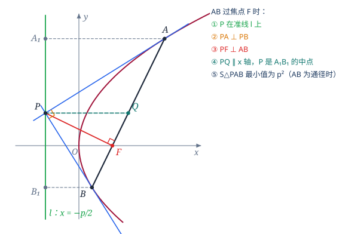
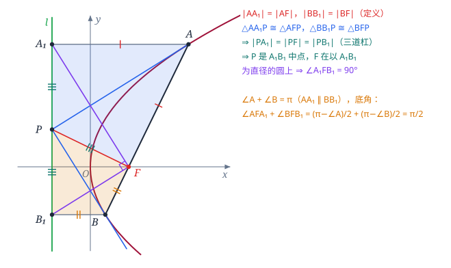
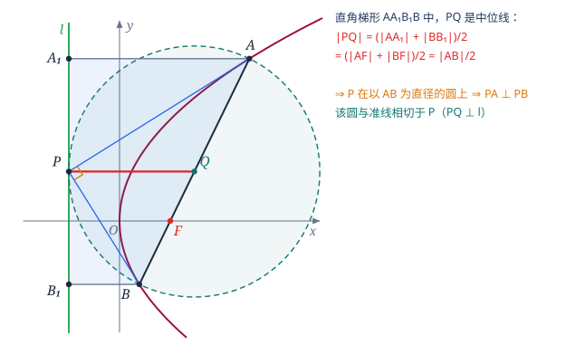
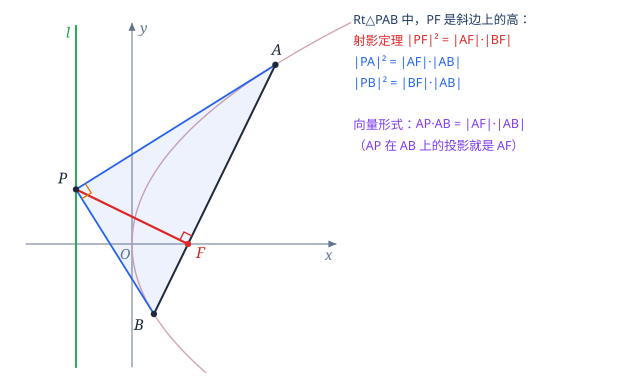
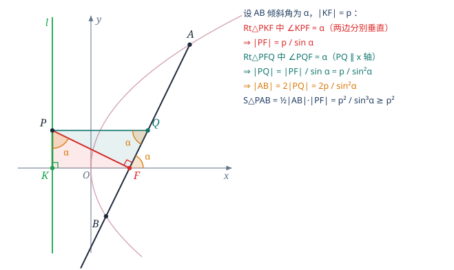
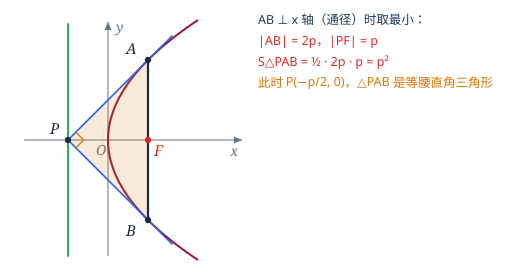

# 底边过焦点的阿基米德三角形：P 在准线上、PA ⊥ PB、PF ⊥ AB、面积最小值 p²

> **来源**：补充专题（阿基米德三角形 2/6） ｜ **适用模块**：五、抛物线

*(记号同第 1 条：$y^2 = 2px$，弦 $AB$ 过焦点 $F\left(\frac{p}{2}, 0\right)$，$A(x_1, y_1)$、$B(x_2, y_2)$，两切线交于 $P(x_0, y_0)$，$Q$ 为 $AB$ 中点；$A_1$、$B_1$ 是 $A$、$B$ 在准线 $l$ 上的投影。这是考试最常考的情形，多选题经常把下面几条一起放进选项。)*

## 一、结论一览

弦 $AB$ 过焦点 $F$ 时：

1. ==$P$ 在准线上==；反之，$P$ 在准线上 $\Rightarrow$ $AB$ 过焦点。
2. ==$PA \perp PB$==（$\triangle PAB$ 是以 $P$ 为直角顶点的直角三角形）。
3. ==$PF \perp AB$==。
4. $PQ \parallel x$ 轴，且 $P$ 是 $A_1 B_1$ 的中点；$|PQ| = \frac{1}{2}|AB|$，以 $AB$ 为直径的圆与准线相切于 $P$。
5. $\angle A_1 F B_1 = 90^\circ$。
6. ==$|PF|^2 = |AF| \cdot |BF|$==，$\overrightarrow{AP} \cdot \overrightarrow{AB} = |AF| \cdot |AB|$。
7. 若 $AB$ 的倾斜角为 $\alpha$，则 $|AB| = \frac{2p}{\sin^2\alpha}$，$|PF| = \frac{p}{\sin\alpha}$，$S_{\triangle PAB} = \frac{p^2}{\sin^3\alpha}$。
8. ==$S_{\triangle PAB}$ 的最小值为 $p^2$==，当且仅当 $AB$ 为通径。

下面逐条证明，每条把资料里出现的证法都列出来。

## 二、$P$ 在准线上

**证法一（切点弦方程）**：$AB$ 的方程为 $y_0 y = p(x + x_0)$，它过 $F\left(\frac{p}{2}, 0\right)$，代入得 $0 = p\left(\frac{p}{2} + x_0\right)$，所以 ==$x_0 = -\frac{p}{2}$==，$P$ 在准线上。

**证法二（用一般结论）**：第 1 条推论说 $AB$ 与 $x$ 轴交于 $G(-x_0, 0)$；现在 $G$ 就是 $F$，所以 $-x_0 = \frac{p}{2}$。也可直接套第 5 条「$AB$ 过 $(x_0, 0)$ $\Leftrightarrow$ $P$ 在 $x = -x_0$ 上」。

**证法三（韦达）**：设 $AB: x = my + \frac{p}{2}$，与 $y^2 = 2px$ 联立得 $y^2 - 2pmy - p^2 = 0$，所以 ==$y_1 y_2 = -p^2$==（焦点弦的常用结论）。由第 1 条 $x_0 = \frac{y_1 y_2}{2p} = -\frac{p}{2}$。

**反过来**：$P$ 在准线上，即 $x_0 = -\frac{p}{2}$，代入 $AB: y_0 y = p\left(x - \frac{p}{2}\right)$，令 $y = 0$ 得 $x = \frac{p}{2}$，所以 $AB$ 过 $F$。

## 三、$PA \perp PB$

**证法一（斜率之积）**：切线斜率 $k_{PA} = \frac{p}{y_1}$，$k_{PB} = \frac{p}{y_2}$（求导 $y' = \frac{p}{y}$），所以

$$k_{PA} \cdot k_{PB} = \frac{p^2}{y_1 y_2} = \frac{p^2}{-p^2} = -1$$

对 $x^2 = 2py$ 则是 $k_{PA} \cdot k_{PB} = \frac{x_1 x_2}{p^2} = -1$。

**证法二（全等，课上方法）**：$|AA_1| = |AF|$，且 $PA$ 平分 $\angle A_1 AF$（第 1 条光学性质），$AP$ 公共，所以 $\triangle AA_1P \cong \triangle AFP$，$\angle A_1PA = \angle APF$；同理 $\triangle BB_1P \cong \triangle BFP$，$\angle B_1PB = \angle BPF$。$A_1$、$P$、$B_1$ 共线（都在准线上），四个角之和为 $180^\circ$，所以 $\angle APB = \angle APF + \angle BPF = 90^\circ$。

**证法三（中位线 + 直径所对圆周角）**：直角梯形 $AA_1B_1B$ 中，$P$ 是 $A_1B_1$ 中点、$Q$ 是 $AB$ 中点（$PQ \parallel x$ 轴，见第 1 条），所以 $PQ$ 是中位线：

$$|PQ| = \frac{|AA_1| + |BB_1|}{2} = \frac{|AF| + |BF|}{2} = \frac{|AB|}{2}$$

$P$ 到 $AB$ 中点的距离等于 $AB$ 的一半，所以 $P$ 在以 $AB$ 为直径的圆上，$\angle APB = 90^\circ$。

## 四、$PF \perp AB$

**证法一（等角，课上方法）**：一般的阿基米德三角形都有 $\angle PFA = \angle PFB$（第 4 条）。现在 $A$、$F$、$B$ 共线，两角互补又相等，都等于 $90^\circ$。

**证法二（斜率之积）**：$P\left(-\frac{p}{2}, y_0\right)$，$k_{PF} = \frac{y_0 - 0}{-\frac{p}{2} - \frac{p}{2}} = -\frac{y_0}{p}$；$k_{AB} = \frac{p}{y_0}$（切点弦方程），所以 $k_{PF} \cdot k_{AB} = -1$（$y_0 = 0$ 时 $AB$ 竖直、$PF$ 水平，同样垂直）。

**证法三（向量）**：$\overrightarrow{FP} = \left(-p, \frac{y_1 + y_2}{2}\right)$，$\overrightarrow{AB} = (x_2 - x_1, y_2 - y_1)$，

$$\overrightarrow{FP} \cdot \overrightarrow{AB} = -p \cdot \frac{y_2^2 - y_1^2}{2p} + \frac{(y_1 + y_2)(y_2 - y_1)}{2} = 0$$

**证法四（全等）**：由上图 $\triangle BB_1P \cong \triangle BFP$，$\angle BFP = \angle BB_1P = 90^\circ$。

## 五、$\angle A_1FB_1 = 90^\circ$

**证法一（等腰三角形底角）**：$|AA_1| = |AF|$，$|BB_1| = |BF|$，所以 $\triangle AA_1F$、$\triangle BB_1F$ 都等腰。$AA_1 \parallel BB_1$，$\angle A_1AF + \angle B_1BF = \pi$，于是

$$\angle AFA_1 + \angle BFB_1 = \frac{\pi - \angle A_1AF}{2} + \frac{\pi - \angle B_1BF}{2} = \frac{\pi}{2}$$

所以 $\angle A_1FB_1 = \pi - \frac{\pi}{2} = \frac{\pi}{2}$。（也可写成：$\angle BB_1F = \angle BFB_1 = \angle B_1FO$，$\angle AA_1F = \angle AFA_1 = \angle A_1FO$，两组相加为 $\pi$。）

**证法二（全等）**：由 $\triangle BB_1P \cong \triangle BFP$、$\triangle AA_1P \cong \triangle AFP$ 得 ==$|PA_1| = |PF| = |PB_1|$==，$F$ 在以 $A_1B_1$ 为直径的圆上（圆心 $P$），所以 $\angle A_1FB_1 = 90^\circ$。

## 六、$|PF|^2 = |AF| \cdot |BF|$（射影定理）

在 $\text{Rt}\triangle PAB$ 中，$PF$ 是斜边 $AB$ 上的高，由射影定理（相似）：

$$|PF|^2 = |AF| \cdot |BF|, \quad |PA|^2 = |AF| \cdot |AB|, \quad |PB|^2 = |BF| \cdot |AB|$$

向量形式：$\overrightarrow{AP}$ 在 $\overrightarrow{AB}$ 上的投影长就是 $|AF|$，所以 ==$\overrightarrow{AP} \cdot \overrightarrow{AB} = |AF| \cdot |AB|$==。

（$|PF|^2 = |AF| \cdot |BF|$ 对一般的阿基米德三角形也成立，坐标证明见第 4 条；过焦点时用射影定理最快。）

## 七、用倾斜角 $\alpha$ 表示 $|AB|$、$|PF|$ 与面积

设 $AB$ 的倾斜角为 $\alpha$，准线与 $x$ 轴交于 $K$，$|KF| = p$。

- $\text{Rt}\triangle PKF$ 中，$PK \perp KF$、$PF \perp AB$，两边分别垂直，所以 $\angle KPF = \alpha$，$|PF| = \frac{|KF|}{\sin\alpha} = \frac{p}{\sin\alpha}$。
- $\text{Rt}\triangle PFQ$ 中（直角在 $F$），$PQ \parallel x$ 轴，所以 $\angle PQF = \alpha$，$|PQ| = \frac{|PF|}{\sin\alpha} = \frac{p}{\sin^2\alpha}$。
- 于是 ==$|AB| = 2|PQ| = \frac{2p}{\sin^2\alpha}$==（焦点弦长公式，这个结论证法很多，见模块五第 2 节与模块六），
- $S_{\triangle PAB} = \frac{1}{2}|AB| \cdot |PF| = \frac{p^2}{\sin^3\alpha}$。

## 八、面积最小值 $p^2$

**证法一（面积公式，课上方法）**：一般的阿基米德三角形面积 $S = \frac{1}{p}\left(y_0^2 - 2px_0\right)^{\frac{3}{2}}$（第 3 条）。现在 $x_0 = -\frac{p}{2}$：

$$S = \frac{1}{p}\left(y_0^2 + p^2\right)^{\frac{3}{2}} \ge \frac{1}{p}\left(p^2\right)^{\frac{3}{2}} = p^2$$

当 $y_0 = 0$ 即 $P\left(-\frac{p}{2}, 0\right)$ 时取等号。

**证法二（中线 × 纵坐标差，配套资料方法）**：$S = \frac{1}{2}|PQ| \cdot |y_1 - y_2|$。其中

$$|PQ| = \frac{x_1 + x_2}{2} + \frac{p}{2} = \frac{y_1^2 + y_2^2}{4p} + \frac{p}{2} \ge \frac{2|y_1 y_2|}{4p} + \frac{p}{2} = p$$

又 $y_1$、$y_2$ 异号，$|y_1 - y_2| = |y_1| + |y_2| \ge 2\sqrt{|y_1 y_2|} = 2p$。所以 $S \ge \frac{1}{2} \cdot p \cdot 2p = p^2$。

**证法三（底 × 高，笔记方法）**：$S = \frac{1}{2}|AB| \cdot d$，高 $d = |PF| = \sqrt{p^2 + y_0^2} \ge p$；焦点弦中通径最短，$|AB| \ge 2p$。所以 $S \ge \frac{1}{2} \cdot 2p \cdot p = p^2$。（也可由 $S = \frac{p^2}{\sin^3\alpha} \ge p^2$ 直接看出，$\alpha = 90^\circ$ 时取等。）

==最小值 $p^2$ 在 $AB$ 为通径时取到==，此时 $\triangle PAB$ 是等腰直角三角形。注意不是 $\frac{p^2}{2}$，多选题常拿这个设陷阱。
