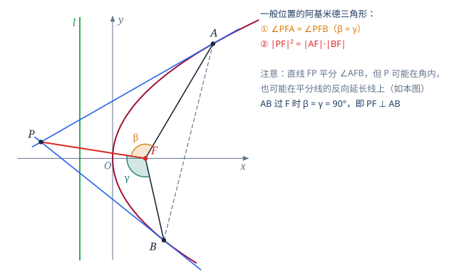
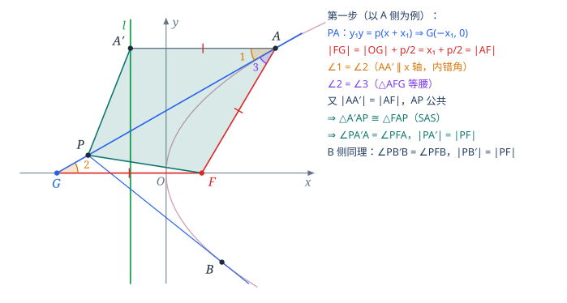
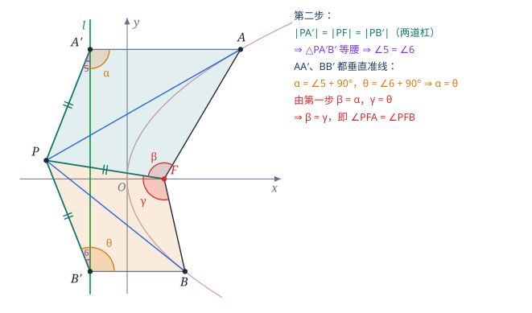
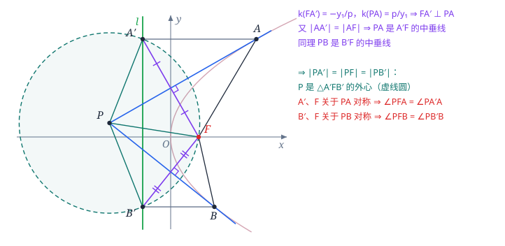
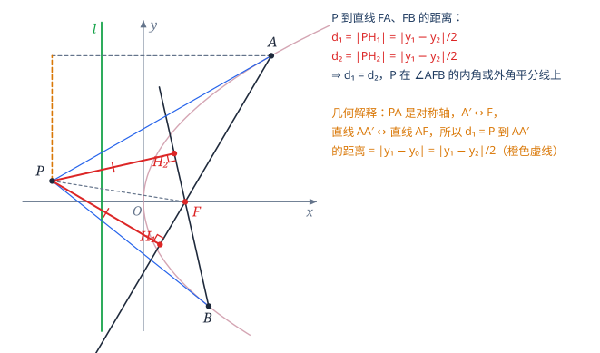

# 一般位置的焦点性质：∠PFA = ∠PFB 与 |PF|² = |AF|·|BF|（多种证法）

> **来源**：补充专题（阿基米德三角形 4/6） ｜ **适用模块**：五、抛物线

*(记号同第 1 条：$y^2 = 2px$，$A(x_1, y_1)$、$B(x_2, y_2)$，顶点 $P(x_0, y_0)$；$A'$、$B'$ 为 $A$、$B$ 在准线上的投影。这里**不要求** $AB$ 过焦点。)*

## 一、结论

对任意阿基米德三角形 $PAB$：

$$\angle PFA = \angle PFB, \qquad |PF|^2 = |AF| \cdot |BF|$$

- ==等角==：$FP$ 与 $FA$、$FB$ 成等角，即直线 $FP$ 平分 $\angle AFB$。注意 $P$ 可能在 $\angle AFB$ 内部，也可能在平分线的反向延长线上（如图，两角都是钝角）。
- ==$AB$ 过焦点时==两角互补又相等，都是 $90^\circ$，就是第 2 条的 $PF \perp AB$；$|PF|^2 = |AF| \cdot |BF|$ 也就退化成射影定理。
- 两条结论合起来：$\frac{|PF|}{|AF|} = \frac{|BF|}{|PF|}$ 且夹角相等，所以 $\triangle PFA \sim \triangle BFP$，从而还有 $\angle FPA = \angle FBP$、$\angle FAP = \angle FPB$。

## 二、$|PF|^2 = |AF| \cdot |BF|$ 的证明

**思路**：$|AF|$、$|BF|$ 用焦半径（到准线的距离）表示，$|PF|$ 用两点距离公式，两边都化成同一种变量比较。

**证法一（化成横坐标，课上方法）**：$P\left(\frac{y_1 y_2}{2p}, \frac{y_1 + y_2}{2}\right)$，$F\left(\frac{p}{2}, 0\right)$，

$$|PF|^2 = \left(\frac{y_1 y_2}{2p} - \frac{p}{2}\right)^2 + \left(\frac{y_1 + y_2}{2}\right)^2 = \frac{y_1^2 y_2^2}{4p^2} + \frac{p^2}{4} - \frac{y_1 y_2}{2} + \frac{y_1^2 + y_2^2 + 2y_1 y_2}{4}$$

$-\frac{y_1 y_2}{2}$ 与 $\frac{2y_1 y_2}{4}$ 抵消，再把 $y_1^2 = 2px_1$、$y_2^2 = 2px_2$ 代入：

$$|PF|^2 = \frac{2px_1 \cdot 2px_2}{4p^2} + \frac{p^2}{4} + \frac{2px_1 + 2px_2}{4} = x_1 x_2 + \frac{p}{2}(x_1 + x_2) + \frac{p^2}{4}$$

而焦半径公式给出 $|AF| \cdot |BF| = \left(x_1 + \frac{p}{2}\right)\left(x_2 + \frac{p}{2}\right) = x_1 x_2 + \frac{p}{2}(x_1 + x_2) + \frac{p^2}{4}$，两者相等。

**证法二（化成纵坐标，配套资料方法）**：反过来把 $|AF| \cdot |BF|$ 化成纵坐标：

$$|AF| \cdot |BF| = x_1 x_2 + \frac{p}{2}(x_1 + x_2) + \frac{p^2}{4} = \left(\frac{y_1 y_2}{2p}\right)^2 + \frac{y_1^2 + y_2^2}{4} + \frac{p^2}{4}$$

$$|PF|^2 = \left(\frac{y_1 y_2}{2p} - \frac{p}{2}\right)^2 + \left(\frac{y_1 + y_2}{2}\right)^2 = \left(\frac{y_1 y_2}{2p}\right)^2 + \frac{y_1^2 + y_2^2}{4} + \frac{p^2}{4}$$

（交叉项 $-\frac{y_1 y_2}{2}$ 与 $+\frac{y_1 y_2}{2}$ 抵消。）两式相同。

## 三、$\angle PFA = \angle PFB$ 的证明

### 证法一：两组全等（课上方法）

**第一步**：以 $A$ 侧为例。切线 $PA: y_1 y = p(x + x_1)$ 交 $x$ 轴于 $G(-x_1, 0)$，所以 $|FG| = |x_G| + \frac{p}{2} = x_1 + \frac{p}{2} = |AF|$，$\triangle AFG$ 等腰。

- $\angle 1 = \angle 2$：$AA' \parallel x$ 轴，内错角相等；
- $\angle 2 = \angle 3$：$\triangle AFG$ 等腰，底角相等；
- 又 $|AA'| = |AF|$，$AP$ 公共，所以 ==$\triangle A'AP \cong \triangle FAP$（SAS）==，得 $\angle PA'A = \angle PFA$，$|PA'| = |PF|$。

同理 $\triangle B'BP \cong \triangle FBP$，得 $\angle PB'B = \angle PFB$，$|PB'| = |PF|$。

**第二步**：由 $|PA'| = |PF| = |PB'|$，$\triangle PA'B'$ 是等腰三角形（底边 $A'B'$ 在准线上），所以 $\angle 5 = \angle 6$。$AA'$、$BB'$ 都垂直于准线，记 $\alpha = \angle PA'A$，$\theta = \angle PB'B$，则

$$\alpha = \angle 5 + 90^\circ, \quad \theta = \angle 6 + 90^\circ \ \Rightarrow\ \alpha = \theta$$

结合第一步 $\beta = \angle PFA = \alpha$，$\gamma = \angle PFB = \theta$，得 ==$\beta = \gamma$==。

### 证法二：中垂线（配套资料 + 笔记方法）

$A'\left(-\frac{p}{2}, y_1\right)$，$k_{FA'} = \frac{y_1}{-p} = -\frac{y_1}{p}$，而 $k_{PA} = \frac{p}{y_1}$，所以 $k_{FA'} \cdot k_{PA} = -1$，==$FA' \perp PA$==。又 $|AA'| = |AF|$，所以 $PA$ 是线段 $A'F$ 的中垂线（等腰三角形底边上的高也是中线）。

- $A'$、$F$ 关于直线 $PA$ 对称，所以 $\triangle PAA' \cong \triangle PAF$，$|PA'| = |PF|$，$\angle PA'A = \angle PFA$；
- 同理 $|PB'| = |PF|$，$\angle PB'B = \angle PFB$；
- 于是 $|PA'| = |PB'|$，$\angle PA'B' = \angle PB'A'$，两边各加 $90^\circ$ 得 $\angle PA'A = \angle PB'B$，所以 $\angle PFA = \angle PFB$。

顺带得到一个好记的结论：==$P$ 到 $A'$、$F$、$B'$ 距离相等，$P$ 是 $\triangle A'FB'$ 的外心==（$AB$ 过焦点时 $P$ 是 $A'B'$ 的中点，见第 2 条）。

### 证法三：向量夹角（2005 江西卷的方法一）

$\overrightarrow{FA} = \left(x_1 - \frac{p}{2}, y_1\right)$，$\overrightarrow{FP} = \left(\frac{y_1 y_2}{2p} - \frac{p}{2}, \frac{y_1 + y_2}{2}\right)$。用 $x_1 = \frac{y_1^2}{2p}$ 展开：

$$\overrightarrow{FP} \cdot \overrightarrow{FA} = \frac{y_1^3 y_2}{4p^2} + \frac{y_1^2}{4} + \frac{y_1 y_2}{4} + \frac{p^2}{4} = \frac{(y_1^2 + p^2)(y_1 y_2 + p^2)}{4p^2}$$

又 $|\overrightarrow{FA}| = x_1 + \frac{p}{2} = \frac{y_1^2 + p^2}{2p}$，所以

$$\cos\angle AFP = \frac{\overrightarrow{FP} \cdot \overrightarrow{FA}}{|\overrightarrow{FP}| \cdot |\overrightarrow{FA}|} = \frac{y_1 y_2 + p^2}{2p\,|\overrightarrow{FP}|}$$

结果关于 $y_1$、$y_2$ 对称，同理 $\cos\angle BFP$ 也等于它，所以 $\angle AFP = \angle BFP$。

注意 $\frac{y_1 y_2 + p^2}{2p} = x_0 + \frac{p}{2}$，所以 ==$\cos\angle AFP = \frac{x_0 + \frac{p}{2}}{|PF|}$==：$P$ 在准线上（$x_0 = -\frac{p}{2}$）时为 $0$，这又一次说明过焦点时 $PF \perp AB$。（原题用 $x^2 = y$：$\cos\angle AFP = \frac{x_0 x_1 + \frac{1}{4}}{|FP|}$，$x_0$、$x_1$ 为两切点横坐标。）

### 证法四：到两边距离相等（2005 江西卷的方法二）

直线 $FA$：$y_1 x - \left(x_1 - \frac{p}{2}\right)y - \frac{p}{2}y_1 = 0$。分母 $\sqrt{y_1^2 + \left(x_1 - \frac{p}{2}\right)^2} = x_1 + \frac{p}{2}$（因为 $y_1^2 = 2px_1$），分子代入 $P$ 的坐标化简为 $\frac{|y_1 - y_2|(y_1^2 + p^2)}{4p}$，所以

$$d_1 = \frac{|y_1 - y_2|(y_1^2 + p^2)}{4p} \div \frac{y_1^2 + p^2}{2p} = \frac{|y_1 - y_2|}{2}$$

同理 $P$ 到直线 $FB$ 的距离 $d_2 = \frac{|y_1 - y_2|}{2}$，所以 $d_1 = d_2$。（原题 $x^2 = y$ 中算得 $d_1 = d_2 = \frac{|x_0 - x_1|}{2}$；它还单独讨论了 $x_0 x_1 = 0$、直线 $AF$ 斜率不存在的情况，结论不变。）

**几何解释**：由证法二，$A'$ 与 $F$ 关于 $PA$ 对称，直线 $AA'$ 关于 $PA$ 对称成直线 $AF$，所以 $P$ 到 $AF$ 的距离 = $P$ 到 $AA'$ 的距离 $= |y_1 - y_0| = \frac{|y_1 - y_2|}{2}$（图中橙色虚线）。

**注意**：距离相等只能说明 $P$ 在 $\angle AFB$ 的内角平分线或外角平分线所在直线上，严格地还要排除外角平分线（外角平分线上两角互补而不是相等）。所以这个方法适合小题快速判断，大题写证明用证法一到三更稳。

### 证法小结

| 证法 | 核心 | 来源 |
| --- | --- | --- |
| 两组全等 | 切线交 $x$ 轴于 $G(-x_1, 0)$，等腰 + 内错角 | 课上 |
| 中垂线 / 外心 | $FA' \perp PA$，且 $AA'$、$AF$ 等长 | 配套资料、笔记 |
| 向量夹角 | $\cos\angle AFP$ 关于 $y_1$、$y_2$ 对称 | 配套资料（2005 江西卷解答） |
| 到两边距离相等 | $d_1 = d_2$，都等于两切点纵坐标差的一半 | 配套资料（2005 江西卷解答） |
