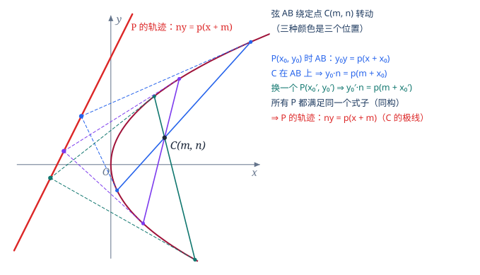
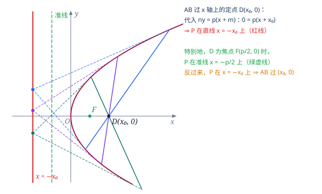
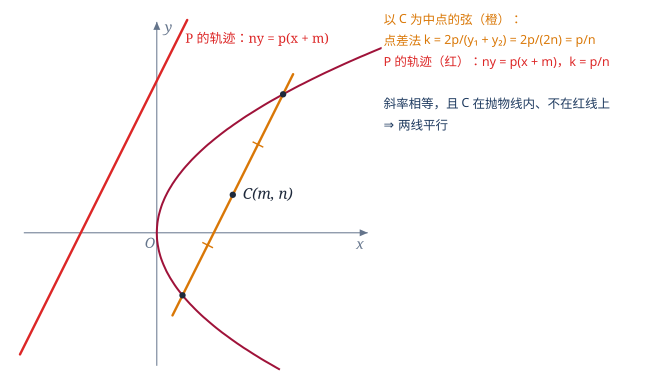
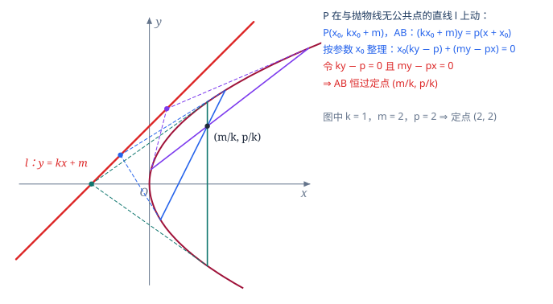

# 同构法：底边过定点 ⇔ 顶点在定直线上（含以定点为中点的弦、同构方程的其他用法）

> **来源**：补充专题（阿基米德三角形 5/6） ｜ **适用模块**：五、抛物线

*(记号同第 1 条：$y^2 = 2px$，顶点 $P(x_0, y_0)$，切点弦 $AB: y_0 y = p(x + x_0)$。本条是课上的引申：用「同构」看出轨迹，背后是极点与极线。)*

## 一、同构的想法

如果几个点（或几个数）都满足==形式完全相同的等式==，只是字母不同，就把它们看成同一个方程的解：

- 点 $(x_1, y_1)$、$(x_2, y_2)$ 都满足同一个二元一次方程 $\Rightarrow$ 两点都在这条直线上（第 1 条用它得到切点弦方程）；
- 数 $y_1$、$y_2$ 都满足同一个一元二次方程 $\Rightarrow$ 它们是这个方程的两根，可以用韦达定理（第 1 条性质 1 的证法三）；
- 动点在不同位置满足的等式结构相同 $\Rightarrow$ 把变化的量换成 $x$、$y$，就是轨迹方程（本条第二部分）。

## 二、底边 $AB$ 过定点 $C(m, n)$ $\Rightarrow$ 顶点 $P$ 在定直线上

若阿基米德三角形的底边 $AB$ 过抛物线内的定点 $C(m, n)$，则顶点 $P$ 的轨迹为直线

$$ny = p(x + m)$$

它就是==对 $C$ 「代一半」得到的直线==，即 $C$ 的极线。

**证法一（课上：取两个位置看同构）**：$P$ 在 $(x_1, y_1)$ 时，$AB: y_1 y = p(x + x_1)$，$C$ 在 $AB$ 上，得

$$y_1 \cdot n = p(m + x_1)$$

$P$ 换到 $(x_2, y_2)$ 时，同样得 $y_2 \cdot n = p(m + x_2)$；换到 $(x_3, y_3)$ 也一样。变化的只有 $P$ 的坐标，式子的结构不变，所以 $P$ 的坐标 $(x, y)$ 总满足 $yn = p(m + x)$，这就是 $P$ 的轨迹方程。

**证法二（配套资料：设动点直接推）**：设 $A(x_1, y_1)$、$B(x_2, y_2)$，顶点 $P(x', y')$。$P$ 在两条切线上：$y_1 y' = p(x' + x_1)$，$y_2 y' = p(x' + x_2)$，所以 $A$、$B$ 都在直线 $y'y = p(x' + x)$ 上，这就是 $AB$。又 $AB$ 过 $C(m, n)$，得 $y' n = p(x' + m)$，即 $P$ 的轨迹为 $ny = p(x + m)$。

（$C$ 在抛物线内时 $n^2 < 2pm$，把直线代入抛物线得 $y^2 - 2ny + 2pm = 0$，判别式 $4n^2 - 8pm < 0$，所以这条直线整条都在抛物线外。）

### 特殊情形：$C$ 在 $x$ 轴上

- ==$AB$ 过 $D(x_0, 0)$ $\Rightarrow$ $P$ 在直线 $x = -x_0$ 上==：代入 $ny = p(x + m)$，$n = 0$，$m = x_0$，得 $0 = p(x + x_0)$。
- ==$AB$ 过焦点 $F\left(\frac{p}{2}, 0\right)$ $\Rightarrow$ $P$ 在准线 $x = -\frac{p}{2}$ 上==（第 2 条第一个结论）。
- 题目常这样出：「过定点 $(x_0, 0)$ 的弦，两端切线交点在哪条线上」，答案就是 $x = -x_0$，与第 1 条「$AB$ 交 $x$ 轴于 $G(-x_0, 0)$」是同一件事的两个方向。

## 三、以 $C$ 为中点的弦平行于 $P$ 的轨迹

抛物线以定点 $C(m, n)$ 为中点的弦，==平行于第二部分中 $P$ 的轨迹 $ny = p(x + m)$==。

**证法一（点差法，笔记方法）**：设弦的端点纵坐标为 $y_1$、$y_2$，$y_1 + y_2 = 2n$，点差法得斜率 $k = \frac{2p}{y_1 + y_2} = \frac{p}{n}$；而轨迹 $ny = p(x + m)$ 的斜率也是 $\frac{p}{n}$。

**证法二（配套资料：套用第一部分）**：若 $C$ 恰为弦 $AB$ 的中点，则 $m = \frac{x_1 + x_2}{2}$，$n = \frac{y_1 + y_2}{2}$，$P$ 的轨迹为 $\frac{y_1 + y_2}{2}y = p\left(x + \frac{x_1 + x_2}{2}\right)$，斜率 $\frac{2p}{y_1 + y_2}$。弦 $AB$ 所在直线为 $y'y = p(x' + x)$，其中 $y' = \frac{y_1 + y_2}{2}$、$x' = \frac{y_1 y_2}{2p}$（第 1 条），即 $\frac{y_1 + y_2}{2}y = p\left(x + \frac{y_1 y_2}{2p}\right)$，斜率也是 $\frac{2p}{y_1 + y_2}$。

两条直线斜率相等，又 $C$ 在弦上而不在轨迹上（$C$ 在抛物线内，轨迹在抛物线外），所以不重合，两者平行。

## 四、反过来：顶点在定直线上 $\Rightarrow$ 底边过定点

若直线 $l$ 与抛物线没有公共点，则==以 $l$ 上的点为顶点的阿基米德三角形，底边 $AB$ 过定点==（定点就是 $l$ 的极点，与第二部分互逆）。

**情形 1：$l: y = kx + m$**（$l$ 与抛物线无公共点，所以 $k \ne 0$ 且 $km > \frac{p}{2}$）。设 $P(x_0, kx_0 + m)$，$AB: (kx_0 + m)y = p(x + x_0)$。==把参数 $x_0$ 提出来==：

$$x_0(ky - p) + (my - px) = 0$$

要对所有 $x_0$ 成立，令 $\begin{cases} ky - p = 0 \\ my - px = 0 \end{cases}$，解得 $y = \frac{p}{k}$，$x = \frac{m}{k}$，所以 ==$AB$ 恒过定点 $\left(\frac{m}{k}, \frac{p}{k}\right)$==。

**情形 1′：$l: ax + by + c = 0$（配套资料的一般式）**。$P(x_0, y_0)$ 满足 $y_0 = -\frac{a}{b}x_0 - \frac{c}{b}$，代入 $AB: y_0 y = p(x + x_0)$：

$$\left(-\frac{a}{b}x_0 - \frac{c}{b}\right)y = p(x + x_0) \ \Rightarrow\ \left(-\frac{a}{b}y - p\right)x_0 = px + \frac{c}{b}y$$

令 $-\frac{a}{b}y - p = 0$ 且 $px + \frac{c}{b}y = 0$，得定点 $\left(\frac{c}{a}, -\frac{bp}{a}\right)$。（取 $a = k$，$b = -1$，$c = m$ 就回到情形 1。）

**情形 2：$l: x = x_0$**（竖直线，需 $x_0 < 0$）。$P(x_0, y_0)$，$AB: y_0 y = p(x + x_0)$，参数是 $y_0$，令 $y = 0$，则 $x = -x_0$，==$AB$ 恒过定点 $(-x_0, 0)$==。特别地，$P$ 在准线上 $\Rightarrow$ $AB$ 过焦点。

课上的提醒：这几个定点坐标不用死记，==会「写切点弦 → 提参数 → 令系数为 0」这套流程就行==。

## 五、同构方程的另外两个常用场景

**1. 两切点的坐标是同一个二次方程的两根。** 从 $P(x_0, y_0)$ 向 $y^2 = 2px$ 作切线，切点纵坐标 $t$ 满足 $t \cdot y_0 = p\left(x_0 + \frac{t^2}{2p}\right)$，即

$$t^2 - 2y_0 t + 2px_0 = 0$$

所以 $y_1 + y_2 = 2y_0$，$y_1 y_2 = 2px_0$。对 $x^2 = 2py$ 同理得 $x_1$、$x_2$ 是 $t^2 - 2x_0 t + 2py_0 = 0$ 的两根，$x_1 + x_2 = 2x_0$（$A$、$P$、$B$ 横坐标成等差数列），$x_1 x_2 = 2py_0$。例如 $P$ 在直线 $y = -2p$ 上时，$x_1 x_2 = -4p^2$，题目给出 $P$ 的具体坐标后，$x_1$、$x_2$ 就是一个具体二次方程的两根（2008 山东卷就是这样处理的）。

**2. 两条切线的斜率是同一个二次方程的两根。** 过 $P(x_0, y_0)$ 斜率为 $k$ 的直线与 $y^2 = 2px$ 相切，消去 $x$ 后令判别式为 $0$，整理得

$$2x_0 k^2 - 2y_0 k + p = 0$$

两切线斜率 $k_1$、$k_2$ 都满足它，所以 $k_1 k_2 = \frac{p}{2x_0}$，$k_1 + k_2 = \frac{y_0}{x_0}$。$P$ 在准线上时 $x_0 = -\frac{p}{2}$，$k_1 k_2 = -1$，又一次得到 $PA \perp PB$。

（这套「代一半 + 同构」在椭圆、双曲线中同样成立，统一的讲法见模块七「半代换法则与切线、切点弦、交点轨迹的统一」和「切线方程的三种证明与同构法推切点弦」。）
