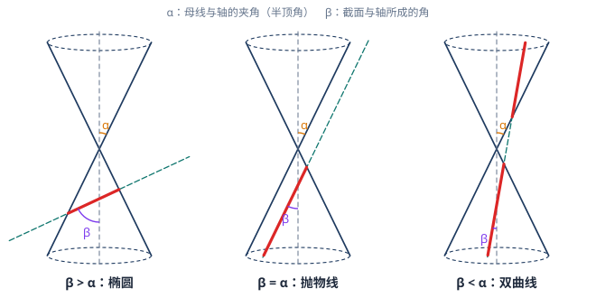
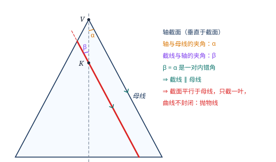
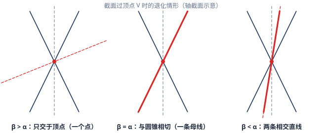
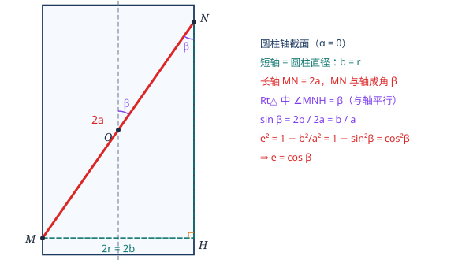

# 截口曲线：圆锥曲线的由来与分类

> **来源**：补充专题（丹德林双球 1/3） ｜ **适用模块**：五、离心率专题

*(说明：本专题统一记号为：==$\alpha$ = 圆锥的轴与母线的夹角（轴截面顶角的一半），$\beta$ = 截面与轴所成的角==，$\alpha, \beta \in \left(0, \frac{\pi}{2}\right)$，$\beta$ 可取 $0$ 与 $\frac{\pi}{2}$。有的资料把半顶角记作 $\theta$、把截面与轴所成角记作 $\alpha$，结论相同，只是字母对调，做题时先看清题目怎么设角。)*

## 一、圆锥曲线就是平面截圆锥得到的截口曲线

圆、椭圆、抛物线、双曲线统称圆锥曲线，因为它们都可以看作**用一个平面去截（双叶）圆锥面**所得的交线。截出哪一种，只看截面与轴所成的角 $\beta$ 和半顶角 $\alpha$ 的大小关系：

| 截面与轴所成的角 | 截面的位置特征 | 截口曲线 | 焦点在哪里 |
| --- | --- | --- | --- |
| $\beta = \frac{\pi}{2}$ | 截面垂直于轴（平着切） | 圆 | 圆心 |
| $\alpha < \beta < \frac{\pi}{2}$ | 比母线"更平"，只截一叶 | ==椭圆== | 截面两侧各一个内切球，两切点是两焦点 |
| $\beta = \alpha$ | ==截面平行于某条母线== | ==抛物线== | 只能放一个内切球，切点是焦点 |
| $0 \le \beta < \alpha$ | 比母线"更陡"，上下两叶都截到 | ==双曲线== | 上下两叶各一个内切球，两切点是两焦点 |

并且三种情况可以用同一个量统一：

$$e = \frac{\cos\beta}{\cos\alpha}$$

$\beta > \alpha \Leftrightarrow e < 1$（椭圆），$\beta = \alpha \Leftrightarrow e = 1$（抛物线），$\beta < \alpha \Leftrightarrow e > 1$（双曲线）；圆对应 $\beta = \frac{\pi}{2}$、$e = 0$。推导见本专题第 3 条。

## 二、几个要点的解释

1. **为什么 $\beta = \alpha$ 时截面平行于母线**：在与截面垂直的那个轴截面里看，截面成一条直线，它与轴的夹角是 $\beta$，母线与轴的夹角是 $\alpha$。$\beta = \alpha$ 时这条直线与一侧母线被轴所截，形成的==内错角相等==，所以截线与这条母线平行，截面就平行于这条母线，只与一叶相交且不封闭，得到抛物线。

    

2. **为什么 $\beta < \alpha$ 时会截到两叶**：截面比母线还陡，向上延伸会穿过顶点另一侧的那一叶，所以交线分成两支，这正是双曲线有两支的来源。极端情况 $\beta = 0$（截面平行于轴，竖着切）仍是双曲线，两支左右对称。
3. **为什么 $\alpha < \beta < \frac{\pi}{2}$ 时是封闭曲线**：截面比母线平，与一叶的所有母线都相交，交线是一条封闭曲线；$\beta$ 越接近 $\frac{\pi}{2}$ 越接近圆，$\beta$ 越接近 $\alpha$ 越扁。
4. **退化情形**：截面若经过圆锥顶点，截口退化为一个点（$\beta > \alpha$）、一条母线（$\beta = \alpha$，截面与圆锥相切）或两条相交直线（$\beta < \alpha$）。题目里的"截口曲线"默认截面不过顶点。

    

5. **"截面"与"焦点"的对应**：焦点永远是与截面相切、同时与圆锥侧面相切的球（丹德林球）和截面的切点。==双曲线的两个球分别在上下两叶里，但在截面的同一侧==；椭圆的两个球在同一叶里，分居截面两侧。这一点决定了第 2 条里 $2a$、$2c$ 的公式谁减"半径差"、谁减"半径和"。

## 三、圆柱也能截出椭圆

圆柱可以看成半顶角 $\alpha = 0$ 的"圆锥"（母线都平行于轴）。用与轴成角 $\beta\ (0 < \beta < \frac{\pi}{2})$ 的平面截圆柱，截口是椭圆，并且

$$e = \frac{\cos\beta}{\cos 0} = \cos\beta$$

即==截面与圆柱的轴所成角的余弦就是离心率==。

直接看图也能得到：短轴就是圆柱的直径，$b = r$；长轴 $MN$ 与轴成角 $\beta$，在 $\text{Rt}\triangle MNH$ 中 $\sin\beta = \frac{2b}{2a}$，所以 $e^2 = 1 - \frac{b^2}{a^2} = 1 - \sin^2\beta = \cos^2\beta$。
