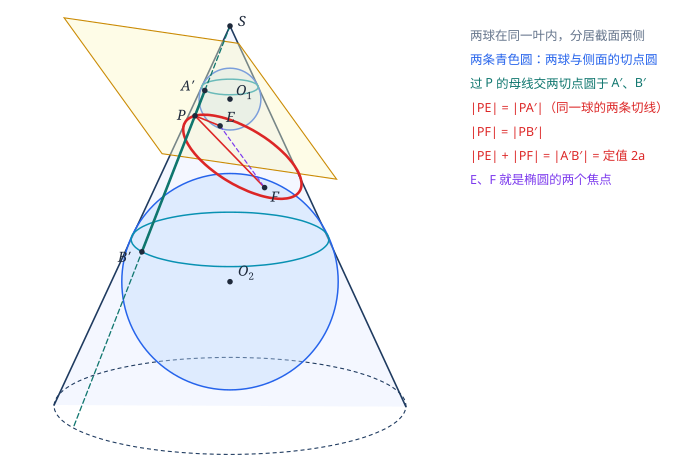
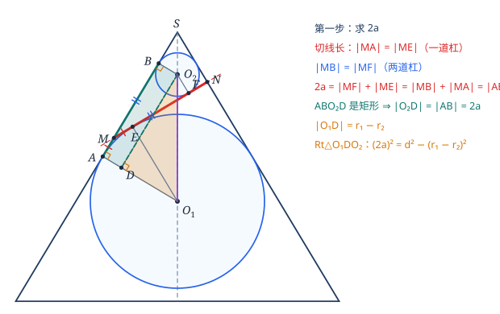
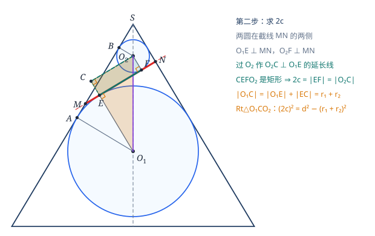
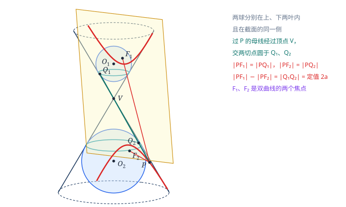
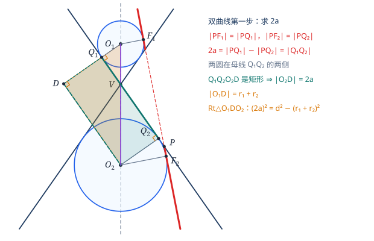
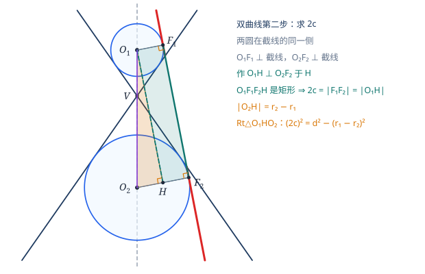
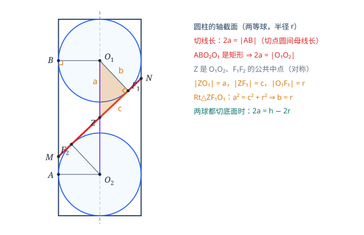
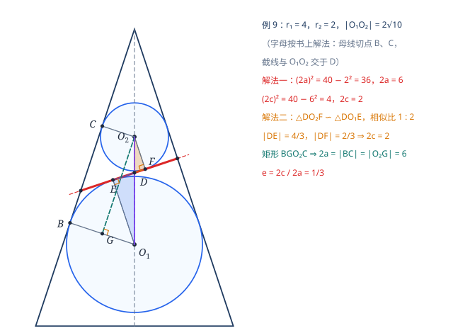
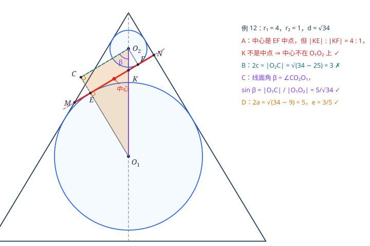

# 丹德林双球：证明截口是椭圆、双曲线，并在轴截面里求 2a、2c（含例 9、例 12）

> **来源**：补充专题（丹德林双球 2/3） ｜ **适用模块**：五、离心率专题

丹德林（G. Dandelin）在圆锥内放两个球，使它们==既与圆锥侧面相切，又与截面相切==（称为 Dandelin 双球），用它证明了截口曲线就是椭圆（双曲线），并且==两球与截面的切点就是两个焦点==。核心工具只有一个：

- **切线长定理（空间版）**：从球外一点向球引的所有切线，切线长都相等。

## 一、椭圆：证明 $|PE| + |PF|$ 为定值

如图，两球 $O_1$（半径 $r_1$）、$O_2$（半径 $r_2$）在同一叶圆锥内，分居截面两侧，分别与截面切于 $E$、$F$；两球与侧面相切的切点各组成一个圆（切点圆），两个切点圆所在平面都垂直于轴，彼此平行。

在截口曲线上任取一点 $P$，过 $P$ 作母线，与两个切点圆分别交于 $A'$、$B'$。

- $PE$、$PA'$ 都是从 $P$ 向球 $O_1$ 引的切线，所以 $|PE| = |PA'|$；同理 $|PF| = |PB'|$；
- 于是 $|PE| + |PF| = |PA'| + |PB'| = |A'B'|$。

$A'B'$ 是母线夹在两个平行切点圆之间的一段，==每条母线上这一段都一样长==，所以 $|PE| + |PF|$ 是定值，记为 $2a$。又 $P$ 不在线段 $EF$ 上，$2a = |PE| + |PF| > |EF|$，由椭圆定义，截口是以 $E$、$F$ 为焦点的椭圆，且 ==$2a$ 等于两切点圆之间的母线长==。

## 二、椭圆：在轴截面里算 $2a$、$2c$

取==过轴且垂直于截面的那个轴截面==（为什么它最好用，以及其中的角为什么就是 $\beta$，见第 3 条的补证）。两球的球心在轴上，切点 $E$、$F$ 和长轴端点 $M$、$N$ 都落在这个轴截面里，立体问题变成平面问题：

设 $A$、$B$ 为两圆与左侧母线的切点，$d = |O_1O_2|$。

**第一步：求 $2a$。**$|ME| = |MA|$，$|MF| = |MB|$，结合对称性 $|FN| = |ME|$，得 $2a = |MN| = |MF| + |ME| = |MB| + |MA| = |AB|$。过 $O_2$ 作 $O_2D \perp O_1A$ 于 $D$，因 $O_1A \perp AB$、$O_2B \perp AB$，四边形 $ABO_2D$ 为矩形，$|O_2D| = |AB|$，$|O_1D| = r_1 - r_2$。在 $\text{Rt}\triangle O_1DO_2$ 中：

$$(2a)^2 = d^2 - (r_1 - r_2)^2$$

**第二步：求 $2c$。**两圆在截线 $MN$ 两侧。过 $O_2$ 作 $O_2C \perp O_1E$，交 $O_1E$ 的延长线于 $C$，四边形 $CEFO_2$ 为矩形，$2c = |EF| = |O_2C|$，$|O_1C| = r_1 + r_2$。在 $\text{Rt}\triangle O_1CO_2$ 中：

$$(2c)^2 = d^2 - (r_1 + r_2)^2$$

**第三步：顺带得到短半轴。**$b^2 = a^2 - c^2 = \frac{(r_1 + r_2)^2 - (r_1 - r_2)^2}{4}$，即 ==$b^2 = r_1 r_2$==。

记忆：==椭圆 $2a$ 减半径差、$2c$ 减半径和==（$a$ 大，所以减得少）。

## 三、双曲线：证明 $||PF_1| - |PF_2||$ 为定值

两球分别在上、下两叶内，都与截面相切（切点 $F_1$、$F_2$），且==两球在截面同一侧==。在截口上任取一点 $P$，过 $P$ 的母线经过顶点 $V$，与两个切点圆分别交于 $Q_1$、$Q_2$（$Q_1$、$Q_2$ 在 $V$ 两侧）。由切线长定理 $|PF_1| = |PQ_1|$，$|PF_2| = |PQ_2|$，所以

$$||PF_1| - |PF_2|| = ||PQ_1| - |PQ_2|| = |Q_1Q_2| = |Q_1V| + |VQ_2|$$

$|Q_1V|$、$|VQ_2|$ 都是从顶点到切点圆的母线长，与母线的选取无关，所以这是定值 $2a$；又 $2a < |F_1F_2|$（三角形两边之差小于第三边），截口是以 $F_1$、$F_2$ 为焦点的双曲线。

在轴截面里分两步算（图中 $V$ 为顶点，$P$ 是截线与母线的交点）：

**第一步：求 $2a$。** 两圆在母线 $Q_1Q_2$ 两侧，延长 $O_1Q_1$ 到 $D$ 使 $Q_1Q_2O_2D$ 为矩形，则 $2a = |O_2D|$、$|O_1D| = r_1 + r_2$。

**第二步：求 $2c$。** 两圆在截线同侧，作 $O_1H \perp O_2F_2$ 于 $H$，则 $2c = |O_1H|$、$|O_2H| = |r_2 - r_1|$。

于是

$$(2a)^2 = d^2 - (r_1 + r_2)^2, \quad (2c)^2 = d^2 - (r_1 - r_2)^2$$

与椭圆正好反过来（双曲线 $c > a$），且同样有 ==$b^2 = c^2 - a^2 = r_1 r_2$==。

## 四、圆柱中的双球

圆柱内放两个与侧面相切的等球（半径 $r$），截面与两球都相切，截口是椭圆。仍由切线长定理，$2a$ 等于两切点圆之间的母线长，而圆柱的切点圆就过两个球心所在的水平面，所以 ==$2a = |O_1O_2|$==；若两球又分别与上、下底面相切，则 $2a = h - 2r$。由 $b^2 = r_1 r_2 = r^2$ 得 ==$b = r$==：两个等球、圆柱里，短半轴就是球的半径。

## 五、例题

**例 9（2023·广州一模）**：在圆锥内放两个大小不同的小球，使它们分别与圆锥的侧面与截面都相切，设球 $O_1$、球 $O_2$ 的半径分别为 $4$ 和 $2$，球心距离 $|O_1O_2| = 2\sqrt{10}$，截面分别与球 $O_1$、球 $O_2$ 相切于点 $E$、$F$（$E$、$F$ 是截口椭圆的焦点），则此椭圆的离心率等于______。

- **解法一（直接套公式）**：$(2a)^2 = 40 - (4 - 2)^2 = 36$，$2a = 6$；$(2c)^2 = 40 - (4 + 2)^2 = 4$，$2c = 2$。所以 $e = \frac{2c}{2a} =$ ==$\frac{1}{3}$==（验证：$b^2 = 9 - 1 = 8 = 4 \times 2 = r_1 r_2$）。
- **解法二（相似三角形，书上解法）**：设 $O_1O_2$ 与 $EF$ 交于 $D$。由 $\triangle DO_2F \sim \triangle DO_1E$ 得 $\frac{|DO_2|}{|DO_1|} = \frac{2}{4} = \frac{1}{2}$，又 $|DO_2| + |DO_1| = 2\sqrt{10}$，解得 $|O_2D| = \frac{2\sqrt{10}}{3}$，$|O_1D| = \frac{4\sqrt{10}}{3}$。于是 $|DE| = \sqrt{\frac{160}{9} - 16} = \frac{4}{3}$，$|DF| = \sqrt{\frac{40}{9} - 4} = \frac{2}{3}$，$2c = 2$。再设母线与两球切于 $B$、$C$，过 $O_2$ 作 $O_2G \perp O_1B$，矩形 $BGO_2C$ 给出 $2a = |BC| = \sqrt{40 - 2^2} = 6$，同样得 $e = \frac{1}{3}$。

**例 12（2024·多选·日照一模）**：在圆锥内放两个大小不同的小球，使它们分别与圆锥的侧面、截面相切，截面分别与球 $O_1$、球 $O_2$ 切于点 $E$、$F$（$E$、$F$ 是截口椭圆 $C$ 的焦点）。设球 $O_1$、球 $O_2$ 的半径分别为 $4$ 和 $1$，球心距 $|O_1O_2| = \sqrt{34}$，则（　）

- A. 椭圆 $C$ 的中心不在直线 $O_1O_2$ 上
- B. $|EF| = 4$
- C. 直线 $O_1O_2$ 与椭圆 $C$ 所在平面所成的角的正弦值为 $\frac{5\sqrt{34}}{34}$
- D. 椭圆 $C$ 的离心率为 $\frac{3}{5}$

**解析**：作长轴与轴确定的轴截面（数据就是第二部分两张图里的数据）。

- A：椭圆中心是长轴 $MN$ 的中点，也是焦距 $EF$ 的中点。截线与 $O_1O_2$ 交于两球之间的点 $K$，由 $\triangle KO_1E \sim \triangle KO_2F$ 得 $|KE| : |KF| = r_1 : r_2 = 4 : 1$，$K$ 不是 $EF$ 的中点，而截线与 $O_1O_2$ 只有 $K$ 这一个公共点，所以中心不在 $O_1O_2$ 上，A 正确。
- B：$2c = |EF| = \sqrt{34 - (4 + 1)^2} = 3$，B 错误。
- C：$O_1O_2$ 与椭圆所在平面所成角就是 $\beta = \angle CO_2O_1$，$\sin\beta = \frac{|O_1C|}{|O_1O_2|} = \frac{5}{\sqrt{34}} = \frac{5\sqrt{34}}{34}$，C 正确。
- D：$2a = \sqrt{34 - (4 - 1)^2} = 5$，$e = \frac{3}{5}$，D 正确。

故选 ==ACD==。
