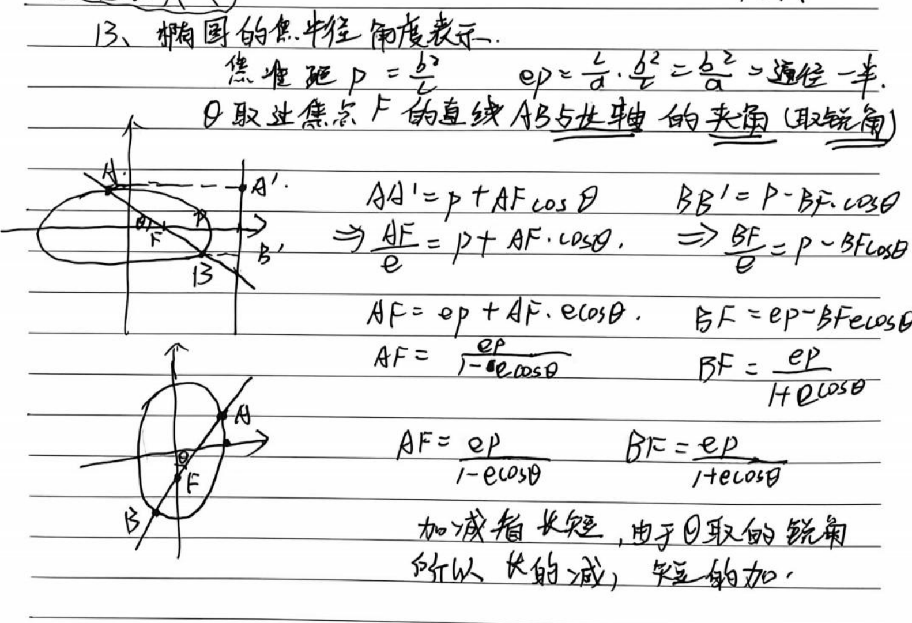
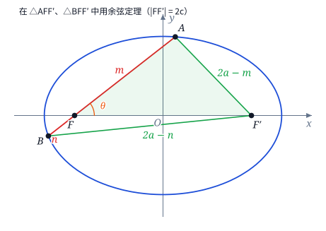

# 椭圆焦半径的角度表示

> **原稿序号**：小写 13. ｜ **原稿页码**：P26 ｜ **所属模块**：六、焦半径、焦点弦、弦长公式与离心率 → 2. 焦半径的角度表示、倒数和与定比公式

## 证法二：用第一定义 + 余弦定理（手写笔记整理）

> **来源**：手写笔记（照片），按原推导整理

$AB$ 过左焦点 $F$，倾斜角为 $\theta$，$F'$ 是右焦点。设 $|AF| = m$，$|BF| = n$，由第一定义 $|AF'| = 2a - m$，$|BF'| = 2a - n$，$|FF'| = 2c$。

**在 $\triangle AFF'$ 中**（$\angle AFF' = \theta$）：

$$(2a - m)^2 = m^2 + 4c^2 - 2 \cdot m \cdot 2c \cdot \cos \theta$$

$$4a^2 - 4am = 4c^2 - 4cm\cos \theta \;\Rightarrow\; m(a - c\cos \theta) = a^2 - c^2 = b^2$$

$$m = \frac{b^2}{a - c\cos \theta} = \frac{\frac{b^2}{a}}{1 - e\cos \theta}$$

**在 $\triangle BFF'$ 中**（$\angle BFF' = \pi - \theta$）：

$$(2a - n)^2 = n^2 + 4c^2 - 2 \cdot n \cdot 2c \cdot \cos(\pi - \theta) \;\Rightarrow\; n(a + c\cos \theta) = b^2$$

$$n = \frac{b^2}{a + c\cos \theta} = \frac{\frac{b^2}{a}}{1 + e\cos \theta}$$

所以 ==$|AF| = \frac{b^2}{a - c\cos \theta}$，$|BF| = \frac{b^2}{a + c\cos \theta}$==，与原稿结论一致。这个证法只用到第一定义，不需要准线。
