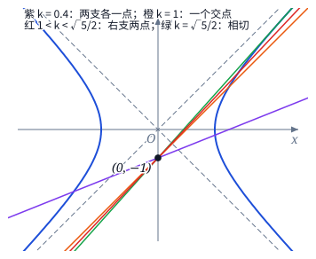
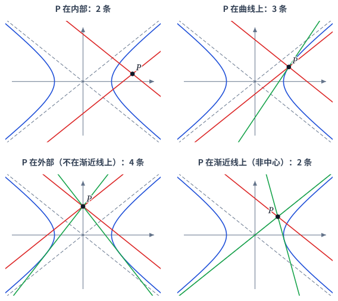
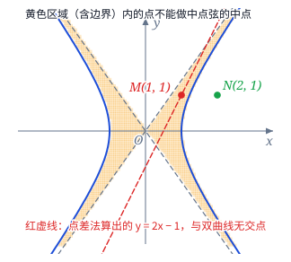

# 直线与双曲线交点个数的分类讨论（含中点弦存在性）

> **来源**：补充专题（直线与圆锥曲线的位置关系 2/2） ｜ **适用模块**：六、焦半径、焦点弦、弦长公式与离心率

（记号：$\frac{x^2}{a^2} - \frac{y^2}{b^2} = 1$，渐近线斜率 $\pm \frac{b}{a}$。）

## 一、联立后的方程

直线 $y = kx + m$ 代入，整理得

$$(b^2 - a^2k^2)x^2 - 2a^2kmx - a^2(m^2 + b^2) = 0$$

==二次项系数 $b^2 - a^2k^2$ 可能为 $0$==，这是双曲线和椭圆最大的不同。系数不为 $0$ 时

$$\Delta = 4a^2b^2(m^2 + b^2 - a^2k^2), \quad x_1 + x_2 = \frac{2a^2km}{b^2 - a^2k^2}, \quad x_1x_2 = \frac{-a^2(m^2 + b^2)}{b^2 - a^2k^2}$$

注意 $x_1x_2$ 的分子 $-a^2(m^2 + b^2)$ 恒为负，所以==两交点在两支（$x_1x_2 < 0$）$\Leftrightarrow$ $b^2 - a^2k^2 > 0$ $\Leftrightarrow$ $|k| < \frac{b}{a}$==。

## 二、按斜率分类（核心：和渐近线斜率比）

| 斜率 | 交点情况 | 理由 |
| --- | --- | --- |
| ==$|k| < \frac{b}{a}$== | ==恒有两个交点，左右两支各一个== | $b^2 - a^2k^2 > 0$，$\Delta > 0$ 自动成立，$x_1x_2 < 0$ |
| ==$|k| = \frac{b}{a}$== | $m \ne 0$：==只有一个交点==（相交不相切）；$m = 0$：就是渐近线，无交点 | 方程变成一次方程 |
| $|k| > \frac{b}{a}$ | $m^2 > a^2k^2 - b^2$：==同一支上两个交点==；$m^2 = a^2k^2 - b^2$：相切；$m^2 < a^2k^2 - b^2$：无交点 | 看 $\Delta$，$x_1x_2 > 0$ |
| 竖直线 $x = t$ | $|t| > a$ 同一支两点；$|t| = a$ 相切；$|t| < a$ 无交点 | 相当于 $k \to \infty$ |

**口诀**：==比渐近线平，两支各一；和渐近线平行，只交一点；比渐近线陡，同支两点、相切或相离。==

所以「直线与双曲线只有一个公共点」有两种情形：==平行于渐近线（相交）==或==相切==，两种都要写。

## 三、与某一支有两个交点

要求两交点都在右支：$b^2 - a^2k^2 \ne 0$，且

$$\Delta > 0, \quad x_1 + x_2 > 0, \quad x_1x_2 > 0$$

都在左支把 $x_1 + x_2 > 0$ 改成 $< 0$；两支各一个只需 $x_1x_2 < 0$。

**例 1**　直线 $y = kx - 1$ 与双曲线 $x^2 - y^2 = 4$，分别求满足下列条件的 $k$：(1) 只有一个公共点；(2) 有两个公共点；(3) 与右支有两个公共点；(4) 与左右两支各有一个公共点。

**解**：代入得 $(1 - k^2)x^2 + 2kx - 5 = 0$。

(1) $1 - k^2 = 0$ 时 $k = \pm 1$，一个交点；$1 - k^2 \ne 0$ 时 $\Delta = 4k^2 + 20(1 - k^2) = 20 - 16k^2 = 0$，$k = \pm \frac{\sqrt{5}}{2}$，相切。所以 ==$k = \pm 1$ 或 $k = \pm \frac{\sqrt{5}}{2}$==。

(2) $1 - k^2 \ne 0$ 且 $\Delta > 0$：==$-\frac{\sqrt{5}}{2} < k < \frac{\sqrt{5}}{2}$ 且 $k \ne \pm 1$==。

(3) $\Delta > 0$，$x_1x_2 = \frac{-5}{1 - k^2} > 0 \Rightarrow k^2 > 1$，$x_1 + x_2 = \frac{-2k}{1 - k^2} > 0$，分母为负所以 $k > 0$。合起来 ==$1 < k < \frac{\sqrt{5}}{2}$==。

(4) $x_1x_2 < 0 \Rightarrow 1 - k^2 > 0$，==$-1 < k < 1$==（$\Delta > 0$ 自动成立）。

（同理，与左支有两个交点：$-\frac{\sqrt{5}}{2} < k < -1$。四个答案拼起来正好是 $k$ 的全部分类，可以用来检查。）

## 四、过定点的直线与双曲线只有一个公共点：几条？

按定点 $P$ 的位置分五种情况。数法：==平行于渐近线的直线（每条渐近线方向各一条，过 $P$ 的那条若恰为渐近线本身则不算）+ 过 $P$ 的切线条数==。

| $P$ 的位置 | 平行于渐近线 | 切线 | 合计 |
| --- | --- | --- | --- |
| 双曲线内部（含焦点的区域） | 2 | 0 | ==2== |
| 双曲线上 | 2 | 1 | ==3== |
| 外部（两支之间，不在渐近线上） | 2 | 2 | ==4== |
| 渐近线上（不是中心） | 1 | 1 | ==2== |
| 中心 | 0 | 0 | ==0== |

说明：

- $P$ 在渐近线上时，平行于这条渐近线的那条直线就是渐近线本身，没有交点；而从 $P$ 只能作一条切线（另一条「切线」退化成渐近线），所以共 2 条。
- $P$ 是中心时，过中心的直线要么与双曲线交两点，要么是渐近线、要么不相交，一条都没有。
- 例如 $P(1, 1)$ 与 $x^2 - y^2 = 1$：$P$ 在渐近线 $y = x$ 上，答案 2 条；$P(2, 0)$（内部）2 条；$P(1, 0)$（顶点，在曲线上）3 条：$x = 1$、$y = \pm(x - 1)$；$P(0, 1)$（外部）4 条。

## 五、中点弦一定存在吗（重要）

椭圆内部任一点都是某条弦的中点；双曲线不是。用点差法求出的「中点弦」，==必须回代检验 $\Delta > 0$==。

**结论**：以 $M(x_0, y_0)$ 为中点的弦存在 $\Leftrightarrow$

$$\frac{x_0^2}{a^2} - \frac{y_0^2}{b^2} > 1 \quad \text{或} \quad \frac{x_0^2}{a^2} - \frac{y_0^2}{b^2} < 0$$

即 $M$ 在双曲线内部，或在两条渐近线之间含 $y$ 轴的区域；==夹在双曲线与渐近线之间的区域（含渐近线、含曲线本身）里的点，都不是任何弦的中点==。

**证明**：记 $s = \frac{x_0^2}{a^2} - \frac{y_0^2}{b^2}$。由半代换，以 $M$ 为中点的弦所在直线为 $\frac{x_0x}{a^2} - \frac{y_0y}{b^2} = s$（模块七第 2、4 节）。用第一条的相交条件「$Ax + By = C$ 与双曲线交于两点 $\Leftrightarrow$ $C^2 > A^2a^2 - B^2b^2$」，这里 $A = \frac{x_0}{a^2}$，$B = -\frac{y_0}{b^2}$，$C = s$，$A^2a^2 - B^2b^2 = s$，所以条件是 $s^2 > s$，即 $s > 1$ 或 $s < 0$。（$s = 0$ 时 $M$ 在渐近线上，算出的直线就是渐近线，也不行。）

**例 2**　双曲线 $x^2 - \frac{y^2}{2} = 1$，是否存在被点 $M(1, 1)$ 平分的弦？

**解**：点差法得 $k = \frac{b^2x_0}{a^2y_0} = 2$，直线 $y = 2x - 1$。回代：$x^2 - \frac{(2x - 1)^2}{2} = 1 \Rightarrow 2x^2 - 4x + 3 = 0$，$\Delta = 16 - 24 < 0$，==不存在==。用结论更快：$s = 1 - \frac{1}{2} = \frac{1}{2} \in [0, 1]$，不存在。而 $N(2, 1)$：$s = 4 - \frac{1}{2} > 1$，存在，弦所在直线 $y = 4x - 7$。

**例 3**（2023 全国乙卷）　设 $A$、$B$ 为双曲线 $x^2 - \frac{y^2}{9} = 1$ 上两点，下列四个点中，可为线段 $AB$ 中点的是（　）

A．$(1, 1)$　　B．$(-1, 2)$　　C．$(1, 3)$　　D．$(-1, -4)$

**解**：算 $s = x_0^2 - \frac{y_0^2}{9}$，要求 $s > 1$ 或 $s < 0$：

- A：$s = 1 - \frac{1}{9} = \frac{8}{9}$，在 $[0, 1]$ 内，不行；
- B：$s = 1 - \frac{4}{9} = \frac{5}{9}$，不行；
- C：$s = 1 - 1 = 0$，点在渐近线 $y = 3x$ 上，不行；
- D：$s = 1 - \frac{16}{9} = -\frac{7}{9} < 0$，可以。

答案 ==D==。验证 D：点差法 $k = \frac{9x_0}{y_0} = \frac{9}{4}$，直线 $y = \frac{9}{4}x - \frac{7}{4}$，代入得 $63x^2 + 126x - 193 = 0$，$\Delta > 0$，确实有两个交点。

这道题如果逐个用点差法求直线再回代，要算四次判别式；记住上面的区域结论，四个选项心算就能排除。

（抛物线：以 $M$ 为中点的弦存在 $\Leftrightarrow$ $M$ 在抛物线内部 $y_0^2 < 2px_0$。椭圆：$M$ 在内部即可。）
