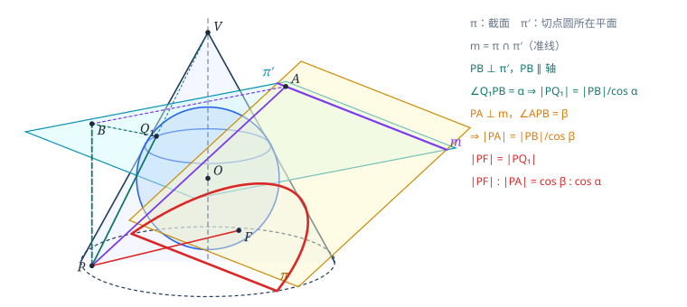

# 离心率与截面角：$e = \frac{\cos\beta}{\cos\alpha}$ 的三种证明（含准线、补证与例 11）

> **来源**：补充专题（丹德林双球 3/3） ｜ **适用模块**：六、焦半径、焦点弦、弦长公式与离心率

**结论**：圆锥的轴与母线夹角为 $\alpha$，截面与轴所成的角为 $\beta$，则截口曲线的离心率

$$e = \frac{\cos\beta}{\cos\alpha}$$

==离心率就是"截面与轴的夹角余弦"比"母线与轴的夹角余弦"==，三种曲线通用；圆柱中 $\alpha = 0$，$e = \cos\beta$。

## 一、先补两处"角相等"（证明要用，资料里没有说明）

**补证 1：轴截面里截线与轴的夹角，就是线面角 $\beta$。**

取过轴 $l$ 且垂直于截面 $\pi$ 的平面 $σ$（在 $l$ 上任取一点作 $\pi$ 的垂线，它与 $l$ 确定的平面即为 $σ$；它含 $\pi$ 的垂线，故 $σ \perp \pi$）。设 $σ ∩ \pi = MN$，$l$ 与 $MN$ 交于 $K$。在 $l$ 上任取一点 $S$，在 $σ$ 内作 $ST \perp MN$ 于 $T$。因为 $σ \perp \pi$，$ST ⊂ σ$ 且垂直于交线 $MN$，由==面面垂直的性质定理==，$ST \perp \pi$，所以 $T$ 是 $S$ 在 $\pi$ 上的射影，$KT$（即 $MN$）是 $l$ 在 $\pi$ 内的射影。因此 $l$ 与 $\pi$ 所成的角 $\beta$ 就等于轴截面 $σ$ 里 $l$ 与 $MN$ 的夹角。另外，整个图形关于 $σ$ 对称，所以长轴、两球球心、两个焦点都在 $σ$ 内。

**补证 2：$\angle O_1O_2D = \alpha$，$\angle O_1O_2C = \beta$（第 2 条椭圆轴截面图）。**

矩形 $ABO_2D$ 中 $O_2D \parallel AB$，而 $AB$ 在母线上，$O_1O_2$ 在轴上，所以 $O_2D$ 与轴的夹角等于母线与轴的夹角 $\alpha$；矩形 $CEFO_2$ 中 $O_2C \parallel EF$，由补证 1，$EF$ 与轴的夹角为 $\beta$，所以 $\angle O_1O_2C = \beta$。双曲线图中 $\angle DO_2O_1 = \alpha$、$\angle HO_1O_2 = \beta$ 同理。

## 二、证法一：轴截面中的直角三角形（最快）

接第 2 条的椭圆轴截面：$2a = |O_2D|$，$2c = |O_2C|$，$d = |O_1O_2|$。在两个直角三角形里，由补证 2：

$$\cos\alpha = \frac{|O_2D|}{|O_1O_2|} = \frac{2a}{d}, \quad \cos\beta = \frac{|O_2C|}{|O_1O_2|} = \frac{2c}{d}$$

两式相除，$e = \frac{2c}{2a} = \frac{\cos\beta}{\cos\alpha}$。双曲线用 $\text{Rt}\triangle O_1DO_2$ 与 $\text{Rt}\triangle O_1HO_2$，完全同理。

反过来也说明了分类：椭圆 $e < 1 \Leftrightarrow \cos\beta < \cos\alpha \Leftrightarrow \beta > \alpha$（余弦在 $\left(0, \frac{\pi}{2}\right)$ 上递减）；双曲线 $e > 1 \Leftrightarrow \beta < \alpha$。

## 三、证法二：相交弦定理 + 正弦定理（不放球）

设截口为椭圆，长轴 $A_1A_2 = 2a$，中心 $N$，短轴 $B_1B_2 = 2b$。过 $N$ 作垂直于轴的圆截面，它在轴截面里的直径为 $C_1C_2$（$C_1$ 在 $PA_1$ 上，$C_2$ 在 $PA_2$ 上，$P$ 为顶点）。

- **相交弦**：$B_1B_2 \perp$ 轴截面，所以 $B_1B_2$ 垂直于轴，在这个圆截面里，且被 $N$ 平分；$B_1B_2$ 与直径 $C_1C_2$ 交于 $N$，由相交弦定理 $b^2 = |NB_1| \cdot |NB_2| = |NC_1| \cdot |NC_2|$。
- **找角**（在轴截面里）：$\triangle PA_1A_2$ 中 $\angle A_1PK = \alpha$（$K$ 为 $A_1A_2$ 与轴的交点），$\angle PKA_1 = \beta$，所以 $\angle C_1A_1N = \alpha + \beta$（外角），$\angle A_1C_1N = 90^\circ - \alpha$（母线与水平直径的夹角）；同理 $\angle C_2A_2N = \beta - \alpha$，$\angle A_2C_2N = 90^\circ + \alpha$。
- **正弦定理**：在 $\triangle A_1NC_1$ 中 $\frac{|NC_1|}{\sin(\alpha + \beta)} = \frac{a}{\sin(90^\circ - \alpha)}$；在 $\triangle A_2NC_2$ 中 $\frac{|NC_2|}{\sin(\beta - \alpha)} = \frac{a}{\sin(90^\circ + \alpha)}$。所以

$$b^2 = |NC_1| \cdot |NC_2| = a^2 \cdot \frac{\sin(\beta + \alpha)\sin(\beta - \alpha)}{\cos^2\alpha}$$

- 利用 $\sin(\beta + \alpha)\sin(\beta - \alpha) = \sin^2\beta\cos^2\alpha - \cos^2\beta\sin^2\alpha = \sin^2\beta - \sin^2\alpha$：

$$e^2 = 1 - \frac{b^2}{a^2} = 1 - \frac{\sin^2\beta - \sin^2\alpha}{\cos^2\alpha} = \frac{1 - \sin^2\beta}{\cos^2\alpha} = \frac{\cos^2\beta}{\cos^2\alpha}$$

故 $e = \frac{\cos\beta}{\cos\alpha}$。

## 四、证法三：一个球 + 准线（抛物线也能证，三种曲线统一）

只放一个与侧面、截面 $\pi$ 都相切的球（切截面于 $F$），它与侧面的切点圆所在平面记为 $\pi'$（$\pi' \perp$ 轴），设 $m = \pi ∩ \pi'$。在截口上任取一点 $P$：

1. 过 $P$ 的母线交切点圆于 $Q_1$，由切线长定理 ==$|PF| = |PQ_1|$==。
2. 作 $PB \perp \pi'$ 于 $B$，则 $PB \parallel$ 轴，$PQ_1$ 在母线上，所以 $\angle Q_1PB = \alpha$，$|PQ_1| = \frac{|PB|}{\cos\alpha}$。
3. 在 $\pi$ 内作 $PA \perp m$ 于 $A$。**补证 3（$\angle APB = \beta$）**：$PB \perp \pi'$，$m ⊂ \pi'$，所以 $PB \perp m$；又 $PA \perp m$，所以 $m \perp$ 平面 $PAB$，从而平面 $PAB \perp \pi$，交线为 $PA$。于是 $PB$ 在 $\pi$ 内的射影落在 $PA$ 上，$\angle APB$ 正是 $PB$（即轴的方向）与 $\pi$ 所成的角 $\beta$，$|PA| = \frac{|PB|}{\cos\beta}$。
4. 两式相比：

$$\frac{|PF|}{|PA|} = \frac{|PQ_1|}{|PA|} = \frac{|PB| / \cos\alpha}{|PB| / \cos\beta} = \frac{\cos\beta}{\cos\alpha}$$

$|PA|$ 是 $P$ 到直线 $m$ 的距离，所以截口上的点到定点 $F$ 与到定直线 $m$ 的距离之比为常数 $\frac{\cos\beta}{\cos\alpha}$。这就是圆锥曲线的第二定义：==$F$ 是焦点，$m$ 是对应的准线==，离心率 $e = \frac{\cos\beta}{\cos\alpha}$。特别地，$\beta = \alpha$ 时 $|PF| = |PA|$，截口是抛物线（此时只能放下一个球，双球法用不上，必须用这个证法）。

## 五、例题

**例 11（2024·杭州二模）**：机场为旅客提供的圆锥形纸杯，母线长为 $12\,\text{cm}$，开口直径为 $8\,\text{cm}$。旅客使用纸杯喝水时，当水面与纸杯内壁所形成的椭圆经过母线中点时，椭圆的离心率等于______。

**解析**：作纸杯的轴截面 $\triangle ABC$（$A$ 为杯底尖点，$BC$ 为杯口直径，$AD$ 为轴，$D$ 为 $BC$ 中点），水面的长轴为 $BE$，$E$ 为 $AC$ 中点。杯子是在这个轴截面内倾斜的，所以水面垂直于该轴截面，由补证 1，$\angle BMD = \beta$（$M = BE ∩ AD$）。

- $\cos\alpha = \frac{|AD|}{|AB|} = \frac{\sqrt{12^2 - 4^2}}{12} = \frac{2\sqrt{2}}{3}$；
- $\cos C = \frac{4}{12} = \frac{1}{3}$，$|BE| = \sqrt{8^2 + 6^2 - 2 \times 8 \times 6 \times \frac{1}{3}} = 2\sqrt{17}$；
- $M$ 是两条中线 $AD$、$BE$ 的交点，即重心，$|MD| = \frac{1}{3}|AD| = \frac{8\sqrt{2}}{3}$，$|BM| = \frac{2}{3}|BE| = \frac{4\sqrt{17}}{3}$，$\triangle BMD$ 中 $\angle BDM = 90^\circ$，$\cos\beta = \frac{|MD|}{|BM|} = \frac{2\sqrt{2}}{\sqrt{17}}$；
- $e = \frac{\cos\beta}{\cos\alpha} = \frac{2\sqrt{2}}{\sqrt{17}} \cdot \frac{3}{2\sqrt{2}} = \frac{3}{\sqrt{17}} =$ ==$\frac{3\sqrt{17}}{17}$==。
