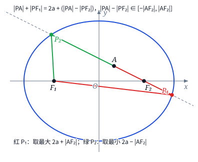
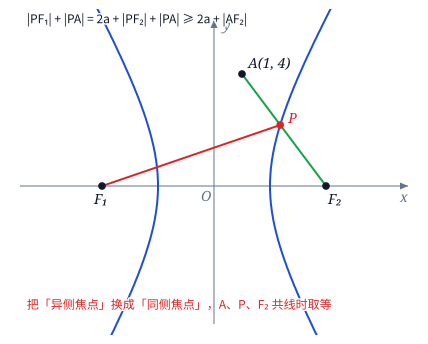
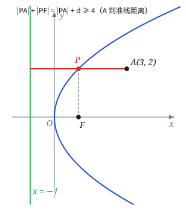
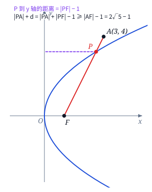
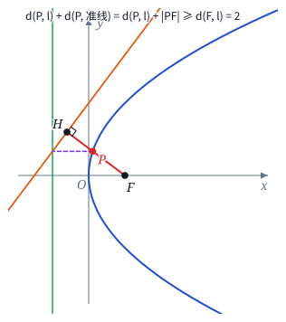
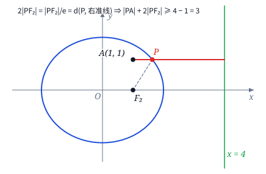
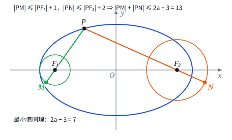

# 定义转化型最值：和差最值、焦半径与准线转化

> **来源**：补充专题（圆锥曲线中的最值与范围问题 1/3） ｜ **适用模块**：六、焦半径、焦点弦、弦长公式与离心率

*(圆锥曲线最值小题按方法分三类：本条是「用定义把一段距离换成另一段，再用三角形两边之和差或垂线段最短」；第 2 条是「设点坐标或参数，化成函数求最值」；第 3 条是弦长、面积、角度的最值。所有转化的落脚点只有三个：==两点之间线段最短==、==三角形两边之差小于第三边==、==点到直线垂线段最短==。)*

## 一、方法总表

| 曲线 | 要求的式子 | 转化 | 结果 |
| --- | --- | --- | --- |
| 椭圆 | $|PA| + |PF_1|$（$A$ 在内部） | $|PF_1| = 2a - |PF_2|$ | ==$[2a - |AF_2|, \, 2a + |AF_2|]$== |
| 双曲线 | $|PA| + |PF_1|$（$P$ 在右支，$A$ 与 $F_2$ 在右支两侧） | $|PF_1| = 2a + |PF_2|$ | ==最小 $2a + |AF_2|$== |
| 抛物线 | $|PA| + |PF|$（$A$ 在内部） | $|PF| = d$（到准线） | 最小为 $A$ 到准线的距离 |
| 抛物线 | $|PA| + |PF|$（$A$ 在外部） | 直接 | 最小 $|AF|$ |
| 抛物线 | $|PA| + d(P, y\text{轴})$ | $d = |PF| - \frac{p}{2}$ | 最小 $|AF| - \frac{p}{2}$（$A$ 在外部） |
| 抛物线 | $d(P, l) + d(P, \text{准线})$ | $d(P, \text{准线}) = |PF|$ | 最小 $d(F, l)$ |
| 椭圆 / 双曲线 | $|PA| + \frac{1}{e}|PF|$ | 第二定义 $\frac{1}{e}|PF| = d$ | 最小为 $A$ 到相应准线距离 |
| 椭圆 | $|PM| + |PN|$，$M$、$N$ 在以焦点为圆心的圆上 | 先固定 $P$，$|PM| \le |PF_1| + r_1$ | $[2a - r_1 - r_2, \, 2a + r_1 + r_2]$ |

## 二、椭圆：$|PA| + |PF_1|$

**例 1**　$P$ 在椭圆 $\frac{x^2}{25} + \frac{y^2}{16} = 1$ 上，$A(1, 1)$，$F_1$ 为左焦点，求 $|PA| + |PF_1|$ 的范围。

**解**：$c = 3$，$F_2(3, 0)$，$|AF_2| = \sqrt{5}$。$|PA| + |PF_1| = 2a + (|PA| - |PF_2|) = 10 + (|PA| - |PF_2|)$。在 $\triangle PAF_2$ 中 $\left||PA| - |PF_2|\right| \le |AF_2| = \sqrt{5}$，$P$、$A$、$F_2$ 共线时取等：$F_2$ 在 $A$、$P$ 之间取最大，$A$ 在 $P$、$F_2$ 之间取最小。所以 ==$|PA| + |PF_1| \in [10 - \sqrt{5}, \, 10 + \sqrt{5}]$==。

**关键**：求的是 $|PA|$ 与 $F_1$ 的和，却要连 $AF_2$，「==和换差，换到另一个焦点==」。

## 三、双曲线：异侧换同侧

**例 2**　$F_1$ 是双曲线 $\frac{x^2}{4} - \frac{y^2}{12} = 1$ 的左焦点，$A(1, 4)$，$P$ 是右支上的动点，求 $|PF_1| + |PA|$ 的最小值。

**解**：$a = 2$，$c = 4$，$F_2(4, 0)$。$P$ 在右支，$|PF_1| = 2a + |PF_2| = 4 + |PF_2|$，所以

$$|PF_1| + |PA| = 4 + |PF_2| + |PA| \ge 4 + |AF_2| = 4 + 5 = 9$$

$A$ 在两支之间、$F_2$ 在右支内部，线段 $AF_2$ 与右支有交点，取等成立，==最小值 $9$==。

**易错**：若 $A$ 与 $F_2$ 在右支同侧（都在右支内部），线段 $AF_2$ 与右支没有交点，就不能这样取等。

## 四、抛物线：到焦点与到准线互换

**例 3**　$P$ 在抛物线 $y^2 = 4x$ 上，$F$ 为焦点。(1) $A(3, 2)$，求 $|PA| + |PF|$ 最小值；(2) $A(3, 4)$，求 $|PA| + d$ 的最小值，$d$ 为 $P$ 到 $y$ 轴的距离。

**解**：(1) $2^2 < 4 \times 3$，$A$ 在内部。$|PF| = d(P, \text{准线})$，$|PA| + |PF| \ge A$ 到准线 $x = -1$ 的距离 $= 4$，$P(1, 2)$ 时取等，==最小值 $4$==。

(2) $4^2 > 4 \times 3$，$A$ 在外部。$d = |PF| - 1$，$|PA| + d = |PA| + |PF| - 1 \ge |AF| - 1 = \sqrt{4 + 16} - 1$，最小值 ==$2\sqrt{5} - 1$==（$P$ 为线段 $AF$ 与抛物线的交点）。

**口诀**：==点在内部用准线，点在外部用焦点==。

**例 4**　$P$ 在 $y^2 = 4x$ 上，求 $P$ 到直线 $l: 4x - 3y + 6 = 0$ 与到准线 $x = -1$ 的距离之和的最小值。

**解**：$d(P, \text{准线}) = |PF|$，和 $= d(P, l) + |PF| \ge d(F, l) = \frac{|4 + 6|}{5} = 2$，==最小值 $2$==（过 $F$ 作 $l$ 的垂线，与抛物线的交点即为 $P$）。

## 五、第二定义：把 $\frac{1}{e}|PF|$ 换成到准线的距离

**例 5**　$P$ 在椭圆 $\frac{x^2}{4} + \frac{y^2}{3} = 1$ 上，$F$ 为右焦点，$A(1, 1)$，求 $|PA| + 2|PF|$ 的最小值。

**解**：$e = \frac{1}{2}$，右准线 $x = 4$，$2|PF| = \frac{|PF|}{e} = d(P, \text{右准线})$。$|PA| + d \ge A$ 到准线的距离 $= 4 - 1 = 3$，过 $A$ 作准线的垂线与椭圆交于 $P\left(\frac{2\sqrt{6}}{3}, 1\right)$，==最小值 $3$==。

**识别信号**：系数恰好是 $\frac{1}{e}$（如 $2|PF|$ 配 $e = \frac{1}{2}$，$\frac{5}{3}|PF|$ 配 $e = \frac{3}{5}$）。

## 六、两个圆：先放缩到圆心

**例 6**　$P$ 在椭圆 $\frac{x^2}{25} + \frac{y^2}{9} = 1$ 上，$M$、$N$ 分别在圆 $(x + 4)^2 + y^2 = 1$ 和 $(x - 4)^2 + y^2 = 4$ 上，求 $|PM| + |PN|$ 的范围。

**解**：两圆心是焦点 $F_1(-4, 0)$、$F_2(4, 0)$。固定 $P$，$|PF_1| - 1 \le |PM| \le |PF_1| + 1$，$|PF_2| - 2 \le |PN| \le |PF_2| + 2$，相加并用 $|PF_1| + |PF_2| = 10$：==$|PM| + |PN| \in [7, 13]$==。

## 七、焦半径本身的范围（常作为隐含条件）

| 曲线 | 焦半径范围 | 取到位置 |
| --- | --- | --- |
| 椭圆 | ==$[a - c, \, a + c]$== | 长轴两端点 |
| 双曲线 | ==$[c - a, +\infty)$== | 同侧顶点 |
| 抛物线 | $\left[\frac{p}{2}, +\infty\right)$ | 顶点 |

推论：椭圆 $|PF_1| \cdot |PF_2| = |PF_1|(2a - |PF_1|) \in [b^2, a^2]$（短轴端点最大 $a^2$，长轴端点最小 $b^2$）；双曲线 $|PF_1| \cdot |PF_2| \ge b^2$（顶点处最小）。
