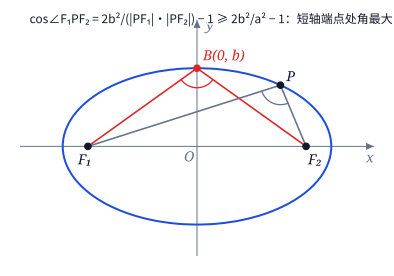
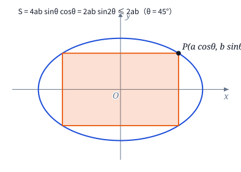
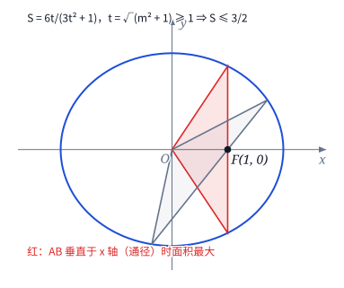
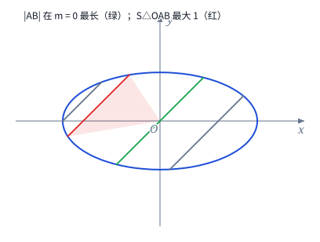

# 弦长、面积与角度型最值

> **来源**：补充专题（圆锥曲线中的最值与范围问题 3/3） ｜ **适用模块**：六、焦半径、焦点弦、弦长公式与离心率

## 一、焦点弦长的最值

由焦点弦长公式（本模块第 3 节）：

| 曲线 | 焦点弦长 | 最小值 | 最大值 |
| --- | --- | --- | --- |
| 椭圆 | $\frac{2ab^2}{a^2 - c^2\cos^2\theta}$ | ==通径 $\frac{2b^2}{a}$== | 长轴 $2a$ |
| 双曲线（同支） | $\frac{2ab^2}{\left|a^2 - c^2\cos^2\theta \right|}$ | ==通径 $\frac{2b^2}{a}$== | 无 |
| 双曲线（异支） | 同上 | 实轴 $2a$ | 无 |
| 抛物线 | $\frac{2p}{\sin^2\theta}$ | ==通径 $2p$== | 无 |

所以「过焦点的弦长为 $l$ 的直线有几条」看 $l$ 与通径、实轴的大小：例如双曲线 $x^2 - \frac{y^2}{2} = 1$（通径 $4$，实轴 $2$），过焦点弦长为 $4$ 的直线有 $3$ 条（通径 1 条 + 异支 2 条）。

## 二、角度最值：$\angle F_1PF_2$

椭圆上 $\angle F_1PF_2$ 在==短轴端点处最大==：设 $|PF_1| = r_1$，$|PF_2| = r_2$，

$$\cos \angle F_1PF_2 = \frac{r_1^2 + r_2^2 - 4c^2}{2r_1r_2} = \frac{(r_1 + r_2)^2 - 4c^2}{2r_1r_2} - 1 = \frac{2b^2}{r_1r_2} - 1 \ge \frac{2b^2}{a^2} - 1$$

（$r_1r_2 \le \left(\frac{r_1 + r_2}{2}\right)^2 = a^2$，$r_1 = r_2$ 即短轴端点时取等。）

**应用**：

- 椭圆上存在 $P$ 使 $\angle F_1PF_2 = 90^\circ$ $\Leftrightarrow$ 短轴端点处顶角 $\ge 90^\circ$ $\Leftrightarrow$ $c \ge b$ $\Leftrightarrow$ ==$e \in \left[\frac{\sqrt{2}}{2}, 1\right)$==。
- 存在 $P$ 使 $\angle F_1PF_2 = 120^\circ$ $\Leftrightarrow$ $e \in \left[\frac{\sqrt{3}}{2}, 1\right)$。
- 同理 $\angle A_1PA_2$（$A_1$、$A_2$ 为长轴端点）也在短轴端点处最大。

## 三、面积最值

**1. 焦点三角形**：$S = c|y_0| \le bc$，==短轴端点处最大 $bc$==。

**2. 内接矩形**：$P(a\cos \theta, b\sin \theta)$，$S = 4ab\sin \theta \cos \theta = 2ab\sin 2\theta$，==最大 $2ab$==（$\theta = 45^\circ$）。

**3. 过焦点的弦与中心构成的三角形**（对勾函数型，最常考）

**例 1**　过椭圆 $\frac{x^2}{4} + \frac{y^2}{3} = 1$ 右焦点 $F(1, 0)$ 的直线交椭圆于 $A$、$B$，求 $\triangle OAB$ 面积的最大值。

**解**：设 $AB: x = my + 1$（==设成 $x = my + 1$ 可包含竖直线，又避开水平线这种退化情况==），代入得 $(3m^2 + 4)y^2 + 6my - 9 = 0$，

$$|y_1 - y_2| = \frac{\sqrt{36m^2 + 36(3m^2 + 4)}}{3m^2 + 4} = \frac{12\sqrt{m^2 + 1}}{3m^2 + 4}$$

$S = \frac{1}{2}|OF| \cdot |y_1 - y_2| = \frac{6\sqrt{m^2 + 1}}{3m^2 + 4}$。令 $t = \sqrt{m^2 + 1} \ge 1$，

$$S = \frac{6t}{3t^2 + 1} = \frac{6}{3t + \frac{1}{t}}$$

$3t + \frac{1}{t}$ 在 $[1, +\infty)$ 上单调递增（对勾函数的拐点 $t = \frac{\sqrt{3}}{3} < 1$），所以 $t = 1$（$m = 0$，$AB$ 为通径）时 ==$S_{\max} = \frac{3}{2}$==。

**注意**：若拐点落在定义域内，最大值就在拐点处取，不一定是通径。抛物线的同类问题见原稿焦点弦性质 ⑤：$S_{\triangle AOB} = \frac{p^2}{2\sin \theta} \ge \frac{p^2}{2}$，==通径时最小==。

**4. 平行弦（斜率固定）的弦长与面积**

**例 2**　直线 $y = x + m$ 与椭圆 $\frac{x^2}{4} + y^2 = 1$ 交于 $A$、$B$，求 $|AB|$ 的最大值与 $\triangle OAB$ 面积的最大值。

**解**：代入得 $5x^2 + 8mx + 4m^2 - 4 = 0$，$\Delta > 0 \Rightarrow m^2 < 5$。

$$|AB| = \sqrt{2} \cdot \frac{\sqrt{64m^2 - 20(4m^2 - 4)}}{5} = \frac{4\sqrt{2}}{5}\sqrt{5 - m^2}$$

==$m = 0$ 时 $|AB|_{\max} = \frac{4\sqrt{10}}{5}$==（过中心的弦最长）。

$O$ 到 $AB$ 的距离 $d = \frac{|m|}{\sqrt{2}}$，

$$S = \frac{1}{2}|AB| \cdot d = \frac{2}{5}|m|\sqrt{5 - m^2} \le \frac{2}{5} \cdot \frac{m^2 + (5 - m^2)}{2} = 1$$

==$m^2 = \frac{5}{2}$ 时 $S_{\max} = 1$==。这正是仿射变换给出的结论：椭圆内接 $\triangle OAB$ 面积最大为 $\frac{ab}{2}$（模块七第 6 节）。

## 四、离心率范围类（最值的反问）

「存在点 $P$ 使某个量等于某值」$\Leftrightarrow$ 该值落在这个量的范围里，所以先求范围：

| 条件 | 用到的范围 | 结论 |
| --- | --- | --- |
| 椭圆上存在 $P$，$PF_1 \perp PF_2$ | $\angle F_1PF_2$ 最大在短轴端点 | $e \ge \frac{\sqrt{2}}{2}$ |
| 椭圆上存在 $P$，$|PF_1| = 2|PF_2|$ | $|PF_2| = \frac{2a}{3} \ge a - c$ | $e \ge \frac{1}{3}$ |
| 双曲线右支上存在 $P$，$|PF_1| = 3|PF_2|$ | $|PF_2| = a \ge c - a$ | $1 < e \le 2$ |
| 椭圆上存在 $P$，$\overrightarrow{PF_1} \cdot \overrightarrow{PF_2} = 0$ | $|PO|^2 - c^2 \in [b^2 - c^2, b^2]$ | 同第一行 |

## 五、方法小结

| 目标 | 常用手段 |
| --- | --- |
| 焦点弦长 | 角度公式，看 $\cos^2\theta$ 的范围 |
| 顶角 | 余弦定理 + 基本不等式 $r_1r_2 \le a^2$ |
| 内接图形面积 | 参数方程 / 仿射变换 |
| 过定点的弦与 $O$ 的面积 | 设 $x = my + n$，$S = \frac{1}{2}|n| \cdot |y_1 - y_2|$，换元成对勾函数 |
| 斜率固定的弦 | 弦长公式 + 点线距 + 基本不等式 |
