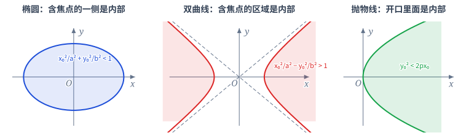
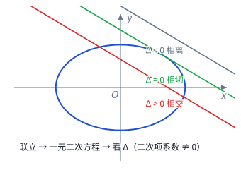
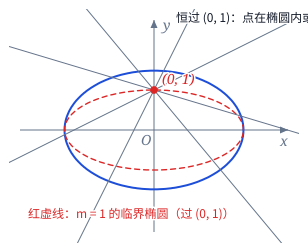
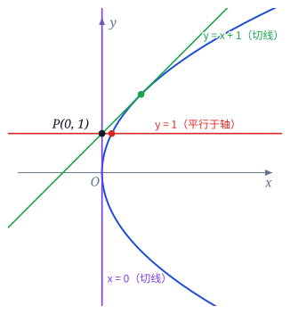

# 直线与圆锥曲线的位置关系（判别式法、相切条件与定点法）

> **来源**：补充专题（直线与圆锥曲线的位置关系 1/2） ｜ **适用模块**：七、第三定义、垂径定理、中点弦与光学性质 → 2. 直线与圆锥曲线的位置关系、中点弦与弦长公式

## 一、先看点：点与圆锥曲线的位置关系

点 $P(x_0, y_0)$ 代入方程左边减右边，看符号：

| 曲线 | 点在内部 | 点在曲线上 | 点在外部 |
| --- | --- | --- | --- |
| 椭圆 $\frac{x^2}{a^2} + \frac{y^2}{b^2} = 1$ | $\frac{x_0^2}{a^2} + \frac{y_0^2}{b^2} < 1$ | $= 1$ | $> 1$ |
| 双曲线 $\frac{x^2}{a^2} - \frac{y^2}{b^2} = 1$ | ==$\frac{x_0^2}{a^2} - \frac{y_0^2}{b^2} > 1$== | $= 1$ | $< 1$ |
| 抛物线 $y^2 = 2px$ | $y_0^2 < 2px_0$ | $=$ | $>$ |

==「内部」一律指含焦点的区域==。双曲线的内部是两支各自包住焦点的区域，符号与椭圆相反，最容易弄错。

## 二、判别式法（通法）

把直线方程代入曲线方程，消去 $y$（或 $x$）得 $Ax^2 + Bx + C = 0$：

1. ==先看二次项系数 $A$==：
    - $A = 0$：方程是一次的，最多一个解。只在两种情况出现：==直线平行于双曲线的渐近线==，或==直线平行于抛物线的对称轴==。这时直线与曲线相交，只有一个交点，但不是相切。
    - $A \ne 0$：再看判别式。
2. $\Delta > 0$ 相交（两个交点），$\Delta = 0$ 相切（一个公共点），$\Delta < 0$ 相离。

所以：

- 椭圆（和圆）：==只有一个公共点 $\Leftrightarrow$ 相切==。
- 双曲线、抛物线：只有一个公共点 $\Leftrightarrow$ 相切，或平行于渐近线 / 对称轴。

## 三、相切的判定公式（不用联立）

| 曲线 | 直线 $y = kx + m$ 相切 | 直线 $Ax + By + C = 0$ 相切 |
| --- | --- | --- |
| 椭圆 $\frac{x^2}{a^2} + \frac{y^2}{b^2} = 1$ | ==$m^2 = a^2k^2 + b^2$== | $A^2a^2 + B^2b^2 = C^2$ |
| 双曲线 $\frac{x^2}{a^2} - \frac{y^2}{b^2} = 1$ | $m^2 = a^2k^2 - b^2$（$k \ne \pm \frac{b}{a}$） | $A^2a^2 - B^2b^2 = C^2$（$C \ne 0$） |
| 抛物线 $y^2 = 2px$ | $p = 2km$（$k \ne 0$） | $pB^2 = 2AC$ |

（椭圆：$\Delta = 4a^2b^2(a^2k^2 + b^2 - m^2)$；双曲线：$\Delta = 4a^2b^2(m^2 + b^2 - a^2k^2)$，见下一条；抛物线：代入 $x = -\frac{By + C}{A}$ 得 $Ay^2 + 2pBy + 2pC = 0$，$\Delta = 0$。）

把「$=$」换成不等号就是相交、相离的条件。例如椭圆 $m^2 < a^2k^2 + b^2$ 相交。这些式子也是求「曲线上的点到直线距离最值」时找平行切线的捷径（见本模块第 6 节）。

## 四、几何法：直线过定点

直线含参数但恒过定点 $P$ 时：

- ==$P$ 在椭圆内部（或椭圆上）$\Rightarrow$ 直线与椭圆一定有公共点==（在内部时一定是两个）。
- $P$ 在抛物线内部 $\Rightarrow$ 直线与抛物线一定有公共点（平行于轴的那条只有一个）。
- 双曲线不能这样用，因为直线可以平行于渐近线、或从两支之间穿过，见下一条。

**例 1**　直线 $y = kx + 1$ 与椭圆 $\frac{x^2}{5} + \frac{y^2}{m} = 1$ 恒有公共点，求 $m$ 的范围。

**解**：直线恒过 $(0, 1)$，只需 $(0, 1)$ 在椭圆内或椭圆上：$\frac{1}{m} \le 1$，$m \ge 1$。又是椭圆，$m \ne 5$。所以 ==$m \in [1, 5) \cup (5, +\infty)$==。（容易漏掉 $m \ne 5$。）

## 五、抛物线：只有一个公共点的直线

**例 2**　过点 $P(0, 1)$ 且与抛物线 $y^2 = 4x$ 只有一个公共点的直线有几条？写出方程。

**解**：$P$ 在抛物线外部（$1 > 0$）。

- 斜率不存在：$x = 0$，与抛物线只交于原点，是==切线==（$y$ 轴在顶点处与抛物线相切）。
- 斜率为 $0$：$y = 1$，平行于对称轴，交于 $\left(\frac{1}{4}, 1\right)$。
- 斜率为 $k \ne 0$：$y = kx + 1$ 代入得 $k^2x^2 + (2k - 4)x + 1 = 0$，$\Delta = (2k - 4)^2 - 4k^2 = 16 - 16k = 0$，$k = 1$，切线 $y = x + 1$。

共 ==3 条==：$x = 0$，$y = 1$，$y = x + 1$。

**一般结论**（过定点 $P$ 与抛物线只有一个公共点的直线条数）：$P$ 在外部 3 条（两条切线 + 一条平行于轴），$P$ 在抛物线上 2 条（切线 + 平行于轴），$P$ 在内部 1 条（平行于轴）。

## 六、小结

| 曲线 | 「只有一个公共点」的含义 | 判别前先查 |
| --- | --- | --- |
| 圆、椭圆 | 相切 | — |
| 双曲线 | 相切，或==平行于渐近线== | 二次项系数 $b^2 - a^2k^2$ 是否为 $0$ |
| 抛物线 | 相切，或==平行于对称轴== | 斜率是否为 $0$（对 $y^2 = 2px$） |
