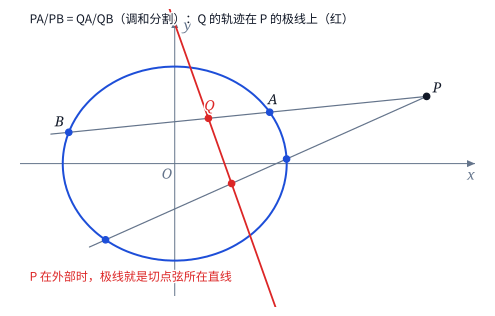
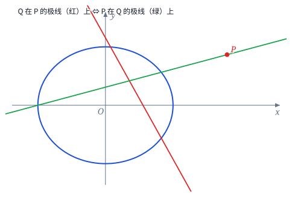
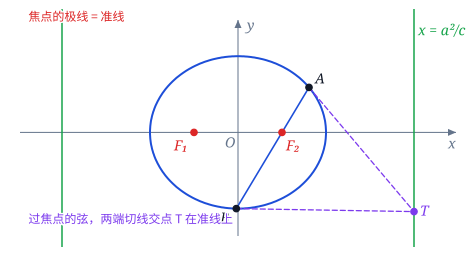
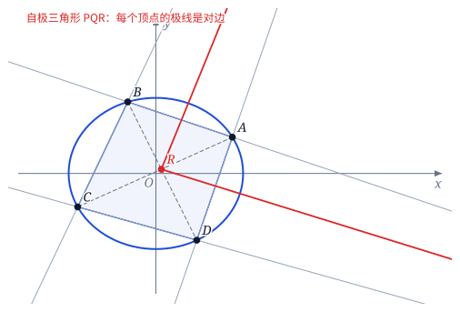
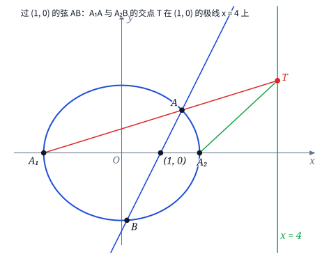
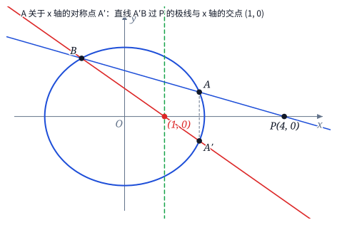

# 极点与极线：定义、配极原则与定点定线结论

> **来源**：补充专题（切线统一体系 4/4） ｜ **适用模块**：七、第三定义、垂径定理、中点弦与光学性质

*(前三条的「半代换直线」就是极线。本条把它的名字、几何定义和最常用的几条性质补齐，小题里用来秒判「定点、定直线」。记号以椭圆 $\frac{x^2}{a^2} + \frac{y^2}{b^2} = 1$ 为例，双曲线、抛物线、圆把方程换成对应的半代换即可。)*

## 一、定义

**代数定义**：点 $P(x_0, y_0)$ 关于椭圆的==极线==是

$$\frac{x_0x}{a^2} + \frac{y_0y}{b^2} = 1$$

$P$ 叫这条直线的==极点==。双曲线 $\frac{x_0x}{a^2} - \frac{y_0y}{b^2} = 1$，抛物线 $y_0y = p(x + x_0)$，圆 $x_0x + y_0y = r^2$（第 1 条的半代换表）。

**几何意义**（第 1 条已列，这里统一成一句话）：

| $P$ 的位置 | 极线是 |
| --- | --- |
| 在曲线上 | 过 $P$ 的切线 |
| 在曲线外 | 从 $P$ 引两条切线的==切点弦== |
| 在曲线内（非中心） | 过 $P$ 的弦两端切线交点的轨迹（一条在曲线外的直线） |
| 中心 | 无（极线在无穷远） |

**调和定义**（三种情况通用）：过 $P$ 任作一条直线交曲线于 $A$、$B$，在直线 $AB$ 上取点 $Q$，使

$$\frac{|PA|}{|PB|} = \frac{|QA|}{|QB|}$$

（$P$、$Q$ 调和分割 $AB$），则 ==$Q$ 总在 $P$ 的极线上==。等价写法：$\frac{2}{|PQ|} = \frac{1}{|PA|} + \frac{1}{|PB|}$。

**简证**：设直线上的点为 $P + t\vec{u}$，代入椭圆得 $\alpha t^2 + 2\beta t + \gamma = 0$，其中 $\gamma = \frac{x_0^2}{a^2} + \frac{y_0^2}{b^2} - 1$；代入极线得一次方程 $\beta t + \gamma = 0$（同一个 $\beta$）。所以 $t_Q = -\frac{\gamma}{\beta}$，而 $\frac{1}{t_A} + \frac{1}{t_B} = \frac{t_A + t_B}{t_At_B} = -\frac{2\beta}{\gamma} = \frac{2}{t_Q}$，这就是调和关系。

## 二、配极原则

==$Q$ 在 $P$ 的极线上 $\Leftrightarrow$ $P$ 在 $Q$ 的极线上==。

**证明**：$Q(x_1, y_1)$ 在 $P$ 的极线上即 $\frac{x_0x_1}{a^2} + \frac{y_0y_1}{b^2} = 1$，这个式子关于 $(x_0, y_0)$ 和 $(x_1, y_1)$ 对称，所以也说明 $P$ 在 $Q$ 的极线上。

**推论（定点定线互化）**：

1. ==点 $P$ 在定直线 $l$ 上运动 $\Rightarrow$ $P$ 的极线恒过定点==（$l$ 的极点）。
2. ==直线绕定点 $Q$ 转动 $\Rightarrow$ 它的极点在定直线上==（$Q$ 的极线）。

例如：从直线 $l$ 上的点向椭圆引两条切线，切点弦恒过 $l$ 的极点；过定点 $Q$ 的弦，两端切线的交点在 $Q$ 的极线上。阿基米德三角形第 5 条「底边过定点 $\Leftrightarrow$ 顶点在定直线上」就是这一条。

## 三、常用的极点、极线对

| 极点 | 椭圆 / 双曲线的极线 | 抛物线 $y^2 = 2px$ 的极线 |
| --- | --- | --- |
| 焦点 $(c, 0)$ / $\left(\frac{p}{2}, 0\right)$ | ==准线 $x = \frac{a^2}{c}$== | ==准线 $x = -\frac{p}{2}$== |
| $x$ 轴上的点 $(m, 0)$ | $x = \frac{a^2}{m}$ | $x = -m$ |
| $y$ 轴上的点 $(0, n)$ | $y = \frac{b^2}{n}$（双曲线 $y = -\frac{b^2}{n}$） | — |
| 中点弦的中点 $M$ | 与以 $M$ 为中点的弦==平行== | 同左 |

- **焦点的极线是准线**：所以==过焦点的弦，两端切线的交点在准线上==；从准线上一点引两条切线，切点弦过焦点（抛物线的阿基米德三角形是特例）。
- **$(m, 0)$ 与 $x = \frac{a^2}{m}$**：这对关系是大题「定点、定直线」最常见的来源。

## 四、自极三角形

椭圆的内接四边形 $ABCD$，对边延长线交点 $P = AB \cap CD$、$Q = AD \cap BC$，对角线交点 $R = AC \cap BD$，则 $\triangle PQR$ 中==每个顶点的极线恰是另外两个顶点的连线==（$P$ 的极线是 $QR$，等等）。

这就是下面两个经典结论背后的原因：四边形退化（两个顶点取长轴端点、或取关于 $x$ 轴对称的点）时，对角线交点、对边交点分别落在 $x$ 轴上的点和它的极线上。

## 五、两个经典定点定线结论

**结论 1**　过 $x$ 轴上的点 $M(m, 0)$ 作直线交椭圆于 $A$、$B$，$A_1$、$A_2$ 为长轴左、右端点，则 ==$A_1A$ 与 $A_2B$ 的交点在直线 $x = \frac{a^2}{m}$ 上==。（四边形 $A_1A_2BA$ 中，$M$ 是对角线交点，所以对边交点在 $M$ 的极线上。）

**例 1**　椭圆 $\frac{x^2}{4} + \frac{y^2}{3} = 1$，过 $(1, 0)$ 的直线交椭圆于 $A$、$B$，则直线 $A_1A$ 与 $A_2B$ 的交点 $T$ 在哪条定直线上？

**解**：$(1, 0)$ 的极线 $x = \frac{a^2}{1} = 4$，所以 ==$T$ 在直线 $x = 4$ 上==（也是右准线，因为 $(1, 0)$ 恰好是右焦点）。

**结论 2**　过 $x$ 轴上的点 $P(m, 0)$ 的直线交椭圆于 $A$、$B$，$A'$ 是 $A$ 关于 $x$ 轴的对称点，则 ==直线 $A'B$ 过定点 $\left(\frac{a^2}{m}, 0\right)$==（$P$ 的极线与 $x$ 轴的交点）。

**例 2**　椭圆 $\frac{x^2}{4} + \frac{y^2}{3} = 1$，过 $P(4, 0)$ 的直线交椭圆于 $A$、$B$，$A$ 关于 $x$ 轴的对称点为 $A'$，求直线 $A'B$ 所过的定点。

**解**：$P(4, 0)$ 的极线 $x = \frac{4}{4} = 1$，与 $x$ 轴交于 ==$(1, 0)$==，即右焦点。

**使用提醒**：极点极线在小题里可以直接用来「猜答案」；大题必须用联立、韦达写出证明，极线只用来提前知道定点、定直线是什么。
