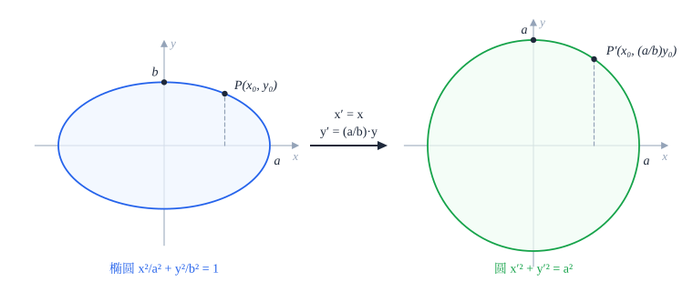
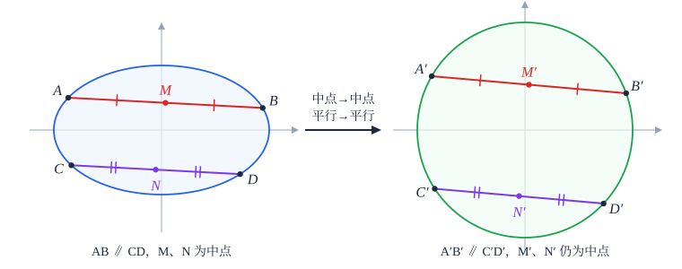
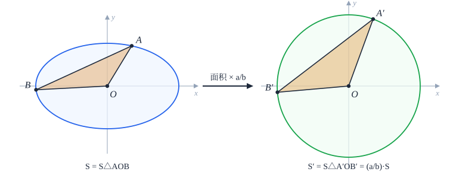
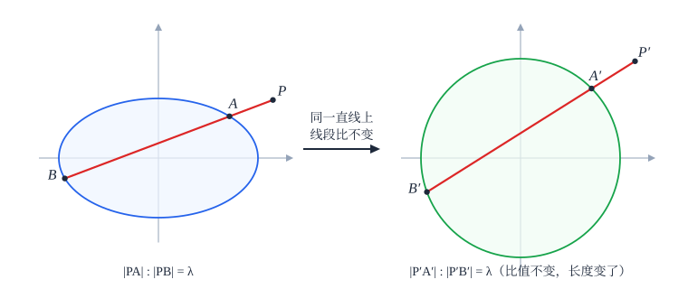
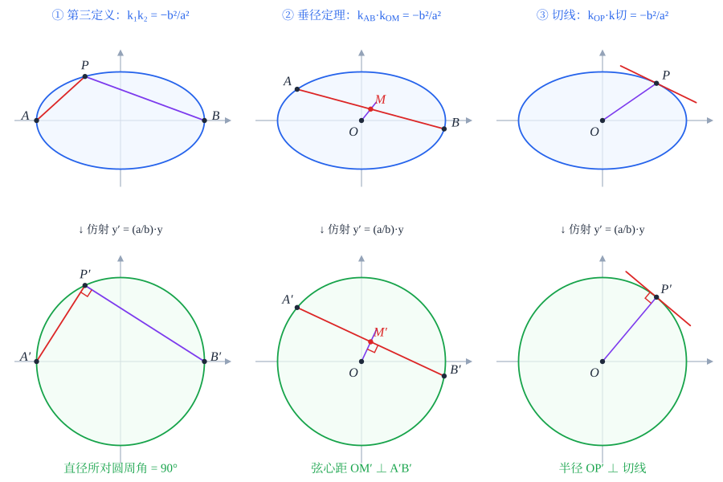
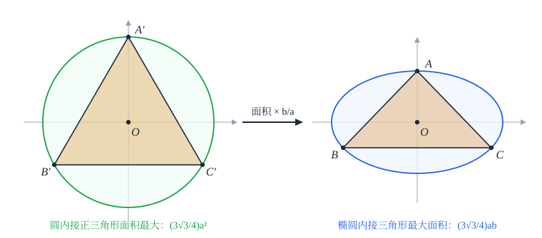
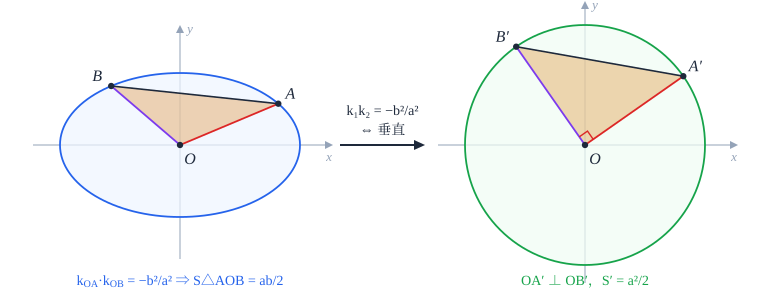

# 仿射变换：把椭圆化成圆（基本性质、对应关系与常用结论）

> **来源**：补充专题（仿射变换 1/3） ｜ **适用模块**：七、第三定义、垂径定理、中点弦与光学性质 → 6. 仿射变换：把椭圆化成圆（补充专题）

## 一、为什么要学

"仿射变换"听起来高级，高中用到的只是其中很好懂的一小部分：==把椭圆沿 $y$ 方向拉伸成圆==。好处有两个：

1. 椭圆的很多结论可以和圆类比着得到（第三定义、垂径定理、切线性质都是圆里"垂直"的翻版）；
2. 圆的对称性更好，几何关系（垂直、圆周角、垂径、切割线定理）一眼就能看出来，面积、弦长比值问题往往==不用联立、不用韦达==。

整体思路只有一句：==化椭圆为圆 → 在圆里用几何算 → 再变回椭圆==。

> 大题不推荐直接用仿射变换写过程（容易被扣步骤分），但==小题能直接出答案==；大题也可以先用它把答案算出来，再用常规方法写过程、验证结果。

## 二、变换与对应关系

椭圆 $\frac{x^2}{a^2} + \frac{y^2}{b^2} = 1\ (a > b > 0)$，作变换

$$x' = x, \quad y' = \frac{a}{b}y$$

则椭圆变成圆 ==$x'^2 + y'^2 = a^2$==（代入即得：$\frac{x'^2}{a^2} + \frac{y'^2}{a^2} = 1$）。横坐标不动，纵坐标统一放大 $\frac{a}{b}$ 倍，就像把椭圆"竖着拉高"。

变换前后有下面的对应关系（记 $\lambda = \frac{a}{b}$）：

| 对象 | 椭圆中 | 圆中 | 简单理由 |
|---|---|---|---|
| 点 | $P(x_0, y_0)$ | $P'\left(x_0, \frac{a}{b}y_0\right)$ | 定义 |
| 斜率 | $k$ | ==$k' = \frac{a}{b}k$== | $\Delta x$ 不变，$\Delta y$ 乘 $\frac{a}{b}$ |
| 面积 | $S$ | ==$S' = \frac{a}{b}S$== | 竖直方向拉长，横向不变 |
| 中点、平行、共线、相切 | 保持 | 保持 | 直线变直线，交点个数不变 |
| 同一直线（或平行直线）上的线段比 | $\frac{|PA|}{|PB|}$ | 不变 | 线段按同一比例伸缩 |
| 一般线段长 | $|AB|$ | $\frac{|A'B'|}{|AB|} = \sqrt{\frac{1 + k'^2}{1 + k^2}}$ | 只与所在直线的斜率有关 |

**几点说明**

- **斜率**：$k' = \frac{y_2' - y_1'}{x_2 - x_1} = \frac{a}{b} \cdot \frac{y_2 - y_1}{x_2 - x_1} = \frac{a}{b}k$。竖直线仍是竖直线，水平线仍是水平线。
- **面积**：以三角形为例，$S = \frac{1}{2}|x_1y_2 - x_2y_1|$（一个顶点在原点时），每个 $y$ 都乘 $\frac{a}{b}$，所以面积也乘 $\frac{a}{b}$。一般图形可以看成很多竖直的细长条，每条都被拉长 $\frac{a}{b}$ 倍。==面积问题里顶点在原点时最好用==。
- **线段比**：一条斜率为 $k$ 的直线上，每一段 $|AB| = \sqrt{1 + k^2}\,|x_1 - x_2|$，变换后 $|A'B'| = \sqrt{1 + k'^2}\,|x_1 - x_2|$，伸缩倍数 $\sqrt{\frac{1 + k'^2}{1 + k^2}}$ 只和斜率有关，所以==同一条直线上的线段比值不变==。

**变回来时别忘了**：圆里算出的面积要乘 $\frac{b}{a}$、斜率要乘 $\frac{b}{a}$ 才是椭圆里的答案。==角度、垂直、一般长度、焦点和离心率都不保持==：圆里的直角在椭圆里一般不是直角，椭圆的焦点在圆里也没有对应意义，焦半径问题不要用仿射变换。

## 三、核心对应：$-\frac{b^2}{a^2}$ 变成 $-1$

由 $k' = \frac{a}{b}k$，椭圆里两条直线的斜率乘积若为 $k_1k_2 = -\frac{b^2}{a^2}$，则圆里

$$k_1'k_2' = \frac{a^2}{b^2}k_1k_2 = -1$$

也就是==椭圆里"斜率之积为 $-\frac{b^2}{a^2}$（即 $e^2 - 1$）"，在圆里就是"垂直"==。本模块前面三个结论，都是圆里垂直关系的翻版：

| 椭圆中的结论 | 仿射后在圆里 |
|---|---|
| 第三定义：$A$、$B$ 为长轴端点，$k_{PA} \cdot k_{PB} = -\frac{b^2}{a^2}$ | 直径所对的圆周角是直角 |
| 垂径定理（中点弦）：$k_{AB} \cdot k_{OM} = -\frac{b^2}{a^2}$ | 弦心距垂直于弦 |
| 切线性质：$k_{OP} \cdot k_{\text{切}} = -\frac{b^2}{a^2}$ | 切线垂直于过切点的半径 |

反过来，看到题目里出现 $k_1k_2 = -\frac{b^2}{a^2}$，就应该想到：==变成圆后它们互相垂直==。

## 四、两个顺手得到的结论（补充）

**结论 1：椭圆面积 $S = \pi ab$。**圆面积 $\pi a^2$，变回椭圆乘 $\frac{b}{a}$，得 $\pi ab$。

**结论 2：椭圆内接三角形面积的最大值为 $\frac{3\sqrt{3}}{4}ab$。**圆内接三角形中正三角形面积最大，为 $\frac{3\sqrt{3}}{4}a^2$；因为面积按同一比例 $\frac{b}{a}$ 变化，圆里最大的那个变回去，在椭圆里也最大，所以最大值是 $\frac{3\sqrt{3}}{4}a^2 \cdot \frac{b}{a} = \frac{3\sqrt{3}}{4}ab$。

**结论 3：$A$、$B$ 在椭圆上，若 $k_{OA} \cdot k_{OB} = -\frac{b^2}{a^2}$，则 $S_{\triangle AOB} = \frac{1}{2}ab$（定值）。**变成圆后 $OA' \perp OB'$，$S' = \frac{1}{2}a^2$，变回去 $S = \frac{1}{2}a^2 \cdot \frac{b}{a} = \frac{1}{2}ab$。

## 五、什么时候想到仿射变换

1. ==面积问题==，尤其是三角形有一个顶点在原点；
2. 出现==斜率之积 $-\frac{b^2}{a^2}$==（第三定义、中点弦、切线），在圆里就是垂直；
3. ==同一条直线上的线段比值==（定比、$\frac{|OQ|}{|OP|}$、$\frac{|BP|}{|BQ|}$ 之类）；
4. 其他和中点、平行、相切、原点对称有关的问题。

**做题三步**：① 写出变换 $y' = \frac{a}{b}y$，求出圆的半径 $a$ 和题中关键点的新坐标；② 在圆里用几何（垂径定理、圆周角、切割线定理、点到直线距离）计算；③ 斜率、面积乘 $\frac{b}{a}$ 变回去，比值直接用。
