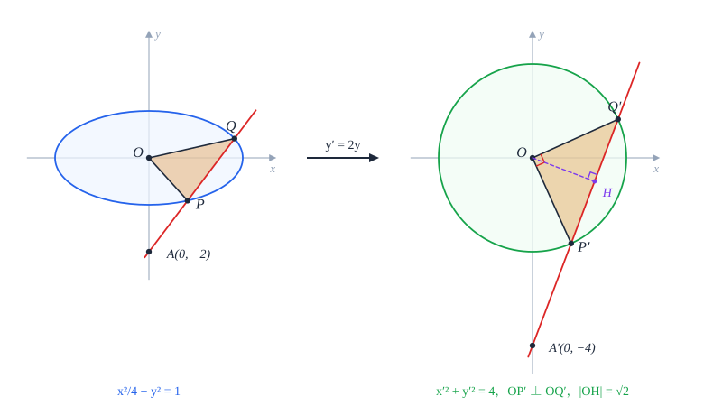
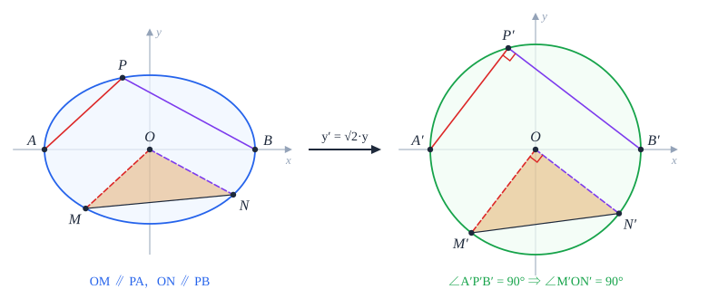
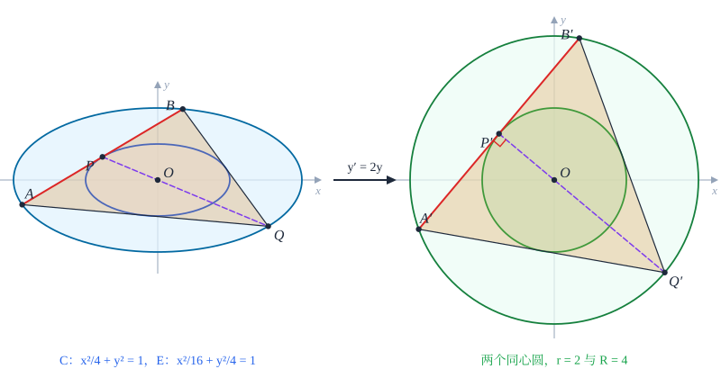
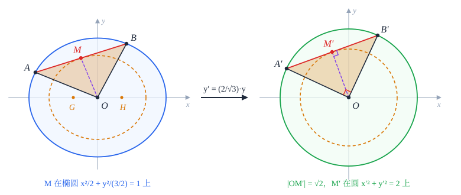

# 仿射变换处理面积问题（例 1、例 2、例 5、例 6）

> **来源**：补充专题（仿射变换 2/3） ｜ **适用模块**：七、第三定义、垂径定理、中点弦与光学性质

本条 4 道例题原来都是解答题，这里改编成小题：原题第（1）问（求椭圆方程等）和专题无关，直接作为条件给出。共同套路：

==面积按同一比例变化：$S = \frac{b}{a}S'$==。所以椭圆里面积最大（或为定值），等价于圆里面积最大（或为定值），而圆里的三角形面积常用 $S' = \frac{1}{2}r^2\sin\theta$ 或 $S' = \frac{1}{2} \cdot$ 底 $\cdot$ 弦心距。

## 例 1（改编自 2014·新课标Ⅰ）

已知椭圆 $E: \frac{x^2}{4} + y^2 = 1$，点 $A(0, -2)$，过点 $A$ 的直线 $l$ 与 $E$ 相交于 $P$、$Q$ 两点，$O$ 为坐标原点。当 $\triangle OPQ$ 的面积最大时，$l$ 的方程为（　）

A．$y = \pm\frac{\sqrt{7}}{2}x - 2$　　B．$y = \pm\sqrt{7}x - 2$　　C．$y = \pm\frac{\sqrt{3}}{2}x - 2$　　D．$y = \pm\frac{\sqrt{7}}{4}x - 2$

**解析**：$a = 2$，$b = 1$，作变换 $x' = x$，$y' = 2y$，椭圆变成圆 $x'^2 + y'^2 = 4$（$r = 2$），$A$ 变成 ==$A'(0, -4)$==（纵坐标也要乘 2）。

- 在圆中，$S'_{\triangle OP'Q'} = \frac{1}{2}r^2\sin\angle P'OQ' = 2\sin\angle P'OQ' \le 2$，当 ==$OP' \perp OQ'$== 时取最大值。又 $S = \frac{1}{2}S'$，所以椭圆中面积也在此时最大（最大值为 1）。
- $OP' \perp OQ'$ 时，$\triangle OP'Q'$ 是等腰直角三角形，弦心距 $|OH| = \frac{r}{\sqrt{2}} = \sqrt{2}$。设 $l': y' = k'x' - 4$，则 $\frac{4}{\sqrt{k'^2 + 1}} = \sqrt{2}$，得 $k'^2 = 7$，$k' = \pm\sqrt{7}$。
- 变回椭圆：==$k = \frac{b}{a}k' = \pm\frac{\sqrt{7}}{2}$==，$l: y = \pm\frac{\sqrt{7}}{2}x - 2$。

**答案：A**。B 是在圆里算完==忘了把斜率乘 $\frac{b}{a}$ 变回去==；如果把 $A$ 的坐标错写成 $A'(0, -2)$，也会得到错误答案。

## 例 2（第三定义 + 面积定值）

已知 $A$、$B$ 分别为椭圆 $C: \frac{x^2}{4} + \frac{y^2}{2} = 1$ 的左、右顶点，$P$ 为 $C$ 上异于 $A$、$B$ 的任意一点，直线 $PA$、$PB$ 的斜率之积为 $-\frac{1}{2}$。过原点 $O$ 作与直线 $PA$、$PB$ 平行的两条射线，分别交椭圆 $C$ 于点 $M$、$N$，则 $\triangle MON$ 的面积（　）

A．为定值 1　　B．为定值 $\sqrt{2}$　　C．为定值 2　　D．随点 $P$ 变化，不是定值

**解析**：$a = 2$，$b = \sqrt{2}$，作变换 $y' = \sqrt{2}y$，椭圆变成圆 $x'^2 + y'^2 = 4$。

- $k_{PA} \cdot k_{PB} = -\frac{1}{2} = -\frac{b^2}{a^2}$，所以圆中 $k'_{PA} \cdot k'_{PB} = -1$，即 $P'A' \perp P'B'$（就是==直径所对的圆周角是直角==）。
- 平行关系保持：$OM' \parallel P'A'$，$ON' \parallel P'B'$，所以 ==$OM' \perp ON'$==，$S' = \frac{1}{2} \times 2 \times 2 = 2$。
- 变回去：$S = \frac{b}{a}S' = \frac{\sqrt{2}}{2} \times 2 = \sqrt{2}$。

**答案：B**。这正是第 1 条的结论 3：$k_{OM} \cdot k_{ON} = -\frac{b^2}{a^2}$ 时 $S_{\triangle MON} = \frac{1}{2}ab = \sqrt{2}$。C 是忘记乘 $\frac{b}{a}$。

## 例 5（改编自 2015·山东，多选）

已知椭圆 $C: \frac{x^2}{4} + y^2 = 1$，椭圆 $E: \frac{x^2}{16} + \frac{y^2}{4} = 1$。$P$ 为椭圆 $C$ 上任意一点，过点 $P$ 的直线 $y = kx + m$ 交椭圆 $E$ 于 $A$、$B$ 两点，射线 $PO$ 交椭圆 $E$ 于点 $Q$。则下列结论正确的是（　）

A．$\frac{|OQ|}{|OP|} = 2$　　B．$S_{\triangle ABQ} = 3S_{\triangle ABO}$　　C．$\triangle ABQ$ 面积的最大值为 $6\sqrt{3}$　　D．$\triangle ABQ$ 面积的最大值为 $12\sqrt{3}$

**解析**：两个椭圆的 $\frac{a}{b}$ 都等于 2，==用同一个变换 $y' = 2y$== 就能把它们同时变成同心圆：$C \to x'^2 + y'^2 = 4$（$r = 2$），$E \to x'^2 + y'^2 = 16$（$R = 4$）。

- **A**：$P$、$O$、$Q$ 共线，线段比不变。圆中 $|OQ'| = 4$，$|OP'| = 2$，所以 $\frac{|OQ|}{|OP|} = 2$，A 正确。
- **B**：$Q$、$O$、$P$ 共线且 $P$ 在 $AB$ 上，$|QP| = |QO| + |OP| = 3|OP|$，所以 $Q$ 到 $AB$ 的距离是 $O$ 到 $AB$ 距离的 3 倍，$S_{\triangle ABQ} = 3S_{\triangle ABO}$，B 正确。
- **C、D**：在圆中，设 $O$ 到 $A'B'$ 的距离为 $d$，因为 $A'B'$ 过小圆上的点 $P'$，所以 ==$d \le |OP'| = 2$==。

$$S'_{\triangle A'OB'} = \frac{1}{2} \cdot 2\sqrt{16 - d^2} \cdot d = \sqrt{d^2(16 - d^2)}$$

$d^2(16 - d^2)$ 在 $d^2 \le 8$ 时递增，所以 $d = 2$（即 $A'B' \perp OP'$，直线与小圆相切于 $P'$）时最大，$S'_{\triangle A'OB'} = \sqrt{4 \times 12} = 4\sqrt{3}$，于是 $S'_{\triangle A'B'Q'} = 3 \times 4\sqrt{3} = 12\sqrt{3}$。变回去：$S_{\triangle ABQ} = \frac{1}{2} \times 12\sqrt{3} = 6\sqrt{3}$，C 正确，D 是==忘记乘 $\frac{b}{a} = \frac{1}{2}$==。

**答案：ABC**。注意这里不能直接用 $\frac{1}{2}R^2\sin\theta$ 取 $\theta = 90^\circ$：那样弦心距 $d = 2\sqrt{2} > 2$，直线碰不到小圆上的 $P'$。

## 例 6（面积最大时的中点轨迹）

已知椭圆 $C: \frac{x^2}{4} + \frac{y^2}{3} = 1$，$A$、$B$ 是椭圆 $C$ 上两点，$O$ 为坐标原点，线段 $AB$ 的中点为 $M$。当 $\triangle AOB$ 的面积最大时，平面内存在两个定点 $G$、$H$，使得 $|GM| + |HM|$ 为定值，这个定值为（　）

A．$\sqrt{2}$　　B．$2\sqrt{2}$　　C．$2\sqrt{3}$　　D．$4$

**解析**：作变换 $y' = \frac{2}{\sqrt{3}}y$，椭圆变成圆 $x'^2 + y'^2 = 4$。

- $S' = \frac{1}{2} \times 2 \times 2 \times \sin\angle A'OB' \le 2$，当 $OA' \perp OB'$ 时最大；$S = \frac{\sqrt{3}}{2}S'$，所以椭圆中也在此时最大。
- 此时 $\triangle A'OB'$ 是等腰直角三角形，斜边 $|A'B'| = 2\sqrt{2}$，中线 ==$|OM'| = \sqrt{2}$==，即 $M'$ 在圆 $x'^2 + y'^2 = 2$ 上（中点仍是中点）。
- 变回去：把 $y' = \frac{2}{\sqrt{3}}y$ 代入得 $x^2 + \frac{4}{3}y^2 = 2$，即 $\frac{x^2}{2} + \frac{y^2}{\frac{3}{2}} = 1$。$M$ 在这个椭圆上，取它的两个焦点 $G\left(-\frac{\sqrt{2}}{2}, 0\right)$、$H\left(\frac{\sqrt{2}}{2}, 0\right)$，则 $|GM| + |HM| = 2\sqrt{2}$（长轴长）。

**答案：B**。圆变回椭圆的方法：==把 $x' = x$、$y' = \frac{a}{b}y$ 代回圆的方程==，圆就变回一个和原椭圆"同形状"（离心率相同）的椭圆。
