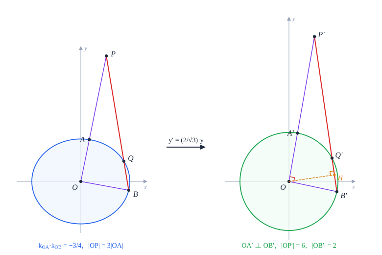
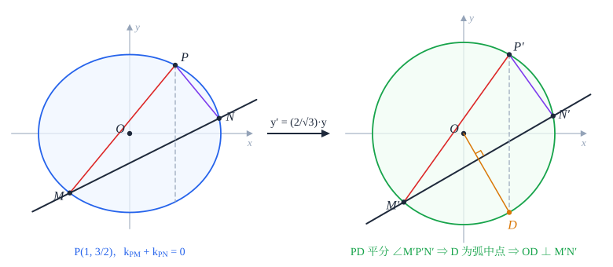
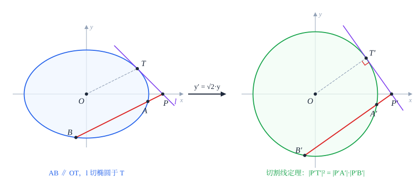
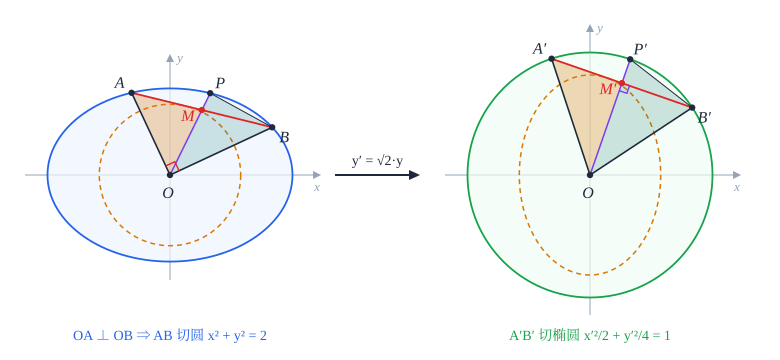

# 仿射变换处理比值、斜率与长度问题（例 3、例 4、例 7、例 8）

> **来源**：补充专题（仿射变换 3/3） ｜ **适用模块**：七、第三定义、垂径定理、中点弦与光学性质

本条 4 道例题同样由解答题改编，原题第（1）问直接作为条件。用到的对应关系：

- ==同一条直线上的线段比不变==，可以直接在圆里算；
- 斜率 $k' = \frac{a}{b}k$，斜率之积 $-\frac{b^2}{a^2}$ 变成 $-1$（垂直）；
- 不在同一直线上的长度要用伸缩倍数 $\frac{|A'B'|}{|AB|} = \sqrt{\frac{1 + k'^2}{1 + k^2}}$ 换算。

## 例 3（斜率之积 + 同一直线上的比值）

已知椭圆 $C: \frac{x^2}{4} + \frac{y^2}{3} = 1$，$A$、$B$ 是椭圆 $C$ 上两点，$O$ 为坐标原点，直线 $OA$、$OB$ 的斜率之积为 $-\frac{3}{4}$。若射线 $OA$ 上的点 $P$ 满足 $|PO| = 3|OA|$，且 $PB$ 与椭圆交于另一点 $Q$，则 $\frac{|BP|}{|BQ|}$ 的值为（　）

A．3　　B．4　　C．5　　D．6

**解析**：作变换 $y' = \frac{2}{\sqrt{3}}y$，椭圆变成圆 $x'^2 + y'^2 = 4$。

- $k_{OA} \cdot k_{OB} = -\frac{3}{4} = -\frac{b^2}{a^2}$，所以圆中 ==$OA' \perp OB'$==。
- $O$、$A$、$P$ 共线，比值不变：$|OP'| = 3|OA'| = 6$。在 $\text{Rt}\triangle P'OB'$ 中，$|P'B'| = \sqrt{6^2 + 2^2} = 2\sqrt{10}$。
- 作 $OH \perp B'Q'$ 于 $H$，由垂径定理 $H$ 是弦 $B'Q'$ 的中点；$OH$ 又是直角三角形斜边上的高，由射影定理 $|B'H| = \frac{|OB'|^2}{|B'P'|} = \frac{4}{2\sqrt{10}}$，所以 $|B'Q'| = \frac{8}{2\sqrt{10}}$。
- $B$、$Q$、$P$ 共线，比值不变：

$$\frac{|BP|}{|BQ|} = \frac{|B'P'|}{|B'Q'|} = \frac{2\sqrt{10} \cdot 2\sqrt{10}}{8} = 5$$

**答案：C**。结果和 $A$、$B$ 的具体位置无关，在圆里==转一下图形不改变任何长度==，所以不用设点、不用联立。

## 例 4（斜率和为 0 ⇒ 弦的斜率为定值）

已知椭圆 $C: \frac{x^2}{4} + \frac{y^2}{3} = 1$（原题第（1）问由 $A(-2, 0)$、$B(2, 0)$ 和 $k_{PA} \cdot k_{PB} = -\frac{3}{4}$ 求得），点 $P\left(1, \frac{3}{2}\right)$ 在 $C$ 上。直线 $l$ 与 $C$ 交于 $M$、$N$ 两点（均异于 $P$），若 $k_{PM} + k_{PN} = 0$ 恒成立，则直线 $l$ 的斜率（　）

A．恒为 $\frac{1}{2}$　　B．恒为 $-\frac{1}{2}$　　C．恒为 $\frac{\sqrt{3}}{3}$　　D．不是定值

**解析**：作变换 $y' = \frac{2}{\sqrt{3}}y$，圆 $x'^2 + y'^2 = 4$，$P'(1, \sqrt{3})$。

- 斜率都乘同一个 $\frac{2}{\sqrt{3}}$，所以圆中仍有 $k'_{PM} + k'_{PN} = 0$：直线 $P'M'$、$P'N'$ 关于竖直线 $x = 1$ 对称，即 ==$x = 1$ 平分 $\angle M'P'N'$==。
- 设 $x = 1$ 与圆的另一个交点为 $D(1, -\sqrt{3})$。$\angle M'P'D = \angle DP'N'$，同圆中相等的圆周角所对的弧相等，所以 ==$D$ 是弧 $M'N'$ 的中点==，由垂径定理 $OD \perp M'N'$。
- $k_{OD} = -\sqrt{3}$，所以 $k'_{MN} = \frac{1}{\sqrt{3}} = \frac{\sqrt{3}}{3}$；变回去：$k_{MN} = \frac{b}{a}k' = \frac{\sqrt{3}}{2} \cdot \frac{\sqrt{3}}{3} = \frac{1}{2}$。

**答案：A**。C 是圆里的斜率，==忘了乘 $\frac{b}{a}$==。

> 一般地，椭圆上定点 $P(x_0, y_0)$ 引两条斜率互为相反数的弦 $PM$、$PN$，则 $MN$ 的斜率为定值 $\frac{b^2x_0}{a^2y_0}$（本题 $\frac{3 \times 1}{4 \times \frac{3}{2}} = \frac{1}{2}$）。用仿射变换看就是：圆中 $k'_{MN} = \frac{x_0}{y_0'}$，再乘 $\frac{b}{a}$。

## 例 7（改编自 2016·四川：相切保持 + 切割线定理）

已知椭圆 $E: \frac{x^2}{6} + \frac{y^2}{3} = 1$，直线 $l: y = -x + 3$ 与椭圆 $E$ 有且只有一个公共点 $T(2, 1)$。设 $O$ 为坐标原点，直线 $m$ 平行于 $OT$，与椭圆 $E$ 交于不同的两点 $A$、$B$，且与直线 $l$ 交于点 $P$。若 $|PT|^2 = \lambda|PA| \cdot |PB|$，则 $\lambda$ 的值为（　）

A．$\frac{4}{5}$　　B．$\frac{5}{4}$　　C．$1$　　D．$\frac{6}{5}$

**解析**：$a = \sqrt{6}$，$b = \sqrt{3}$，作变换 $y' = \sqrt{2}y$，椭圆变成圆 $x'^2 + y'^2 = 6$。

- 相切保持：$l'$ 仍切圆于 $T'$，$m'$ 仍是割线。由==切割线定理==：$|P'T'|^2 = |P'A'| \cdot |P'B'|$。
- $PT$ 与 $PA$、$PB$ ==不在同一条直线上==，不能直接说比值不变，要分别换算长度：
  - $l$ 的斜率 $k = -1$，$k' = -\sqrt{2}$：$\frac{|P'T'|^2}{|PT|^2} = \frac{1 + 2}{1 + 1} = \frac{3}{2}$；
  - $m$ 的斜率 $k = k_{OT} = \frac{1}{2}$，$k' = \frac{\sqrt{2}}{2}$：$\frac{|P'A'| \cdot |P'B'|}{|PA| \cdot |PB|} = \frac{1 + \frac{1}{2}}{1 + \frac{1}{4}} = \frac{6}{5}$。
- 代入切割线定理：$\frac{3}{2}|PT|^2 = \frac{6}{5}|PA| \cdot |PB|$，所以 $|PT|^2 = \frac{4}{5}|PA| \cdot |PB|$。

**答案：A**。C 是直接把圆里的切割线定理搬过来；D 是只换算了一边。

## 例 8（改编自 2021·成都一模：面积比的范围）

已知椭圆 $C: \frac{x^2}{6} + \frac{y^2}{3} = 1$，直线 $l$ 与椭圆 $C$ 交于不同的两点 $A$、$B$，$M$ 为线段 $AB$ 的中点，$O$ 为坐标原点，射线 $OM$ 与椭圆 $C$ 交于点 $P$，且 $O$ 在以 $AB$ 为直径的圆上。记 $\triangle AOM$、$\triangle BOP$ 的面积分别为 $S_1$、$S_2$，则 $\frac{S_1}{S_2}$ 的取值范围是（　）

A．$\left[\frac{\sqrt{3}}{3}, \frac{\sqrt{6}}{3}\right]$　　B．$\left[\frac{\sqrt{2}}{2}, 1\right)$　　C．恒为 $\frac{\sqrt{2}}{2}$　　D．$\left[\frac{\sqrt{6}}{6}, \frac{\sqrt{3}}{3}\right]$

**解析**：

**第一步，面积比化成线段比。**$\triangle AOM$ 与 $\triangle BOP$ 的底 $OM$、$OP$ 在同一直线上，$M$ 是 $AB$ 中点，所以 $A$、$B$ 到直线 $OM$ 的距离相等，

$$\frac{S_1}{S_2} = \frac{|OM|}{|OP|} = \frac{|OM'|}{|OP'|} = \frac{|OM'|}{\sqrt{6}}$$

（同一直线上比值不变；变换 $y' = \sqrt{2}y$ 后圆的半径为 $\sqrt{6}$。）

**第二步，看清"垂直"在哪个图里。**$O$ 在以 $AB$ 为直径的圆上，说明==原椭圆中 $OA \perp OB$==，而不是圆中垂直（$k_{OA}k_{OB} = -1$，不是 $-\frac{b^2}{a^2}$）。椭圆中有一个常用结论：

> $OA \perp OB$ 时，$O$ 到直线 $AB$ 的距离为定值 $d$，$\frac{1}{d^2} = \frac{1}{a^2} + \frac{1}{b^2}$。
>
> 证明：设 $|OA| = r_1$，$|OB| = r_2$，$A(r_1\cos\theta, r_1\sin\theta)$，$B(-r_2\sin\theta, r_2\cos\theta)$，代入椭圆得 $\frac{1}{r_1^2} = \frac{\cos^2\theta}{a^2} + \frac{\sin^2\theta}{b^2}$，$\frac{1}{r_2^2} = \frac{\sin^2\theta}{a^2} + \frac{\cos^2\theta}{b^2}$，相加得 $\frac{1}{r_1^2} + \frac{1}{r_2^2} = \frac{1}{a^2} + \frac{1}{b^2}$；而直角三角形斜边上的高 $d = \frac{r_1r_2}{|AB|}$，$\frac{1}{d^2} = \frac{r_1^2 + r_2^2}{r_1^2r_2^2} = \frac{1}{r_1^2} + \frac{1}{r_2^2}$。

本题 $\frac{1}{d^2} = \frac{1}{6} + \frac{1}{3} = \frac{1}{2}$，$d = \sqrt{2}$，即 ==直线 $AB$ 与圆 $x^2 + y^2 = 2$ 相切==。

**第三步，仿射。**相切保持，圆 $x^2 + y^2 = 2$ 变成椭圆 $x'^2 + \frac{y'^2}{2} = 2$，即 $\frac{x'^2}{2} + \frac{y'^2}{4} = 1$，所以 $A'B'$ 是这个小椭圆的切线。$M'$ 是大圆弦 $A'B'$ 的中点，$|OM'|$ 就是 $O$ 到 $A'B'$ 的距离。小椭圆在点 $(\sqrt{2}\cosφ, 2\sinφ)$ 处的切线为 $\frac{\cosφ}{\sqrt{2}}x' + \frac{\sinφ}{2}y' = 1$，

$$|OM'|^2 = \frac{1}{\frac{\cos^2φ}{2} + \frac{\sin^2φ}{4}} \in [2, 4]$$

即 ==$O$ 到小椭圆切线的距离介于短半轴 $\sqrt{2}$ 与长半轴 2 之间==，$|OM'| \in [\sqrt{2}, 2]$，所以

$$\frac{S_1}{S_2} = \frac{|OM'|}{\sqrt{6}} \in \left[\frac{\sqrt{3}}{3}, \frac{\sqrt{6}}{3}\right]$$

**答案：A**。C 是把"$OA \perp OB$"误当成圆中垂直：那样 $|OM'| = \sqrt{3}$ 恒定，得到 $\frac{\sqrt{2}}{2}$。==垂直不是仿射不变的==，必须先判断它在哪个图里。

## 小结：8 道例题在圆里用到了什么

| 例题 | 题型 | 圆里用到的几何 | 变回去 |
|---|---|---|---|
| 例 1 | 面积最大求直线 | $S' = \frac{1}{2}r^2\sin\theta$，弦心距 | 斜率乘 $\frac{b}{a}$ |
| 例 2 | 面积定值 | 直径所对圆周角为直角，平行保持 | 面积乘 $\frac{b}{a}$ |
| 例 3 | 同一直线上的比值 | 垂直、射影定理、垂径定理 | 比值不变 |
| 例 4 | 斜率定值 | 等圆周角对等弧、垂径定理 | 斜率乘 $\frac{b}{a}$ |
| 例 5 | 同心椭圆、面积最值 | 弦心距 $d \le r$，函数最值 | 面积乘 $\frac{b}{a}$ |
| 例 6 | 面积最大时的中点轨迹 | 等腰直角三角形斜边中线 | 圆的方程代回 |
| 例 7 | 不同直线上的长度 | 切割线定理 | 两条直线分别换算长度 |
| 例 8 | 面积比的范围 | 中点弦的弦心距 | 比值不变；先判断垂直在哪个图里 |
