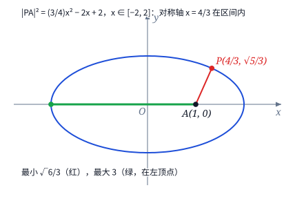
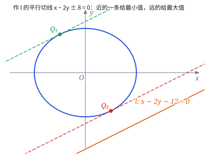
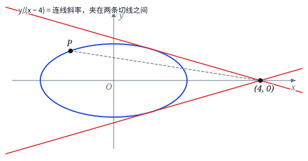
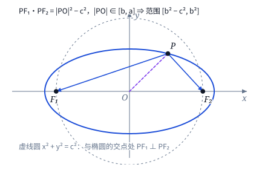

# 坐标与参数型最值：距离、代数式、斜率与数量积

> **来源**：补充专题（圆锥曲线中的最值与范围问题 2/3） ｜ **适用模块**：七、第三定义、垂径定理、中点弦与光学性质 → 7. 圆锥曲线中的最值与范围问题（补充专题）

*(定义转化不了的，就设点。设点有两种：直接设 $P(x_0, y_0)$ 用曲线方程消元，化成==带定义域的二次函数==；或用参数方程 $P(a\cos \theta, b\sin \theta)$ 化成==三角函数==。另有两种几何手段：平行切线、过定点的切线。)*

## 一、定点到曲线上点的距离（二次函数 + 定义域）

**椭圆**：$A(m, 0)$ 在长轴所在直线上，$P(x, y)$ 在椭圆上，用 $y^2 = b^2\left(1 - \frac{x^2}{a^2}\right)$ 消去 $y$：

$$|PA|^2 = (x - m)^2 + b^2 - \frac{b^2}{a^2}x^2 = e^2x^2 - 2mx + m^2 + b^2, \quad x \in [-a, a]$$

对称轴 $x = \frac{m}{e^2}$，==要看对称轴在不在 $[-a, a]$ 内==：在内部则在对称轴处取最小值；不在则最小值在端点（顶点）取到。最大值总在离对称轴较远的端点。

**例 1**　$P$ 在椭圆 $\frac{x^2}{4} + y^2 = 1$ 上，$A(1, 0)$，求 $|PA|$ 的最小值与最大值。

**解**：$|PA|^2 = \frac{3}{4}x^2 - 2x + 2$，$x \in [-2, 2]$，对称轴 $x = \frac{4}{3} \in [-2, 2]$。最小值 $\frac{3}{4} \cdot \frac{16}{9} - \frac{8}{3} + 2 = \frac{2}{3}$，==$|PA|_{\min} = \frac{\sqrt{6}}{3}$==；最大值在 $x = -2$：$|PA|^2 = 3 + 4 + 2 = 9$，==$|PA|_{\max} = 3$==。

**抛物线**：$A(m, 0)$，$P$ 在 $y^2 = 2px$ 上，$|PA|^2 = (x - m)^2 + 2px = x^2 - 2(m - p)x + m^2$，$x \ge 0$：

- ==$m \le p$ 时最小值为 $|m|$（在顶点取到）==；
- ==$m > p$ 时最小值为 $\sqrt{2pm - p^2}$（在 $x = m - p$ 处取到）==。

所以「抛物线上离 $(m, 0)$ 最近的点是顶点」当且仅当 $m \le p$。

**双曲线**：同理 $|PA|^2 = e^2x^2 - 2mx + m^2 - b^2$，定义域 $|x| \ge a$。

## 二、曲线上的点到直线的距离（平行切线法 / 参数法）

**平行切线法**：作与已知直线 $l$ 平行的曲线的切线，切点就是最近（或最远）点，最值就是两平行线的距离。切线用上一节的相切条件写，不用联立。

**参数法**：设 $P(a\cos \theta, b\sin \theta)$，代入点到直线距离公式，用辅助角公式。

**例 2**　$P$ 在椭圆 $\frac{x^2}{16} + \frac{y^2}{12} = 1$ 上，求 $P$ 到直线 $l: x - 2y - 12 = 0$ 的距离的最小值与最大值。

**解法一（平行切线）**：设切线 $x - 2y + m = 0$，相切条件 $A^2a^2 + B^2b^2 = C^2$：$16 + 4 \times 12 = m^2$，$m = \pm 8$。$l$ 与 $x - 2y - 8 = 0$ 的距离 $\frac{4}{\sqrt{5}}$，与 $x - 2y + 8 = 0$ 的距离 $\frac{20}{\sqrt{5}}$。

**解法二（参数）**：$P(4\cos \theta, 2\sqrt{3}\sin \theta)$，

$$d = \frac{|4\cos \theta - 4\sqrt{3}\sin \theta - 12|}{\sqrt{5}} = \frac{|8\cos(\theta + 60^\circ) - 12|}{\sqrt{5}}$$

$8\cos(\theta + 60^\circ) - 12 \in [-20, -4]$，所以 ==$d_{\min} = \frac{4\sqrt{5}}{5}$，$d_{\max} = 4\sqrt{5}$==。

==若直线与曲线相交，最小距离是 $0$==，只有最大值要用切线求。

## 三、坐标的代数式（参数法 / 线性规划）

$P(x, y)$ 在椭圆上，求 $ux + vy$ 的最值：设 $x = a\cos \theta$，$y = b\sin \theta$，

$$ux + vy = ua\cos \theta + vb\sin \theta \in \left[-\sqrt{u^2a^2 + v^2b^2}, \, \sqrt{u^2a^2 + v^2b^2}\right]$$

即 ==$|ux + vy| \le \sqrt{u^2a^2 + v^2b^2}$==（几何意义：直线 $ux + vy = t$ 与椭圆相切时 $t$ 取到最值，和相切条件是一回事）。

**例 3**　$P(x, y)$ 在椭圆 $\frac{x^2}{4} + \frac{y^2}{3} = 1$ 上，求 $x + 2y$ 的最大值。

**解**：$x + 2y = 2\cos \theta + 2\sqrt{3}\sin \theta = 4\sin(\theta + 30^\circ)$，==最大值 $4$==（或 $\sqrt{1 \cdot 4 + 4 \cdot 3} = 4$）。

其他常见式子：$x^2 + y^2 = |PO|^2$（椭圆上 $\in [b^2, a^2]$）；$xy$ 用参数化成 $\frac{ab}{2}\sin 2\theta$（$\in \left[-\frac{ab}{2}, \frac{ab}{2}\right]$）；$x + y^2$、$x^2 + 2y$ 这类用曲线方程消元成二次函数，==注意定义域==。

## 四、斜率型：$\frac{y - n}{x - m}$

$\frac{y - n}{x - m}$ 是曲线上的点 $P$ 与定点 $Q(m, n)$ 连线的斜率，范围由过 $Q$ 的两条切线确定（和圆里的同类题一样）。

**例 4**　$P(x, y)$ 在椭圆 $\frac{x^2}{4} + y^2 = 1$ 上，求 $\frac{y}{x - 4}$ 的范围。

**解**：设切线 $y = k(x - 4)$，即 $kx - y - 4k = 0$，相切条件 $4k^2 + 1 = 16k^2$，$k = \pm \frac{\sqrt{3}}{6}$。所以 ==$\frac{y}{x - 4} \in \left[-\frac{\sqrt{3}}{6}, \frac{\sqrt{3}}{6}\right]$==。

## 五、向量数量积型

**焦点数量积**：$P(x_0, y_0)$ 在椭圆上，

$$\overrightarrow{PF_1} \cdot \overrightarrow{PF_2} = (-c - x_0)(c - x_0) + y_0^2 = x_0^2 + y_0^2 - c^2 = |PO|^2 - c^2$$

椭圆上 $|PO| \in [b, a]$，所以 ==$\overrightarrow{PF_1} \cdot \overrightarrow{PF_2} \in [b^2 - c^2, \, b^2]$==（短轴端点最小，长轴端点最大）。双曲线的情形（$\ge -b^2$，没有最大值）见模块六「双曲线的焦点三角形」的补充部分。

推论：椭圆上存在 $P$ 使 $PF_1 \perp PF_2$ $\Leftrightarrow$ $b^2 - c^2 \le 0$ $\Leftrightarrow$ ==$e \ge \frac{\sqrt{2}}{2}$==（圆 $x^2 + y^2 = c^2$ 与椭圆有公共点）。

一般地，$A$、$B$ 关于原点对称时 $\overrightarrow{PA} \cdot \overrightarrow{PB} = |PO|^2 - |OA|^2$（极化恒等式），所以这类数量积都化成 ==$|PO|$ 的范围==。

**例 5**　$P$ 在椭圆 $\frac{x^2}{4} + y^2 = 1$ 上，求 $\overrightarrow{PF_1} \cdot \overrightarrow{PF_2}$ 的范围。

**解**：$c^2 = 3$，$|PO|^2 \in [1, 4]$，所以 ==$\overrightarrow{PF_1} \cdot \overrightarrow{PF_2} \in [-2, 1]$==。

## 六、方法选择

| 题型 | 首选 | 备选 |
| --- | --- | --- |
| 定点到曲线上的点距离 | 消元成二次函数，看对称轴与定义域 | — |
| 曲线上的点到直线距离 | 平行切线 | 参数方程 + 辅助角 |
| $ux + vy$、$xy$ | 参数方程 | 相切条件 |
| $\frac{y - n}{x - m}$ | 过定点的切线 | 判别式 |
| $\overrightarrow{PA} \cdot \overrightarrow{PB}$（$A$、$B$ 关于中心对称） | 化成 $|PO|^2 - |OA|^2$ | 坐标展开 |
| 抛物线上的点相关 | 设 $P\left(\frac{y_0^2}{2p}, y_0\right)$ 或参数方程 | — |
