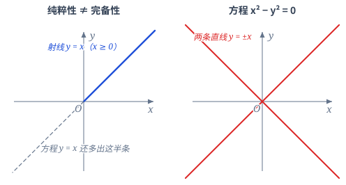
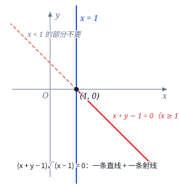

# 曲线与方程的概念、求轨迹方程的一般步骤

> **来源**：补充专题（求轨迹方程 1/6） ｜ **适用模块**：八、曲线与方程

*(这一节常被忽略，但近几年高考连续考到。本专题六条：概念与步骤、直接法、几何法（含定义法）、相关点法、消参法、交轨法。每条都按课堂笔记的例题顺序整理，题图重画。)*

## 一、「曲线的方程」与「方程的曲线」

曲线 $C$ 与二元方程 $f(x, y) = 0$ 之间要同时满足两条，才能说 $f(x, y) = 0$ 是曲线 $C$ 的方程、$C$ 是这个方程的曲线：

| 条件 | 内容 | 俗称 |
| --- | --- | --- |
| ① | 曲线上的点的坐标**都是**方程的解 | ==纯粹性==（曲线上没有「不合格」的点） |
| ② | 以方程的解为坐标的点**都在**曲线上 | ==完备性==（方程没有「多出来」的点） |

只满足一条都不行。例如：

- 射线 $y = x$（$x \ge 0$）上的点都满足方程 $y = x$，但方程 $y = x$ 还包含 $x < 0$ 的那一半，所以 $y = x$ ==不是==这条射线的方程（缺完备性），射线的方程要写成 $y = x$（$x \ge 0$）。
- 方程 $x^2 - y^2 = 0$ 等价于 $(x - y)(x + y) = 0$，它的曲线是==两条直线== $y = \pm x$，而不是一条。

**例**　方程 $(x + y - 1)\sqrt{x - 1} = 0$ 表示什么曲线？

**解**：先看定义域 $x \ge 1$。乘积为 $0$：$\sqrt{x - 1} = 0$ 得 $x = 1$（整条直线，因为 $y$ 任意）；或 $x + y - 1 = 0$ 且 $x \ge 1$（一条射线）。所以是==一条直线 $x = 1$ 和一条射线 $x + y - 1 = 0$（$x \ge 1$）==。漏掉定义域、把它看成两条直线是最常见的错误。

## 二、「求轨迹」与「求轨迹方程」

- **求轨迹方程**：只写出方程（加上 $x$、$y$ 的限制条件）。
- **求轨迹**：写出方程后，还要==说明它是什么曲线==（形状、位置、大小）。

题目问「点 $M$ 的轨迹是什么」时，最后一句一定要说「轨迹是以……为圆心、……为半径的圆（去掉某点）」之类的话。

## 三、求轨迹方程的一般步骤

1. **建系设点**：建立坐标系（题目给了就不用），设动点 $M(x, y)$。
2. **找条件**：写出 $M$ 满足的几何条件。
3. **代坐标**：把条件用 $x$、$y$ 表示出来。
4. **化简**：整理成最简方程。
5. **查漏补缺**：==检查有没有多出来的点或少掉的点==，用「$x \ne \dots$」「$y \ne 0$」「$x > 0$」等写清楚。

第 5 步最容易丢分，多出来的点常见于下面几种情况：

| 情况 | 要去掉的点 |
| --- | --- |
| 条件里有斜率 | 斜率不存在、或作分母的斜率为 $0$ 的点 |
| 条件里有三角形 | 三点共线（三角形退化）的点，通常是 $y = 0$ 的点 |
| 条件里有「两条直线的交点」 | 两条直线平行、重合时对应的点 |
| 用了参数 | 参数取不到的值对应的点（看参数范围） |
| 有根号、分式 | 被开方数 $\ge 0$、分母 $\ne 0$ 带来的范围 |

## 四、选方法

| 题目特征 | 方法 | 见 |
| --- | --- | --- |
| 条件能直接翻译成等式 | 直接法 | 第 2 条 |
| 有直角、直径、切线、中垂线等几何关系；或符合圆锥曲线定义 | 几何法（定义法） | 第 3 条 |
| 动点 $M$ 跟着另一个在已知曲线上运动的点 $P$ 走 | 相关点法（代入法） | 第 4 条 |
| $x$、$y$ 都能用同一个参数表示 | 消参法（参数法） | 第 5 条 |
| $M$ 是两条动直线的交点 | 交轨法 | 第 6 条 |
