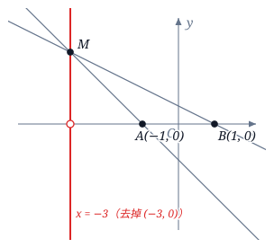
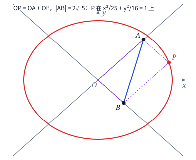
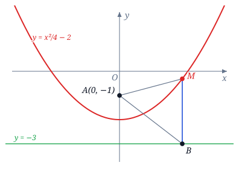

# 直接法：把条件直接翻译成坐标等式

> **来源**：补充专题（求轨迹方程 2/6） ｜ **适用模块**：八、曲线与方程

**做法**：设 $M(x, y)$，题目给的条件（斜率、距离、向量、角度）直接用 $x$、$y$ 写出来，化简即可。==关键在最后一步查漏==：斜率作分母、向量平行这类条件常常会去掉一些点。

**例 1**（人教 A 版习题）　已知 $A(-1, 0)$、$B(1, 0)$，直线 $AM$、$BM$ 相交于点 $M$，且直线 $AM$ 的斜率与直线 $BM$ 的斜率之商是 $2$。点 $M$ 的轨迹是什么？为什么？

**解**：设 $M(x, y)$，

$$\frac{k_{AM}}{k_{BM}} = \frac{\frac{y}{x + 1}}{\frac{y}{x - 1}} = 2$$

两个斜率都要存在（$x \ne \pm 1$），而且 $k_{BM}$ 在分母上，==不能为 $0$，所以 $y \ne 0$==。约去 $y$ 得 $\frac{x - 1}{x + 1} = 2$，$x - 1 = 2x + 2$，$x = -3$。

所以 $M$ 的轨迹是==直线 $x = -3$ 去掉点 $(-3, 0)$==。（题目问「是什么」，要说出是直线、去掉哪个点。）

**例 2**（人教 B 版习题）　设 $A$、$B$ 分别是直线 $y = \frac{2\sqrt{5}}{5}x$ 和 $y = -\frac{2\sqrt{5}}{5}x$ 上的动点，且 $|AB| = 2\sqrt{5}$，$O$ 为坐标原点，动点 $P$ 满足 $\overrightarrow{OP} = \overrightarrow{OA} + \overrightarrow{OB}$。求动点 $P$ 的轨迹方程。

**解**：设 $P(x, y)$，$A\left(x_1, \frac{2}{\sqrt{5}}x_1\right)$，$B\left(x_2, -\frac{2}{\sqrt{5}}x_2\right)$。由 $\overrightarrow{OP} = \overrightarrow{OA} + \overrightarrow{OB}$：

$$x = x_1 + x_2, \quad y = \frac{2}{\sqrt{5}}(x_1 - x_2) \;\Rightarrow\; x_1 - x_2 = \frac{\sqrt{5}}{2}y$$

再翻译 $|AB|^2 = 20$：

$$(x_1 - x_2)^2 + \frac{4}{5}(x_1 + x_2)^2 = 20 \;\Rightarrow\; \frac{5}{4}y^2 + \frac{4}{5}x^2 = 20$$

即 ==$\frac{x^2}{25} + \frac{y^2}{16} = 1$==。

（技巧：不用分别求 $x_1$、$x_2$，只要凑出 $x_1 + x_2$ 和 $x_1 - x_2$，这就是「设而不求」。）

**例 3**　已知点 $A(0, -1)$，点 $B$ 在直线 $y = -3$ 上，$O$ 为坐标原点，点 $M$ 满足 $\overrightarrow{MB} \parallel \overrightarrow{OA}$，$\overrightarrow{MA} \cdot \overrightarrow{AB} = \overrightarrow{MB} \cdot \overrightarrow{BA}$，求点 $M$ 的轨迹方程。

**解**：设 $M(x, y)$，$B(b, -3)$。

先用平行条件定 $B$：$\overrightarrow{MB} = (b - x, -3 - y)$，$\overrightarrow{OA} = (0, -1)$，平行得 $-(b - x) = 0$，$b = x$，即 ==$B(x, -3)$==（$MB$ 是竖直线）。

再翻译数量积：$\overrightarrow{MA} = (-x, -1 - y)$，$\overrightarrow{AB} = (x, -2)$，$\overrightarrow{MB} = (0, -3 - y)$，$\overrightarrow{BA} = (-x, 2)$，

$$-x^2 + 2(1 + y) = 2(-3 - y) \;\Rightarrow\; 4y = x^2 - 8$$

所以 ==$y = \frac{1}{4}x^2 - 2$==。
