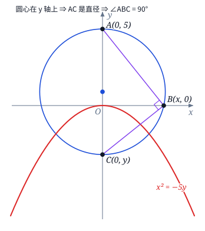
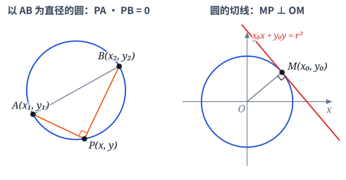
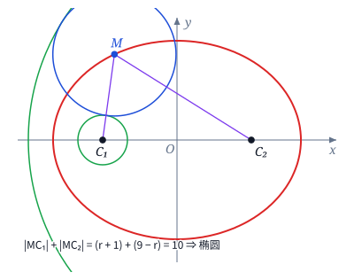

# 几何法与定义法：先看图形关系，再列方程

> **来源**：补充专题（求轨迹方程 3/6） ｜ **适用模块**：八、曲线与方程

**做法**：先找图中隐藏的几何关系（直径所对的圆周角是直角、切线垂直于半径、到两定点距离和为定值……），把它变成一个简单的等式（常用==向量数量积为 $0$==），再代坐标。如果这个关系恰好符合圆、椭圆、双曲线、抛物线的定义，就直接写出标准方程，这就是==定义法==。

## 一、几何法

**例 4**（人教 A 版习题）　已知圆心在 $y$ 轴上移动的圆经过点 $A(0, 5)$，且与 $x$ 轴、$y$ 轴分别交于 $B(x, 0)$、$C(0, y)$ 两个动点，求点 $M(x, y)$ 的轨迹方程。

**解**：圆心在 $y$ 轴上，$A$、$C$ 又都在 $y$ 轴上，所以 ==$AC$ 是直径==，$\angle ABC = 90^\circ$，即 $\overrightarrow{BA} \cdot \overrightarrow{BC} = 0$：

$$(-x, 5) \cdot (-x, y) = x^2 + 5y = 0$$

所以轨迹方程为 ==$x^2 = -5y$==。

**例 5**　以 $A(x_1, y_1)$、$B(x_2, y_2)$ 为直径的圆的方程是什么？

**例 6**　已知 $M(x_0, y_0)$ 是圆 $x^2 + y^2 = r^2$ 上一点，求过点 $M$ 的圆的切线方程。

**例 5 解**：设圆上任一点 $P(x, y)$，直径所对的圆周角是直角，$\overrightarrow{PA} \cdot \overrightarrow{PB} = 0$：

$$(x - x_1)(x - x_2) + (y - y_1)(y - y_2) = 0$$

这就是==圆的直径式方程==（$P$ 与 $A$、$B$ 重合时也满足，不用去点）。

**例 6 解**：切线垂直于半径 $OM$。当 $x_0 \ne 0$、$y_0 \ne 0$ 时，$k_{OM} = \frac{y_0}{x_0}$，切线斜率 $k = -\frac{x_0}{y_0}$，

$$y - y_0 = -\frac{x_0}{y_0}(x - x_0) \;\Rightarrow\; x_0x + y_0y = x_0^2 + y_0^2 = r^2$$

$x_0 = 0$ 或 $y_0 = 0$ 时切线是水平线或竖直线，代入检验也满足，所以切线方程统一为 ==$x_0x + y_0y = r^2$==。（也可以用 $\overrightarrow{OM} \cdot \overrightarrow{MP} = 0$ 直接写出，不必分类。）

## 二、定义法

动点满足的条件经过转化，恰好是「到两定点距离之和（差）为定值」「到定点与定直线距离相等」时，直接写标准方程。

**例 7**　动圆 $M$ 与圆 $C_1$：$(x + 3)^2 + y^2 = 1$ 外切，与圆 $C_2$：$(x - 3)^2 + y^2 = 81$ 内切，求圆心 $M$ 的轨迹方程。

**解**：设动圆半径为 $r$。外切：$|MC_1| = r + 1$；内切（动圆在 $C_2$ 内部）：$|MC_2| = 9 - r$。相加消掉 $r$：

$$|MC_1| + |MC_2| = 10 > |C_1C_2| = 6$$

所以 $M$ 的轨迹是以 $C_1$、$C_2$ 为焦点的椭圆，$a = 5$，$c = 3$，$b = 4$：==$\frac{x^2}{25} + \frac{y^2}{16} = 1$==。

**小结**：「两圆一外切一内切」相加消 $r$ 得椭圆；「两圆都外切（或都内切）」相减消 $r$ 得双曲线的一支；「与定圆外切、与定直线相切」转化为到圆心和到另一条平行直线距离相等，得抛物线。
