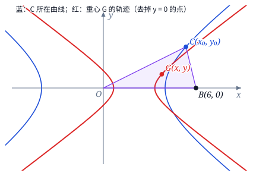
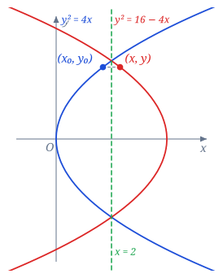
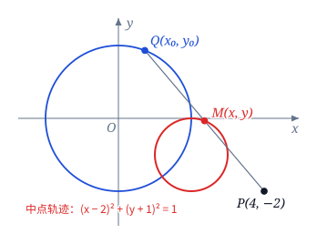
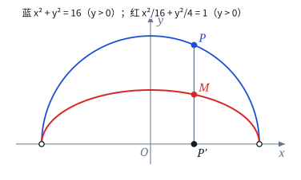
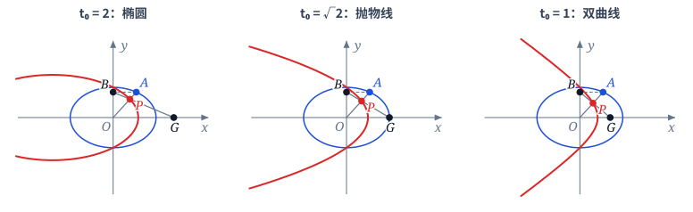

# 相关点法（代入法）：求谁设谁

> **来源**：补充专题（求轨迹方程 4/6） ｜ **适用模块**：八、曲线与方程

**适用**：动点 $M$ 随着另一个点 $P$ 运动，而 $P$ 在一条==已知曲线==上（$P$ 叫相关点、主动点）。

**三步**：

1. ==求谁设谁==：要求 $M$ 的轨迹，就设 $M(x, y)$；相关点设成 $P(x_0, y_0)$。
2. 由 $M$、$P$ 的关系，==用 $x$、$y$ 反解出 $x_0$、$y_0$==（是「反解」，方向别弄反）。
3. 把 $x_0$、$y_0$ 代入 $P$ 所在曲线的方程，化简，再查漏。

（圆那一章原稿第三十一条「相关点法求轨迹方程」是同一个方法，这里按题型整理更多例题。）

**例 1**　已知 $\triangle ABC$ 的两个顶点为 $A(0, 0)$、$B(6, 0)$，顶点 $C$ 在曲线 $\frac{x^2}{16} - \frac{y^2}{9} = 1$ 上运动，则 $\triangle ABC$ 的重心的轨迹方程是______。

**解**：设 $G(x, y)$，$C(x_0, y_0)$。重心坐标：

$$x = \frac{0 + 6 + x_0}{3}, \quad y = \frac{0 + 0 + y_0}{3} \;\Rightarrow\; x_0 = 3x - 6, \; y_0 = 3y$$

代入 $\frac{x_0^2}{16} - \frac{y_0^2}{9} = 1$：$\frac{(3x - 6)^2}{16} - y^2 = 1$，即 ==$\frac{9(x - 2)^2}{16} - y^2 = 1$（$y \ne 0$）==。

$y \ne 0$ 是因为 $C$ 不能在 $x$ 轴上（否则三角形退化）。

**例 2**　曲线 $y^2 = 4x$ 关于直线 $x = 2$ 对称的曲线方程为______。

**解**：设所求曲线上的点 $(x, y)$，它关于 $x = 2$ 的对称点 $(x_0, y_0)$ 在 $y^2 = 4x$ 上。对称关系：$y_0 = y$，$\frac{x_0 + x}{2} = 2$，所以 $x_0 = 4 - x$。代入 $y_0^2 = 4x_0$：==$y^2 = 16 - 4x$==。

（求「曲线关于某条直线对称的曲线」本质上就是相关点法。）

**例 3**（2009 上海文 17）　点 $P(4, -2)$ 与圆 $x^2 + y^2 = 4$ 上任一点连线的中点的轨迹方程是（　）

A．$(x - 2)^2 + (y + 1)^2 = 1$　　B．$(x - 2)^2 + (y + 1)^2 = 4$

C．$(x + 4)^2 + (y - 2)^2 = 4$　　D．$(x + 2)^2 + (y - 1)^2 = 1$

**解**：设中点 $M(x, y)$，圆上的点 $Q(x_0, y_0)$。$\frac{x_0 + 4}{2} = x$，$\frac{y_0 - 2}{2} = y$，所以 $x_0 = 2x - 4$，$y_0 = 2y + 2$。代入 $x_0^2 + y_0^2 = 4$：$(2x - 4)^2 + (2y + 2)^2 = 4$，即 $(x - 2)^2 + (y + 1)^2 = 1$。选 ==A==。

（结论：定点与圆上动点连线的中点轨迹，是==半径减半、圆心在定点与原圆心中点==的圆。）

**例 4**（2024 新课标 Ⅱ 卷 5）　已知曲线 $C$：$x^2 + y^2 = 16$（$y > 0$），从 $C$ 上任意一点 $P$ 向 $x$ 轴作垂线段 $PP'$，$P'$ 为垂足，则线段 $PP'$ 的中点 $M$ 的轨迹方程为（　）

A．$\frac{x^2}{16} + \frac{y^2}{4} = 1$（$y > 0$）　　B．$\frac{x^2}{16} + \frac{y^2}{8} = 1$（$y > 0$）

C．$\frac{y^2}{16} + \frac{x^2}{4} = 1$（$y > 0$）　　D．$\frac{y^2}{16} + \frac{x^2}{8} = 1$（$y > 0$）

**解**：设 $M(x, y)$，$P(x_0, y_0)$，则 $x_0 = x$，$y_0 = 2y$。代入 $x_0^2 + y_0^2 = 16$：$x^2 + 4y^2 = 16$，即 $\frac{x^2}{16} + \frac{y^2}{4} = 1$；$y_0 > 0$ 所以 $y > 0$。选 ==A==。

（这正是「把圆的纵坐标压缩一半得到椭圆」，和椭圆参数方程的两圆作图是同一件事。）

**例 5**（2026 全国 Ⅱ 卷 18）　已知椭圆 $E$：$\frac{x^2}{2} + y^2 = 1$，$O$ 为坐标原点，给定点 $G(t_0, 0)$（$t_0 \ne 0$），$A(x_0, y_0)$（$y_0 \ne 0$）在 $E$ 上，过点 $A$ 作 $y$ 轴的垂线，垂足为 $B$，$AO$ 与 $GB$ 交于点 $P$。当 $A$ 在 $E$ 上运动时，$P$ 的轨迹为 $M$，求 $M$ 的方程，并说明 $M$ 是什么曲线。

**解**：$B(0, y_0)$。两条直线：

$$l_{OA}: \; y = \frac{y_0}{x_0}x, \qquad l_{GB}: \; \frac{x}{t_0} + \frac{y}{y_0} = 1$$

**第一步：用 $x_0$、$y_0$ 表示 $P(x, y)$。** 把 $\frac{y}{y_0} = \frac{x}{x_0}$ 代入第二个式子：$\frac{x}{t_0} + \frac{x}{x_0} = 1$，

$$x = \frac{t_0x_0}{t_0 + x_0}, \qquad y = \frac{y_0}{x_0} \cdot x = \frac{t_0y_0}{t_0 + x_0}$$

**第二步：反解。** 由 $x(t_0 + x_0) = t_0x_0$ 得 $xt_0 = x_0(t_0 - x)$，

$$x_0 = \frac{t_0x}{t_0 - x}, \qquad y_0 = \frac{y}{x} \cdot x_0 = \frac{t_0y}{t_0 - x}$$

**第三步：代入 $\frac{x_0^2}{2} + y_0^2 = 1$。**

$$\frac{t_0^2x^2}{2(t_0 - x)^2} + \frac{t_0^2y^2}{(t_0 - x)^2} = 1 \;\Rightarrow\; t_0^2x^2 + 2t_0^2y^2 = 2(t_0 - x)^2$$

整理得 ==$(t_0^2 - 2)x^2 + 2t_0^2y^2 + 4t_0x - 2t_0^2 = 0$（$y \ne 0$）==。

**第四步：按 $t_0^2 - 2$ 的符号说明是什么曲线**（$y^2$ 的系数 $2t_0^2 > 0$）：

| $t_0$ 的范围 | $x^2$ 的系数 | 曲线 |
| --- | --- | --- |
| $t_0^2 = 2$，即 $t_0 = \pm\sqrt{2}$ | $0$ | 方程化为 $y^2 = 1 - t_0x$，==抛物线==（去掉 $y = 0$ 的点） |
| $t_0 > \sqrt{2}$ 或 $t_0 < -\sqrt{2}$ | 正 | ==椭圆==（去掉 $y = 0$ 的点） |
| $-\sqrt{2} < t_0 < \sqrt{2}$，$t_0 \ne 0$ | 负 | ==双曲线==（去掉 $y = 0$ 的点） |

不可能是圆：要是圆需要 $t_0^2 - 2 = 2t_0^2$，即 $t_0^2 = -2$，无解。

（「是什么曲线」要配方核对：$t_0^2 > 2$ 时配方后右边为 $\frac{2t_0^4}{t_0^2 - 2} > 0$，确实是椭圆；$t_0^2 < 2$ 时 $x^2$、$y^2$ 系数异号，是双曲线。）

**本题的方法**：$P$ 是 $OA$ 与 $GB$ 两条直线的交点，第一步其实是「交轨」的思路（见第 6 条），第二、三步是相关点法。大题里两种方法经常一起用。
