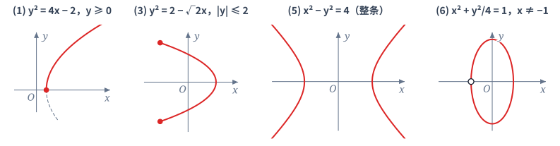

# 消参法（参数法）：找到 x 与 y 之间的内在关系

> **来源**：补充专题（求轨迹方程 5/6） ｜ **适用模块**：八、曲线与方程

**适用**：动点的横、纵坐标都能用同一个参数 $t$（角度、斜率、点的坐标……）表示，即 $\begin{cases} x = f(t) \\ y = g(t) \end{cases}$。

**本质**：参数只是「中间人」，消掉它，剩下的就是 $x$ 和 $y$ 之间的直接关系。

**常用消参手段**：

| 参数式的样子 | 消参办法 |
| --- | --- |
| 一个式子能直接解出 $t$ | 解出 $t$ 代入另一个（代入消参） |
| 含 $\cos t$、$\sin t$ | $\sin^2 t + \cos^2 t = 1$；含 $\cos 2t$ 用二倍角化成同一个角 |
| 含 $t + \frac{1}{t}$、$t - \frac{1}{t}$ | 平方相减，或 $x + y$、$x - y$ 相乘 |
| 含 $\frac{1 - t^2}{1 + t^2}$、$\frac{2t}{1 + t^2}$ | 先凑出 $t$ 的表达式再代入（或看成万能公式） |

==消参后一定要看参数带来的范围==：根号非负、正余弦有界、分式取不到某些值，都会让轨迹只是曲线的一部分。

**例 6**　点 $P(x, y)$ 的坐标满足下列关系，分别求点 $P$ 的轨迹方程。

(1) $\begin{cases} x = \frac{t + 2}{4} \\ y = \sqrt{t} \end{cases}$　(2) $\begin{cases} x = \cos t \\ y = \sin t \end{cases}$　(3) $\begin{cases} x = \sqrt{2}\cos 2t \\ y = 2\sin t \end{cases}$

(4) $\begin{cases} x = 3 - t \\ y = 1 + t \end{cases}$　(5) $\begin{cases} x = t + \frac{1}{t} \\ y = t - \frac{1}{t} \end{cases}$　(6) $\begin{cases} x = \frac{1 - t^2}{1 + t^2} \\ y = \frac{4t}{1 + t^2} \end{cases}$

**解**：

(1) $y = \sqrt{t} \ge 0$，$t = y^2$，代入得 $x = \frac{y^2 + 2}{4}$，即 ==$y^2 = 4x - 2$（$y \ge 0$）==，是抛物线的上半支（也可写成 $y = \sqrt{4x - 2}$）。==漏掉 $y \ge 0$ 是最常见的错误==。

(2) 平方相加：==$x^2 + y^2 = 1$==。

(3) 角不同，先统一：$\cos 2t = 1 - 2\sin^2 t$。由 $\frac{x}{\sqrt{2}} = \cos 2t$，$\frac{y}{2} = \sin t$，得

$$\frac{x}{\sqrt{2}} = 1 - 2 \cdot \frac{y^2}{4} \;\Rightarrow\; y^2 = 2 - \sqrt{2}x$$

即 ==$y^2 = 2 - \sqrt{2}x$（$-2 \le y \le 2$）==。

范围来自 $y = 2\sin t \in [-2, 2]$（对应 $x \in [-\sqrt{2}, \sqrt{2}]$），所以只是抛物线的一段。

(4) 相加：==$x + y = 4$==。

(5) 平方相减：$x^2 = t^2 + \frac{1}{t^2} + 2$，$y^2 = t^2 + \frac{1}{t^2} - 2$，所以 ==$x^2 - y^2 = 4$==。另一种看法：$x + y = 2t$，$x - y = \frac{2}{t}$，两式相乘也得 $x^2 - y^2 = 4$。

范围检查：$x = t + \frac{1}{t} \in (-\infty, -2] \cup [2, +\infty)$，而双曲线 $x^2 - y^2 = 4$ 本身就满足 $|x| \ge 2$；反过来，双曲线上任一点取 $t = \frac{x + y}{2} \ne 0$ 都能对应上，所以是整条双曲线。

(6) 先凑出 $t$：$x + 1 = \frac{2}{1 + t^2}$，$\frac{y}{x + 1} = 2t$，所以 $t = \frac{y}{2(x + 1)}$。代回 $x + 1 = \frac{2}{1 + t^2}$：

$$(x + 1)\left[1 + \frac{y^2}{4(x + 1)^2}\right] = 2 \;\Rightarrow\; 4(x + 1)^2 + y^2 = 8(x + 1) \;\Rightarrow\; 4x^2 + y^2 = 4$$

即 ==$x^2 + \frac{y^2}{4} = 1$（$x \ne -1$）==。$x \ne -1$ 是因为 $x + 1 = \frac{2}{1 + t^2} > 0$，椭圆上的点 $(-1, 0)$ 取不到。

（看成万能公式更快：令 $t = \tan \frac{\varphi}{2}$，则 $x = \cos \varphi$，$y = 2\sin \varphi$，直接得椭圆，$\varphi = \pi$ 对应的 $(-1, 0)$ 取不到。）
