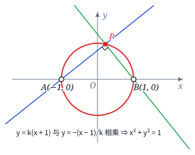
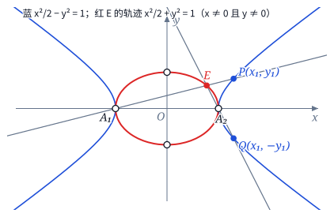
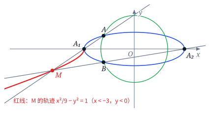

# 交轨法：两条动直线的交点，联立后消参

> **来源**：补充专题（求轨迹方程 6/6） ｜ **适用模块**：八、曲线与方程

## 一、什么是交轨法

动点 $M$ 是==两条动直线（或曲线）的交点==，两条线都随同一个参数（或同一个动点）变化。做法：

1. 写出两条线的方程（里面带着参数）；
2. ==联立，但不去解交点==，而是直接把参数消掉；
3. 剩下关于 $x$、$y$ 的方程就是轨迹，再查漏。

一句话：==写出两条线 → 联立 → 消参==。它可以看成消参法的特例：不必先把 $x$、$y$ 分别用参数表示出来。

**入门例**　过 $A(-1, 0)$ 的直线 $l_1$：$y = k(x + 1)$ 与过 $B(1, 0)$ 的直线 $l_2$：$y = -\frac{1}{k}(x - 1)$（$k \ne 0$）交于 $P$，求 $P$ 的轨迹。

**解**：两式相乘，$k$ 直接消掉：$y^2 = -(x + 1)(x - 1)$，即 ==$x^2 + y^2 = 1$（$x \ne \pm 1$）==。$P$ 不可能是 $A$、$B$（代入另一条直线不成立），所以去掉 $(\pm 1, 0)$。几何上就是 $PA \perp PB$，$P$ 在以 $AB$ 为直径的圆上。

## 二、你真的懂「联立」吗

解方程组 $\begin{cases} x + y = 3 \\ x - y = 1 \end{cases}$ 时，我们习惯两式相加、相减求出 $x = 2$、$y = 1$。但「联立」不只有加减：

| 操作 | 得到 |
| --- | --- |
| 相加 | $2x = 4$ |
| 相减 | $2y = 2$ |
| ==相乘== | $x^2 - y^2 = 3$ |
| ==相除== | $\frac{x + y}{x - y} = 3$ |

交轨法里两条直线的方程往往形如 $y = k_1(\cdots)$、$y = k_2(\cdots)$，==两式相乘==后右边出现 $k_1k_2$，而 $k_1k_2$ 常常可以用曲线方程化成常数，参数就一次性消掉了。下面两道题都是这个套路。

## 三、例题

**例 7**　已知双曲线 $\frac{x^2}{2} - y^2 = 1$ 的左、右顶点分别为 $A_1$、$A_2$，点 $P(x_1, y_1)$、$Q(x_1, -y_1)$ 是双曲线上不同的两个动点，求直线 $A_1P$ 与 $A_2Q$ 交点的轨迹 $E$ 的方程。

**解**：$A_1(-\sqrt{2}, 0)$，$A_2(\sqrt{2}, 0)$。

$$l_{A_1P}: \; y = \frac{y_1}{x_1 + \sqrt{2}}(x + \sqrt{2}), \qquad l_{A_2Q}: \; y = \frac{-y_1}{x_1 - \sqrt{2}}(x - \sqrt{2})$$

两式相乘：

$$y^2 = \frac{-y_1^2}{x_1^2 - 2}(x^2 - 2)$$

$P$ 在双曲线上，$\frac{x_1^2}{2} - y_1^2 = 1$，即 $x_1^2 - 2 = 2y_1^2$，代入：

$$y^2 = \frac{-y_1^2}{2y_1^2}(x^2 - 2) = -\frac{1}{2}(x^2 - 2) \;\Rightarrow\; x^2 + 2y^2 = 2$$

即 ==$\frac{x^2}{2} + y^2 = 1$==。

**查漏**：$P$、$Q$ 不同，所以 $y_1 \ne 0$，$|x_1| > \sqrt{2}$。联立两直线可解出交点横坐标 $x = \frac{2}{x_1}$，所以 $0 < |x| < \sqrt{2}$，即 $x \ne 0$ 且 $x \ne \pm\sqrt{2}$。轨迹 $E$：==$\frac{x^2}{2} + y^2 = 1$（$x \ne 0$ 且 $y \ne 0$）==，去掉椭圆与两轴的四个交点。

（课堂笔记里这一步最后写成了 $x^2 + y^2 = 2$，是笔误：$-\frac{1}{2}(x^2 - 2) = y^2$ 化简应得 $x^2 + 2y^2 = 2$。）

**例 8**（2012 辽宁）　如图，动圆 $C_1$：$x^2 + y^2 = t^2$（$1 < t < 3$）与椭圆 $C_2$：$\frac{x^2}{9} + y^2 = 1$ 相交于 $A$、$B$、$C$、$D$ 四点，点 $A_1$、$A_2$ 分别为 $C_2$ 的左、右顶点。求直线 $AA_1$ 与直线 $A_2B$ 交点 $M$ 的轨迹方程。

**解**：由对称性，设 $A(x_1, y_1)$、$B(x_1, -y_1)$（图中 $A$ 在第二象限）。$A_1(-3, 0)$，$A_2(3, 0)$。

$$l_{AA_1}: \; y = \frac{y_1}{x_1 + 3}(x + 3), \qquad l_{A_2B}: \; y = \frac{-y_1}{x_1 - 3}(x - 3)$$

==相乘==：$y^2 = \frac{-y_1^2}{x_1^2 - 9}(x^2 - 9)$。$A$ 在椭圆上，$\frac{x_1^2}{9} + y_1^2 = 1$，即 $x_1^2 - 9 = -9y_1^2$，代入：

$$y^2 = \frac{-y_1^2}{-9y_1^2}(x^2 - 9) = \frac{x^2 - 9}{9} \;\Rightarrow\; \frac{x^2}{9} - y^2 = 1$$

**查漏**（注意不能直接用 $x_1^2 + y_1^2 = t^2$ 去消，那样 $t$ 消不掉）：联立两直线得交点横坐标 $x = \frac{9}{x_1}$。$A$ 在第二象限，$-3 < x_1 < 0$，所以 $x < -3$；再由 $l_{AA_1}$：$x + 3 < 0$、$y_1 > 0$、$x_1 + 3 > 0$，得 $y < 0$。

所以 $M$ 的轨迹方程为 ==$\frac{x^2}{9} - y^2 = 1$（$x < -3$，$y < 0$）==。

## 四、小结

- 看到「两条直线的交点」「$A_1P$ 与 $A_2Q$ 交于 $M$」，就用交轨法。
- 两条直线过长轴（实轴）的两个端点时，相乘后用曲线方程把 $\frac{y_1^2}{x_1^2 - a^2}$ 化成常数，这是==第三定义 $k_1k_2 = \mp\frac{b^2}{a^2}$ 的同一个式子==（模块七第 1 节）。
- 结论规律：椭圆 $\frac{x^2}{a^2} + \frac{y^2}{b^2} = 1$ 上关于 $x$ 轴对称的两点 $P$、$Q$，$A_1P$ 与 $A_2Q$ 的交点在双曲线 $\frac{x^2}{a^2} - \frac{y^2}{b^2} = 1$ 上；把椭圆换成双曲线，交点就在对应的椭圆上（例 7、例 8 正好是这两种）。交点横坐标 $x = \frac{a^2}{x_1}$，正是模块七「极点与极线」里 $(x_1, 0)$ 的极线位置。
